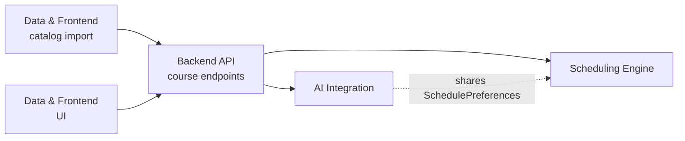

# HANDOFF.md

Live record of project progress. **Read it at the start of every session; update your module's section at the end.** Update rules are in [development-guide.md § 9](docs/development-guide.md#9-updating-handoffmd). In short: pull first, edit only your section, add a session-log line, record only real results, and never delete others' entries.

| | |
|---|---|
| **Last updated** | 2026-10-15 16:45 EDT, by a Claude Code session for @04michael4 |
| **Current milestone** | Phase 1: backend foundation. ✅ Implemented and verified locally; committed on `feature/backend-foundation`. **Awaiting review before merging to `main`.** |
| **Next milestone** | Phase 2: _to be defined by the team_ (see [Next recommended tasks](#next-recommended-tasks)) |

## Repository state

| | |
|---|---|
| Branch | `feature/backend-foundation`, pushed to `origin/feature/backend-foundation` for review |
| Base commit | `8ea194c` "Initial commit" (`main` is still at this commit) |
| Phase 1 commit | `feat: initialize Spring Boot backend and team documentation`, the commit directly after `8ea194c` on this branch (run `git log` for the hash). Contains the backend skeleton, health endpoint, tests and docs. |
| Merged to `main`? | **No.** Waiting for review. |
| Toolchain verified | OpenJDK 21.0.12 (Homebrew), Maven 3.10.0 via wrapper, Spring Boot 4.1.1, macOS |

## Latest test results

**Run 2026-10-15 16:45 EDT** (just before the Phase 1 commit), command `cd backend && ./mvnw -B clean test`:

```
Tests run: 2, Failures: 0, Errors: 0, Skipped: 0 -- in io.github.michael04.registration.health.HealthControllerTest
Tests run: 1, Failures: 0, Errors: 0, Skipped: 0 -- in io.github.michael04.registration.RegistrationBackendApplicationTests
Tests run: 3, Failures: 0, Errors: 0, Skipped: 0
BUILD SUCCESS   (Total time: 2.655 s)
```

**Manual verification, same session:** `./mvnw spring-boot:run` started in 0.489 s. Then:
```
$ curl -i http://localhost:8080/api/health
HTTP/1.1 200
Content-Type: application/json
{"status":"UP","service":"registration-backend"}
```
Also observed earlier the same day: an unknown path returns `404` and `POST /api/health` returns `405`, both with Spring Boot's default error JSON.

## Known bugs and blockers

| # | Item | Type | Owner | Status |
|---|---|---|---|---|
| 1 | Module owners not yet assigned (README team table is `_TBD_`) | Blocker (coordination) | Team | Open |
| 2 | **Lehigh course data source not chosen.** Blocks real course search and scheduling. | Blocker | Data (_TBD_) | Open |
| 3 | Phase 1 is committed and pushed on `feature/backend-foundation` but not merged to `main` | Process | @04michael4 | Open: awaiting review |
| 4 | No CI; tests run only locally | Gap | _TBD_ | Open |
| 5 | Mockito prints JDK "dynamic agent loading" warnings during tests | Cosmetic | — | Accepted (harmless) |

No known functional bugs.

## Important decisions

| Date | Decision | Where |
|---|---|---|
| 2026-10-15 | Java 21 + Spring Boot instead of Python + FastAPI | [ADR-0001](docs/decisions/0001-java-spring-boot-over-python-fastapi.md) |
| 2026-10-15 | Spring Boot 4.1.1 pinned; Maven Wrapper; minimal dependencies; hand-written health endpoint; package by feature | [architecture.md § 15](docs/architecture.md#15-phase-1-decisions-implemented) |
| 2026-10-15 | The AI proposes and explains; the deterministic engine alone decides validity | [architecture.md § 1](docs/architecture.md#1-system-overview) |
| 2026-10-15 | Base package `io.github.michael04.registration` (independent project) | [CLAUDE.md](CLAUDE.md) |
| 2026-10-15 | **Provisional:** planned API shapes for course search, preference extraction and schedule generation, and credit limits (1–24, defaults 12–18). Proposed, not agreed, not implemented. | [api-contract.md](docs/api-contract.md) |
| 2026-10-15 | **Provisional:** four-module split; owners not yet assigned | [README § Team](README.md#team-and-responsibilities) |

## Module ownership and dependencies



| Module | Owner | Depends on | Depended on by |
|---|---|---|---|
| Backend API | _TBD_ (Phase 1: @04michael4) | — | everyone |
| Scheduling Engine | _TBD_ | Backend API (course data), `SchedulePreferences` contract | Frontend |
| AI Integration | _TBD_ | Backend API (course ID validation), `SchedulePreferences` contract | Frontend |
| Data and Frontend | _TBD_ | Backend API (endpoints), data source decision | — |

The engine **logic** can be built and unit-tested now, before the database or catalog exist, using hand-made test data.

---

## Backend API

**Owner:** _TBD_ (Phase 1 foundation: @04michael4) · **Status:** ✅ Foundation implemented and verified; committed on `feature/backend-foundation`, not merged

**Completed**
- 2026-10-15: Spring Boot 4.1.1 / Java 21 project from Spring Initializr in `backend/`, with Maven Wrapper (Maven 3.10.0).
- 2026-10-15: `GET /api/health` → `{"status":"UP","service":"registration-backend"}` (`health` package).
- 2026-10-15: Tests: `HealthControllerTest` (2 × `@WebMvcTest`) and a context-load test. All passing; see [Latest test results](#latest-test-results).
- 2026-10-15: Root `.gitignore` (ignores `.env`/`.env.*`, keeps `.env.example`; verified with `git check-ignore`), `.env.example`, docs.

**In progress**
- _None._

**Next recommended**
1. Review Phase 1, then open a PR from `feature/backend-foundation` into `main` and merge it.
2. Add GitHub Actions CI running `./mvnw test` on PRs.
3. `common`: global error handling with RFC 9457 Problem Details, plus `spring-boot-starter-validation`. This is a contract change, so update [api-contract.md](docs/api-contract.md).
4. Persistence phase: PostgreSQL, a migration tool and the `course` package, once the data source is decided.

**Blockers:** none for items 1–3. Item 4 is blocked on the data-source decision.

---

## Scheduling Engine

**Owner:** _TBD_ · **Status:** ⬜ Not started

**Completed:** _none_. The design is proposed in [architecture.md § 7–8](docs/architecture.md#7-scheduling-engine).

**In progress:** _none_.

**Next recommended**
1. Create the `engine` package with immutable input records (`CourseOption`, `SectionOption`, `Meeting`) and the time-overlap check, plus unit tests.
2. Add backtracking search, top-K scoring and determinism tests, using hand-made fixtures. No DB is needed.
3. Then build the `schedule` package and `POST /api/schedules/generate`, per the [contract](docs/api-contract.md#6-post-apischedulesgenerate).

**Blockers:** none for steps 1–2.

---

## AI Integration

**Owner:** _TBD_ · **Status:** ⬜ Not started

**Completed:** _none_. The design is proposed in [architecture.md § 9](docs/architecture.md#9-ai-integration-and-validation).

**In progress:** _none_.

**Next recommended**
1. Agree with the Engine owner on the final `SchedulePreferences` shape; the proposal is in the [contract](docs/api-contract.md#5-post-apipreferencesextract).
2. Add `com.anthropic:anthropic-java` (pin the version; check Jackson compatibility with Boot 4) behind a `PreferenceExtractor` interface, with a fake for tests.
3. Build `POST /api/preferences/extract` with server-side validation. `./mvnw test` must not call the real API.

**Blockers:** each developer needs their own Anthropic API key, kept in a local `.env` or shell environment and never committed.

---

## Data and Frontend

**Owner:** David · **Status:** 🟡 Active CSE 007 database fixture implemented and
verified; backend persistence and frontend are not started.

**2026-10-16 10:45 EDT — Codex for David, database branch verification: completed.**
Created `feature/data-cse007-snapshot` from merged `main`. Regenerated the active
screenshot fixture after verifying all eight source hashes, then verified all three
PostgreSQL schemas against the local loopback server. Actual result lines:
`PASS: 1 course, 5 sections, 9 meetings; 3 feasible pairs; 1 after 10; 0 with Friday morning blocked`;
`PASS: PDF fixture: 1 course, 6 sections, 9 meetings, 4 links; 3 time-feasible pairs, 1 after 10, 0 Friday-free; credits, TBA, provenance and 9 rejection checks passed`;
`PASS: SuY corrections: 2 valid lecture/lab choices at 4 credits; 3 nullable requirement rows; 0 open issues; 5 selection scenarios and 8 rejection checks passed`.
The local database server was stopped after verification. `backend/.\mvnw.cmd test`
failed before running tests with `Cannot start maven from wrapper` / `Cannot index
into a null array`; no Java test success is claimed.

**2026-10-15 22:07 EDT — Codex, screenshot-based CSE 007 database: completed.**
Inspected all seven supplied `Images for courses` PNGs. The active dataset is now
`data/cse007-snapshot/fixture.json`, loaded as schema `cse007_snapshot` in the local
`registration_demo` database (127.0.0.1:55432). Includes Spring 2027 term 202710,
lecture 010/CRN 12275, labs 060/13132 and 062/12638, five per-day meetings, Brian
Chen, eight attributes, the confirmed 010/060 pair and the lab-060 seat snapshot.
`source_asset` preserves all file paths/hashes and transcription-check times;
capture time/URL remain unknown. All rows are static screenshot observations.

`database.sql` is a standalone pgAdmin-compatible import. Fresh creation,
transactional stable-ID reimport, sample queries and an isolated rollback of the
complete SQL bundle were verified. Actual results:
`PASS: 7 screenshot hashes verified; generated V2__seed.sql and database.sql`
`PASS: screenshot dataset: 3 sections, 5 meetings, 1 confirmed link; 4 provisional credits; source conflicts retained; 6 rejection checks passed`.
`git diff --check` passed. Backend `.\mvnw.cmd test` again failed before tests with
`Cannot start maven from wrapper` / `Cannot index into a null array`; no Java test
success is claimed. The backend remains unconnected.

Open data issues: lab-060 credits conflict (list 0 vs detail 4), lab-062 link
target unknown, full lecture component group unknown, unreadable prerequisite
rules, ambiguous FLEX delivery and missing locations/date ranges for 010/062.
These are stored in `data_issue` rather than inferred. Seat counts are explicitly
not live. Earlier demo schemas remain archival; README points to this snapshot.
No work in progress. Files remain uncommitted on `main`.

**2026-10-15 21:46 EDT — Codex, PDF-aligned CSE 007 fixture: completed and SQL-verified.**
Read all six pages of `Course Scheduling App — Proposed Database Structure.pdf`.
Added `data/cse007-pdf/fixture.json`, ordered schema/seed SQL, standard-library
seed generator, examples and dataset checks. Loaded schema `cse007_pdf_demo` in
the existing local database. Uses UUIDs, code `CSE-007`, section credits (4 + 0),
meeting provenance, one TBA case and synthetic profile/preferences. The earlier
`cse007_demo` remains intact. Prerequisite and generated-schedule tables are empty;
eligibility is unknown and scoring remains a team decision. No HTTP contract or
backend implementation changes. PDF-reader dependencies are ignored in Git.

Verification (fresh load, then transactional seed reimport and query):
`PASS: PDF fixture: 1 course, 6 sections, 9 meetings, 4 links; 3 time-feasible pairs, 1 after 10, 0 Friday-free; credits, TBA, provenance and 9 rejection checks passed`.
`git diff --check` passed. Reattempted `backend/.\mvnw.cmd test`: failed before
tests with `Cannot start maven from wrapper` / `Cannot index into a null array`.
Java/backend tests are not verified in this session. JSON warning names/preference
shape are fixture proposals; reconcile the provisional API contract before wiring
the backend. Changes remain uncommitted on `main`. No work in progress.

**2026-10-15 21:02 EDT — Codex, CSE 007 demo:** Created standalone PostgreSQL
schema/seed scripts and local database `registration_demo` on 127.0.0.1:55432.
One catalog-sourced course, five simulated sections, nine meetings and four lab links.
Setup, provenance, queries and expected scenarios are in `data/README.md`.
Backend integration remains unimplemented; no API changes. Cluster files are git-ignored.
Verified with `psql -f data/cse007/create.sql`:
`PASS: 1 course, 5 sections, 9 meetings; 3 feasible pairs; 1 after 10; 0 with Friday morning blocked`.
Backend tests attempted with `.\mvnw.cmd test`: failed before tests with
`Cannot start maven from wrapper` / `Cannot index into a null array`.
Only Java 17 found on PATH; backend requires 21. No claim of passing Java tests.
Repository discrepancy: current branch is `main`, commit `76a8310` (merged Phase 1),
whereas earlier handoff says unmerged. Existing entries preserved. Changes uncommitted.
Next: connect the course API to this dataset when its DTO contract is agreed.

**In progress:** _none_.

**Next recommended**
1. **Data:** identify a permitted source for Lehigh course/section data, and record its format, terms of use and refresh process in `data/README.md`. Meanwhile, create a small **synthetic** sample catalog so the Engine and Backend API work can proceed.
2. **Frontend:** scaffold Next.js + TypeScript + Tailwind in `frontend/`; add a page that calls `GET /api/health`; document the run commands in `frontend/README.md` and the README.
3. Decide CORS vs. a Next.js proxy with the Backend API owner.

**Blockers:** real data depends on step 1.

---

## Next recommended tasks

In priority order, across the team:
1. Review Phase 1 on `feature/backend-foundation`, then merge it to `main`.
2. Assign module owners, and fill in the README team table and this file.
3. Decide the course data source (or agree on a synthetic dataset for the hackathon).
4. Start, in parallel: engine core (no dependencies), frontend scaffold, CI.

## Instructions for the next developer or AI agent

1. Read [README.md](README.md), this file, and [docs/architecture.md](docs/architecture.md). Follow [CLAUDE.md](CLAUDE.md).
2. Run `git status` and `git log --oneline -5`. **Confirm the repository state matches this file**, and note any discrepancy in the session log.
3. Run `cd backend && ./mvnw test` to confirm a green baseline before you change anything.
4. Claim your task under *In progress* in your module's section, with your handle and branch.
5. When you finish: run the tests, update your section with real results, add a session-log line, and leave changes uncommitted unless you were told to commit.

---

## Session log

Newest first, one line per session. Append only.

| When | Who | Module | Summary |
|---|---|---|---|
| 2026-10-16 10:45 EDT | Codex for David | Data | Created `feature/data-cse007-snapshot`; regenerated the active seed with 8 verified source hashes and reran all three PostgreSQL verification suites successfully. Maven wrapper still fails before tests. |
| 2026-10-15 22:07 EDT | Codex | Data | Rebuilt active CSE 007 data from all 7 supplied screenshots: 3 sections, 5 meetings, 1 confirmed link and explicit unresolved fields. Imported cse007_snapshot; hashes, reimport, full SQL bundle and 6 rejection checks passed. Backend Maven wrapper still fails before tests. |
| 2026-10-15 21:46 EDT | Codex | Data | Read the 6-page database PDF; created JSON and PostgreSQL fixture in cse007_pdf_demo with UUIDs, section credits, TBA and synthetic preferences. Fresh load and stable-ID reimport verified; 9 rejection checks passed. Maven wrapper still fails before tests. |
| 2026-10-15 21:02 EDT | Codex | Data | Created and SQL-verified local CSE 007 PostgreSQL demo; setup in data/README.md. Maven wrapper failed before tests; Java 17 on PATH. Backend not connected. |
| 2026-10-15 16:45 EDT | Claude Code for @04michael4 | Backend API / docs | Pre-commit checks; marked API contract, credit limits and team roles as provisional; re-ran tests (3/3 pass) and verified health with curl. Committed Phase 1 and pushed to `origin/feature/backend-foundation`; not merged to `main`. |
| 2026-10-15 16:40 EDT | Claude Code for @04michael4 | Backend API / docs | Wrote README, CLAUDE.md, AGENTS.md, HANDOFF.md, architecture.md, api-contract.md, development-guide.md, ADR-0001. Re-ran tests: 3/3 pass; health verified with curl. Nothing committed. |
| 2026-10-15 16:27 EDT | Claude Code for @04michael4 | Backend API | Phase 1 backend foundation: Spring Boot 4.1.1 skeleton, `/api/health`, tests (3/3 pass), `.gitignore`, `.env.example`. Nothing committed. |
