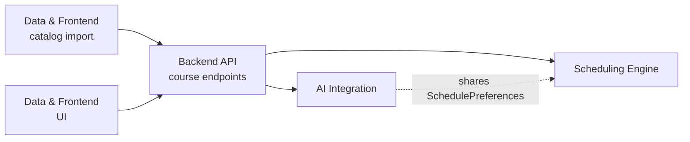

# HANDOFF.md

Live record of project progress. **Read it at the start of every session; update your module's section at the end.** Update rules are in [development-guide.md § 9](docs/development-guide.md#9-updating-handoffmd). In short: pull first, edit only your section, add a session-log line, record only real results, and never delete others' entries.

| | |
|---|---|
| **Last updated** | 2026-10-15 16:45 EDT, by a Claude Code session for @04michael4 |
| **Current milestone** | Phase 1: backend foundation. ✅ Implemented and verified locally; committed on `feature/backend-foundation`. **Awaiting review before merging to `main`.** |
| **Next milestone** | Phase 2: _to be defined by the team_ (see [Next recommended tasks](#next-recommended-tasks)) |

## Repository state

| | |
|---|---|
| Branch | `feature/backend-foundation`, pushed to `origin/feature/backend-foundation` for review |
| Base commit | `8ea194c` "Initial commit" (`main` is still at this commit) |
| Phase 1 commit | `feat: initialize Spring Boot backend and team documentation`, the commit directly after `8ea194c` on this branch (run `git log` for the hash). Contains the backend skeleton, health endpoint, tests and docs. |
| Merged to `main`? | **No.** Waiting for review. |
| Toolchain verified | OpenJDK 21.0.12 (Homebrew), Maven 3.10.0 via wrapper, Spring Boot 4.1.1, macOS |

## Latest test results

**Run 2026-10-15 16:45 EDT** (just before the Phase 1 commit), command `cd backend && ./mvnw -B clean test`:

```
Tests run: 2, Failures: 0, Errors: 0, Skipped: 0 -- in io.github.michael04.registration.health.HealthControllerTest
Tests run: 1, Failures: 0, Errors: 0, Skipped: 0 -- in io.github.michael04.registration.RegistrationBackendApplicationTests
Tests run: 3, Failures: 0, Errors: 0, Skipped: 0
BUILD SUCCESS   (Total time: 2.655 s)
```

**Manual verification, same session:** `./mvnw spring-boot:run` started in 0.489 s. Then:
```
$ curl -i http://localhost:8080/api/health
HTTP/1.1 200
Content-Type: application/json
{"status":"UP","service":"registration-backend"}
```
Also observed earlier the same day: an unknown path returns `404` and `POST /api/health` returns `405`, both with Spring Boot's default error JSON.

## Known bugs and blockers

| # | Item | Type | Owner | Status |
|---|---|---|---|---|
| 1 | Module owners not yet assigned (README team table is `_TBD_`) | Blocker (coordination) | Team | Open |
| 2 | **Lehigh course data source not chosen.** Blocks real course search and scheduling. | Blocker | Data (_TBD_) | Open |
| 3 | Phase 1 is committed and pushed on `feature/backend-foundation` but not merged to `main` | Process | @04michael4 | Open: awaiting review |
| 4 | No CI; tests run only locally | Gap | _TBD_ | Open |
| 5 | Mockito prints JDK "dynamic agent loading" warnings during tests | Cosmetic | — | Accepted (harmless) |

No known functional bugs.

## Important decisions

| Date | Decision | Where |
|---|---|---|
| 2026-10-15 | Java 21 + Spring Boot instead of Python + FastAPI | [ADR-0001](docs/decisions/0001-java-spring-boot-over-python-fastapi.md) |
| 2026-10-15 | Spring Boot 4.1.1 pinned; Maven Wrapper; minimal dependencies; hand-written health endpoint; package by feature | [architecture.md § 15](docs/architecture.md#15-phase-1-decisions-implemented) |
| 2026-10-15 | The AI proposes and explains; the deterministic engine alone decides validity | [architecture.md § 1](docs/architecture.md#1-system-overview) |
| 2026-10-15 | Base package `io.github.michael04.registration` (independent project) | [CLAUDE.md](CLAUDE.md) |
| 2026-10-15 | **Team-agreed** API contract: course search, preference extraction and schedule generation shapes, formats (`"FRIDAY"`, `"15:00"`, `"CSE-017"`), weights 0–5. Agreed, not yet implemented. |
| 2026-10-15 | **Credit limits** follow Lehigh's overload policy: hard cap 21 credits (team rule), default 12–18, normal load 17 (first semester) / 18, schedules over 18 flagged `overload: true` | [api-contract.md § Credit limits](docs/api-contract.md#credit-limits) | [api-contract.md](docs/api-contract.md) |
| 2026-10-15 | **Team-agreed** four-module split and owners: Michael (AI), David (Frontend & DB), Marpu (Backend), Sunny (Engine) | [README § Team](README.md#team-and-responsibilities) |

## Module ownership and dependencies



| Module | Owner | Depends on | Depended on by |
|---|---|---|---|
| Backend API | _TBD_ (Phase 1: @04michael4) | — | everyone |
| Scheduling Engine | _TBD_ | Backend API (course data), `SchedulePreferences` contract | Frontend |
| AI Integration | _TBD_ | Backend API (course ID validation), `SchedulePreferences` contract | Frontend |
| Data and Frontend | _TBD_ | Backend API (endpoints), data source decision | — |

The engine **logic** can be built and unit-tested now, before the database or catalog exist, using hand-made test data.

---

## Backend API

**Owner:** Marpu (per the team assignments in README; Phase 1 foundation: @04michael4) · **Status:** ✅ Foundation merged; `common` implemented and verified on `feature/backend-common`; integration target: `pre-main` for testing, as directed by the user

**Completed**
- 2026-10-15: Spring Boot 4.1.1 / Java 21 project from Spring Initializr in `backend/`, with Maven Wrapper (Maven 3.10.0).
- 2026-10-15: `GET /api/health` → `{"status":"UP","service":"registration-backend"}` (`health` package).
- 2026-10-15: Tests: `HealthControllerTest` (2 × `@WebMvcTest`) and a context-load test. All passing; see [Latest test results](#latest-test-results).
- 2026-10-15: Root `.gitignore` (ignores `.env`/`.env.*`, keeps `.env.example`; verified with `git check-ignore`), `.env.example`, docs.
- 2026-10-15: Codex implemented `common`: centralized RFC 9457 Problem Details, sorted validation errors, safe application exceptions, request IDs, servlet fallback, and exact-origin CORS. Added `spring-boot-starter-validation` for Bean Validation and documented the error-contract change and `CORS_ALLOWED_ORIGINS`. Production changes stay within `common`, `pom.xml`, and `application.properties`; other modules are untouched.

**Verification — 2026-10-15 22:01 EDT**
- Phase 0: read `docs/development-guide.md`, `AGENTS.md`, `CLAUDE.md`, and this handoff in order; `PLANS.md` is absent. Fetched `origin`, confirmed a clean tree, checked that the task branch did not exist, then created and verified `feature/backend-common` from `origin/main` at `098cf092d49379ec32c634bd6e6c1432229fd7bc`. Local `main` matched `origin/main`, so no merge was needed. Git metadata writes required sandbox approval. No commit, push, or PR was made.
- Baseline: `./mvnw -B test` via Git Bash and JDK 21 → `Tests run: 3, Failures: 0, Errors: 0, Skipped: 0`; `BUILD SUCCESS`.
- Final command from `backend/`, in PowerShell: `$env:JAVA_HOME='C:\Program Files\Java\jdk-21'; & 'C:\Program Files\Git\bin\bash.exe' ./mvnw -B test` → `Tests run: 48, Failures: 0, Errors: 0, Skipped: 0`; `BUILD SUCCESS` (2026-10-15 21:59 EDT). Tests cover nested/body/parameter validation, malformed JSON, missing input, 404/405/406/415/422/429/500/502/503, safe errors, request IDs, default/custom/disabled CORS, and rejected origins/methods/headers. They need no DB, AI service, or secrets.
- Live: `./mvnw -B spring-boot:run '-Dspring-boot.run.arguments=--server.port=0'`, using the same JDK/Git Bash setup, started on port 58982. `curl.exe -i` verified health GET/HEAD 200; unknown route 404; POST health 405 with `Allow: GET`; XML Accept 406; allowed JSON POST preflight 200; untrusted origin 403; allowed-origin headers on a 404; `/error` fallback 500 even with HTML Accept. Error bodies are `application/problem+json`, include `type: about:blank`, and match `requestId` to `X-Request-Id`; query strings are omitted.
- Initial feature test run: `Tests run: 48, Failures: 22, Errors: 0, Skipped: 0` because Spring leaves the problem type unset by default. Resolved by setting `about:blank` explicitly in the shared renderer; all final tests pass.
- **Environment issue:** Windows `mvnw.cmd` fails before Maven starts with `Cannot index into a null array`; the Unix wrapper via Git Bash works. The wrapper files were left unchanged, and README documents the workaround. Existing Mockito dynamic-agent notices remain.
- **Documentation discrepancy:** the repository-state/ownership summaries above and some older design notes are stale. Git shows the foundation merged in `76a8310`; README assigns owners. This entry records the discrepancy without replacing other modules' history. The user explicitly assigned CORS; it is implemented while preserving the frontend's option to use a same-origin proxy.
- **Review note:** error JSON and CORS configuration are shared interfaces. Frontend/AI/backend consumers should review the documented contract when a PR is authorized. The API endpoints for course search, scheduling, and AI remain planned.
- **Pre-push recheck — 2026-10-15 22:26 EDT:** the same `./mvnw -B test` command via Git Bash/JDK 21 returned `Tests run: 48, Failures: 0, Errors: 0, Skipped: 0` and `BUILD SUCCESS`. `git diff --check` is clean. Target: `origin/pre-main`, explicitly requested by the user.

**In progress**
- Common implementation is complete. The user authorized committing and pushing it to `pre-main` for testing; `main` is not a push target. Freshly fetched `origin/pre-main` matches the feature base (`098cf09`), so no merge is required. This explicit instruction takes precedence over the guide's default `main` PR destination.

**Next recommended**
1. ~~Review Phase 1, then open a PR from `feature/backend-foundation` into `main` and merge it.~~ Resolved 2026-10-15: Git records the merge as `76a8310`.
2. Add GitHub Actions CI running `./mvnw test` on PRs.
3. ~~`common`: global error handling with RFC 9457 Problem Details, plus `spring-boot-starter-validation`. This is a contract change, so update [api-contract.md](docs/api-contract.md).~~ Implemented and verified 2026-10-15 on `feature/backend-common`; test on `pre-main` and review the contract before promotion to `main`.
4. Persistence phase: PostgreSQL, a migration tool and the `course` package, once the data source is decided.

**Blockers:** none for items 1–3. Item 4 is blocked on the data-source decision.

---

## Scheduling Engine

**Owner:** _TBD_ · **Status:** ⬜ Not started

**Completed:** _none_. The design is proposed in [architecture.md § 7–8](docs/architecture.md#7-scheduling-engine).

**In progress:** _none_.

**Next recommended**
1. Create the `engine` package with immutable input records (`CourseOption`, `SectionOption`, `Meeting`) and the time-overlap check, plus unit tests.
2. Add backtracking search, top-K scoring and determinism tests, using hand-made fixtures. No DB is needed.
3. Then build the `schedule` package and `POST /api/schedules/generate`, per the [contract](docs/api-contract.md#6-post-apischedulesgenerate).

**Blockers:** none for steps 1–2.

---

## AI Integration

**Owner:** _TBD_ · **Status:** ⬜ Not started

**Completed:** _none_. The design is proposed in [architecture.md § 9](docs/architecture.md#9-ai-integration-and-validation).

**In progress:** _none_.

**Next recommended**
1. Agree with the Engine owner on the final `SchedulePreferences` shape; the proposal is in the [contract](docs/api-contract.md#5-post-apipreferencesextract).
2. Add `com.anthropic:anthropic-java` (pin the version; check Jackson compatibility with Boot 4) behind a `PreferenceExtractor` interface, with a fake for tests.
3. Build `POST /api/preferences/extract` with server-side validation. `./mvnw test` must not call the real API.

**Blockers:** each developer needs their own Anthropic API key, kept in a local `.env` or shell environment and never committed.

---

## Data and Frontend

**Owner:** _TBD_ · **Status:** ⬜ Not started (placeholders: [data/README.md](data/README.md), [frontend/README.md](frontend/README.md))

**Completed:** _none_.

**In progress:** _none_.

**Next recommended**
1. **Data:** identify a permitted source for Lehigh course/section data, and record its format, terms of use and refresh process in `data/README.md`. Meanwhile, create a small **synthetic** sample catalog so the Engine and Backend API work can proceed.
2. **Frontend:** scaffold Next.js + TypeScript + Tailwind in `frontend/`; add a page that calls `GET /api/health`; document the run commands in `frontend/README.md` and the README.
3. Decide CORS vs. a Next.js proxy with the Backend API owner.

**Blockers:** real data depends on step 1.

---

## Next recommended tasks

In priority order, across the team:
1. Review Phase 1 on `feature/backend-foundation`, then merge it to `main`.
2. Assign module owners, and fill in the README team table and this file.
3. Decide the course data source (or agree on a synthetic dataset for the hackathon).
4. Start, in parallel: engine core (no dependencies), frontend scaffold, CI.

## Instructions for the next developer or AI agent

1. Read [README.md](README.md), this file, and [docs/architecture.md](docs/architecture.md). Follow [CLAUDE.md](CLAUDE.md).
2. Run `git status` and `git log --oneline -5`. **Confirm the repository state matches this file**, and note any discrepancy in the session log.
3. Run `cd backend && ./mvnw test` to confirm a green baseline before you change anything.
4. Claim your task under *In progress* in your module's section, with your handle and branch.
5. When you finish: run the tests, update your section with real results, add a session-log line, and leave changes uncommitted unless you were told to commit.

---

## Session log

Newest first, one line per session. Append only.

| When | Who | Module | Summary |
|---|---|---|---|
| 2026-10-15 22:26 EDT | Codex | Backend API | User authorized commit and push of the common package to testing branch `pre-main`. Fetched origin and confirmed `origin/pre-main` matches the feature base (`098cf09`). Pre-push `./mvnw -B test` via Git Bash/JDK 21: `Tests run: 48, Failures: 0, Errors: 0, Skipped: 0`, `BUILD SUCCESS`; diff check clean. Prepared normal fast-forward push with explicit `HEAD:refs/heads/pre-main`; `main` is not a push target. |
| 2026-10-15 22:01 EDT | Codex | Backend API | Created and verified `feature/backend-common` from freshly fetched `origin/main` (`098cf09`) before edits; implemented common errors, validation, CORS, and docs. Final `./mvnw -B test` via Git Bash/JDK 21: `Tests run: 48, Failures: 0, Errors: 0, Skipped: 0`, `BUILD SUCCESS`; live curl checks passed. Windows wrapper issue/workaround and stale handoff summaries recorded in Backend API. Uncommitted; no push or PR. |
| 2026-10-15 21:30 EDT | Claude Code for @04michael4 | docs | Credit limits updated from Lehigh's overload policy (cap 21, overload flag); updated api-contract.md, architecture.md, README, HANDOFF.md. Docs only. |
| 2026-10-15 21:22 EDT | Claude Code for @04michael4 | docs | Team agreed the API contract as written; removed "provisional" markers from api-contract.md, architecture.md and HANDOFF.md. Docs only, no code changes. |
| 2026-10-15 16:45 EDT | Claude Code for @04michael4 | Backend API / docs | Pre-commit checks; marked API contract, credit limits and team roles as provisional; re-ran tests (3/3 pass) and verified health with curl. Committed Phase 1 and pushed to `origin/feature/backend-foundation`; not merged to `main`. |
| 2026-10-15 16:40 EDT | Claude Code for @04michael4 | Backend API / docs | Wrote README, CLAUDE.md, AGENTS.md, HANDOFF.md, architecture.md, api-contract.md, development-guide.md, ADR-0001. Re-ran tests: 3/3 pass; health verified with curl. Nothing committed. |
| 2026-10-15 16:27 EDT | Claude Code for @04michael4 | Backend API | Phase 1 backend foundation: Spring Boot 4.1.1 skeleton, `/api/health`, tests (3/3 pass), `.gitignore`, `.env.example`. Nothing committed. |
