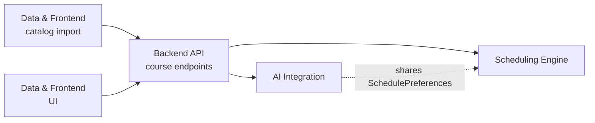

# HANDOFF.md

Live record of project progress. **Read it at the start of every session; update your module's section at the end.** Update rules are in [development-guide.md § 9](docs/development-guide.md#9-updating-handoffmd). In short: pull first, edit only your section, add a session-log line, record only real results, and never delete others' entries.

| | |
|---|---|
| **Last updated** | 2026-10-15 16:45 EDT, by a Claude Code session for @04michael4 |
| **Current milestone** | Phase 1: backend foundation. ✅ Implemented and verified locally; committed on `feature/backend-foundation`. **Awaiting review before merging to `main`.** |
| **Next milestone** | Phase 2: _to be defined by the team_ (see [Next recommended tasks](#next-recommended-tasks)) |

## Repository state

| | |
|---|---|
| Branch | `feature/backend-foundation`, pushed to `origin/feature/backend-foundation` for review |
| Base commit | `8ea194c` "Initial commit" (`main` is still at this commit) |
| Phase 1 commit | `feat: initialize Spring Boot backend and team documentation`, the commit directly after `8ea194c` on this branch (run `git log` for the hash). Contains the backend skeleton, health endpoint, tests and docs. |
| Merged to `main`? | **No.** Waiting for review. |
| Toolchain verified | OpenJDK 21.0.12 (Homebrew), Maven 3.10.0 via wrapper, Spring Boot 4.1.1, macOS |

## Latest test results

**Run 2026-10-15 16:45 EDT** (just before the Phase 1 commit), command `cd backend && ./mvnw -B clean test`:

```
Tests run: 2, Failures: 0, Errors: 0, Skipped: 0 -- in io.github.michael04.registration.health.HealthControllerTest
Tests run: 1, Failures: 0, Errors: 0, Skipped: 0 -- in io.github.michael04.registration.RegistrationBackendApplicationTests
Tests run: 3, Failures: 0, Errors: 0, Skipped: 0
BUILD SUCCESS   (Total time: 2.655 s)
```

**Manual verification, same session:** `./mvnw spring-boot:run` started in 0.489 s. Then:
```
$ curl -i http://localhost:8080/api/health
HTTP/1.1 200
Content-Type: application/json
{"status":"UP","service":"registration-backend"}
```
Also observed earlier the same day: an unknown path returns `404` and `POST /api/health` returns `405`, both with Spring Boot's default error JSON.

## Known bugs and blockers

| # | Item | Type | Owner | Status |
|---|---|---|---|---|
| 1 | Module owners not yet assigned (README team table is `_TBD_`) | Blocker (coordination) | Team | Open |
| 2 | **Lehigh course data source not chosen.** Blocks real course search and scheduling. | Blocker | Data (_TBD_) | Open |
| 3 | Phase 1 is committed and pushed on `feature/backend-foundation` but not merged to `main` | Process | @04michael4 | Open: awaiting review |
| 4 | No CI; tests run only locally | Gap | _TBD_ | Open |
| 5 | Mockito prints JDK "dynamic agent loading" warnings during tests | Cosmetic | — | Accepted (harmless) |

No known functional bugs.

## Important decisions

| Date | Decision | Where |
|---|---|---|
| 2026-10-15 | Java 21 + Spring Boot instead of Python + FastAPI | [ADR-0001](docs/decisions/0001-java-spring-boot-over-python-fastapi.md) |
| 2026-10-15 | Spring Boot 4.1.1 pinned; Maven Wrapper; minimal dependencies; hand-written health endpoint; package by feature | [architecture.md § 15](docs/architecture.md#15-phase-1-decisions-implemented) |
| 2026-10-15 | The AI proposes and explains; the deterministic engine alone decides validity | [architecture.md § 1](docs/architecture.md#1-system-overview) |
| 2026-10-15 | Base package `io.github.michael04.registration` (independent project) | [CLAUDE.md](CLAUDE.md) |
| 2026-10-15 | **Team-agreed** API contract: course search, preference extraction and schedule generation shapes, formats (`"FRIDAY"`, `"15:00"`, `"CSE-017"`), weights 0–5. Agreed, not yet implemented. |
| 2026-10-15 | **Credit limits** follow Lehigh's overload policy: hard cap 21 credits (team rule), default 12–18, normal load 17 (first semester) / 18, schedules over 18 flagged `overload: true` | [api-contract.md § Credit limits](docs/api-contract.md#credit-limits) | [api-contract.md](docs/api-contract.md) |
| 2026-10-15 | **Team-agreed** four-module split and owners: Michael (AI), David (Frontend & DB), Marpu (Backend), Sunny (Engine) | [README § Team](README.md#team-and-responsibilities) |

## Module ownership and dependencies



| Module | Owner | Depends on | Depended on by |
|---|---|---|---|
| Backend API | _TBD_ (Phase 1: @04michael4) | — | everyone |
| Scheduling Engine | _TBD_ | Backend API (course data), `SchedulePreferences` contract | Frontend |
| AI Integration | _TBD_ | Backend API (course ID validation), `SchedulePreferences` contract | Frontend |
| Data and Frontend | _TBD_ | Backend API (endpoints), data source decision | — |

The engine **logic** can be built and unit-tested now, before the database or catalog exist, using hand-made test data.

---

## Backend API

**Owner:** _TBD_ (Phase 1 foundation: @04michael4) · **Status:** ✅ Foundation implemented and verified; committed on `feature/backend-foundation`, not merged

**Completed**
- 2026-10-15: Spring Boot 4.1.1 / Java 21 project from Spring Initializr in `backend/`, with Maven Wrapper (Maven 3.10.0).
- 2026-10-15: `GET /api/health` → `{"status":"UP","service":"registration-backend"}` (`health` package).
- 2026-10-15: Tests: `HealthControllerTest` (2 × `@WebMvcTest`) and a context-load test. All passing; see [Latest test results](#latest-test-results).
- 2026-10-15: Root `.gitignore` (ignores `.env`/`.env.*`, keeps `.env.example`; verified with `git check-ignore`), `.env.example`, docs.

**In progress**
- _None._

**Next recommended**
1. Review Phase 1, then open a PR from `feature/backend-foundation` into `main` and merge it.
2. Add GitHub Actions CI running `./mvnw test` on PRs.
3. `common`: global error handling with RFC 9457 Problem Details, plus `spring-boot-starter-validation`. This is a contract change, so update [api-contract.md](docs/api-contract.md).
4. Persistence phase: PostgreSQL, a migration tool and the `course` package, once the data source is decided.

**Blockers:** none for items 1–3. Item 4 is blocked on the data-source decision.

---

## Scheduling Engine

**Owner:** Sunny (per the [README team table](README.md#team-and-responsibilities)) · **Status:** 🟡 Solver implemented and unit-tested; not yet called by an endpoint. Committed and pushed on `feature/engine-core`.

**Scope:** `engine/` only. Per the team-agreed README work plan, the `schedule/` package and `POST /api/schedules/generate` belong to the Backend API module (Marpu). See the discrepancy note below.

**Completed**
- 2026-10-15: Engine input/output records and the `ScheduleSolver` interface: `Meeting`, `SectionOption`, `CourseOption`, `Constraints`, `SoftWeights`, `ScheduleProblem`, `ScoredSchedule`, `ScheduleResult`. Compact constructors validate the input and copy collections defensively. Committed as `d37eec8` (not pushed).
- 2026-10-15: **Linked sections** (owner decision): one lecture may allow several labs or recitations, and a lecture with linked sections must be taken with exactly one per component type (`SectionOption.component` + `parentCrn`).
- 2026-10-15: **Infeasible input** (owner decision): return diagnostics plus "make X optional" suggestions. No contract change.
- 2026-10-15: **`BacktrackingScheduleSolver`**. It expands lectures into lecture+lab bundles and pre-filters them, then searches with a conflict table, fewest-options-first ordering, credit pruning and branch-and-bound. It also has a deterministic node cap (default 1,000,000), top-K, diagnostics and suggestions. Supporting pieces:
  - `ScheduleScorer`: the scoring formula, using exact integer arithmetic;
  - `Bundle` (package-private);
  - `Meeting.overlaps`;
  - `CourseOption.excluding`, which removes closed sections safely for the caller.
  - Documented in [architecture.md § 7–8](docs/architecture.md#7-scheduling-engine), with measured search sizes.
- 2026-10-15: Engine tests, plain JUnit 5 with no Spring:
  - `MeetingTest` (9);
  - `ScheduleProblemTest` (14);
  - `CourseOptionTest` (4);
  - `BacktrackingScheduleSolverTest` (25), which includes the README worked example, lecture/lab bundles, every diagnostic, determinism under shuffled input, and 200 seeded random catalogs. Each catalog is checked by an independent validity checker and against a **brute-force solver**: the returned schedules must be exactly the true top K.
  - Also: 7 × 10 sections solving in under 1 s (`assertTimeout`).
- 2026-10-16: **Manual mode support: `SelectionChecker`** (owner decisions: grey out + warn on bad drops; lecture and lab dragged separately, with the lab prompted). It checks a hand-picked set of CRNs and returns:
  - conflicts and missing pieces, each with a message the UI can show;
  - for every unplaced section, whether it fits, why not, and whether it completes a placed lecture;
  - credits and a score computed the same way as for generated schedules.

  `SelectionCheckerTest` (12) includes a cross-check: every schedule the solver generates passes the checker with zero issues and an identical score. Documented in architecture.md § 7 "Manual mode".
- 2026-10-16: **Elective recommendations: `ElectiveAdvisor`** (owner chose "both"):
  - `explainElectives` says, for each typed elective, whether it's in the suggestions, and if not, why and how to fix it (section swap, free a blocked time, raise max credits, take a required course later).
  - `suggestElectives` ranks candidate courses that fit a given schedule.
  - **Solver ranking change:** on an equal score, the schedule with more of the student's electives now ranks first. This fixes electives being dropped at a weight of 0; the new test fails without the fix.
  - Flow recorded: suggested mode with required courses → add electives in manual mode (no limit) or type them up front (≤ 8). `ElectiveAdvisorTest` (11). Documented in architecture.md § 7 "Electives".

**In progress:** Sunny, branch `feature/engine-core` (pushed to `origin/feature/engine-core`). The engine is functionally complete; team-agreement items are deferred to the merge, per the owner.

**Merge notes: wiring into Marpu's `schedule` layer on `origin/pre-main`** (checked 2026-10-16 against `9cd9cdf`; not edited, since it's outside this module)
- `pre-main` defines `schedule/integration/SchedulingEngine` and has **no implementation registered**. An adapter `@Bean` must implement it by calling `new BacktrackingScheduleSolver(nodeCap).solve(...)`. Constructing one per call is cheap, and the solver is stateless.
- Field mapping, adapter → engine:
  - `Section.componentType` → `SectionOption.component`.
  - `Section.lectureLink` → `SectionOption.parentCrn`. This must be **`null` for a lecture** and the **lecture's CRN** for a lab or recitation; confirm that's what `lectureLink` holds.
  - `Meeting.days` (a List) → a `Set`.
  - `SoftWeights` field order differs.
  - Result: `sectionCrns` = the CRNs of `ScoredSchedule.sections()`; `score` = `BigDecimal.valueOf(score)`; `scoreBreakdown` = the `breakdown` values as `BigDecimal`.
- ⚠️ **Closed sections:** `EngineMapper.prepare` drops `CLOSED` sections one by one. If every lab of a lecture is closed, the lecture would reach the engine with no labs and be treated as standalone, which breaks the "lecture must have its lab" rule. Fix at merge: pass all sections and drop closed ones with `CourseOption.excluding(...)` in the adapter (architecture.md § 7, rule 4).
- **Node cap:** `pre-main` defaults `scheduling.node-cap` to 200,000, but the engine's default is 1,000,000 (see the § 7 "Search size" table). Pick one.
- **Optional-course limit:** `pre-main` enforces 10 (matches § 7 rule 2).

**Needs team agreement** (details in architecture.md § 7)
1. **Marpu:** the 8 caller rules in § 7, especially rule 4 (`excluding` for closed sections), rule 7 (copy `diagnostics` through) and rule 8 (`@Bean` + node-cap config key).
2. **Marpu:** add "at most N optional courses → `400`" to api-contract.md. The engine owner has to choose N: optional courses drive search cost (see the § 7 "Search size" table).
3. **Marpu:** the scoring formula (0–20 points per preference, `score = 100 − Σ`), and the per-preference `breakdown` keys, which equal the contract's `softPreferences` field names.
4. **David:** the catalog must give each section a component type and the CRN of its lecture, so the "lecture must have its lab" rule works. The credits convention is course credits on the lecture and 0 on its labs, unless the catalog says otherwise.
5. **Michael:** nothing engine-specific. AI output reaches the engine only through `SchedulePreferences`.
6. **Marpu:** add `POST /api/schedules/check` (proposed in architecture.md § 7 "Manual mode") and a `check` method on the `SchedulingEngine` adapter. **David:** the frontend's two modes: suggested (`generate` with `maxResults: 4`), and manual (calendar with every section of the student's courses, grey-out and highlight from `/check`). Manual mode also needs `GET /api/courses/{courseId}` (endpoint 4) for section times.
8. **Marpu:** expose elective recommendations by adding `electiveAdvice` to the `generate` response and adding `POST /api/schedules/suggest-electives` (candidates from course search). Proposed in architecture.md § 7 "Electives".
7. **Whole team, scope change:** the owner wants manual mode to list **the major's required courses automatically**. The README currently puts degree requirements out of scope. It needs degree-requirement data per major (David), the student's major and completed courses as input (frontend/AI), and an endpoint that returns the courses still required and offered this term (Marpu). A hand-entered requirement list for one demo major would be a feasible hackathon version. Not engine work.

**Next recommended**
1. At merge: write the `SchedulingEngine` adapter and resolve the merge notes above, together with Marpu.
2. After the team agrees: tune the score caps (300/600 min) against real-looking schedules, and decide the optional-course limit.
3. Optional: merge bundles of one course that have identical times and credits, if the node cap is hit on real data.

**Blockers:** none for the engine itself. Integration needs Marpu's `schedule` layer.

**Discrepancies found 2026-10-15** (flagged, not edited, because they're outside this module):
- CLAUDE.md (module table) and architecture.md § 4 list `schedule` under the Scheduling Engine module, but the README team plan gives it to Backend API (Marpu). The owners should pick one and fix the other docs.
- The repo header, the *Repository state* section and the README "Current phase" line still say Phase 1 isn't merged and `main` is at `8ea194c`. In fact PR #1 was merged, and `main`/`origin/main` are at `098cf09`. Module owners in the *Module ownership* table here are also still _TBD_.

---

## AI Integration

**Owner:** _TBD_ · **Status:** ⬜ Not started

**Completed:** _none_. The design is proposed in [architecture.md § 9](docs/architecture.md#9-ai-integration-and-validation).

**In progress:** _none_.

**Next recommended**
1. Agree with the Engine owner on the final `SchedulePreferences` shape; the proposal is in the [contract](docs/api-contract.md#5-post-apipreferencesextract).
2. Add `com.anthropic:anthropic-java` (pin the version; check Jackson compatibility with Boot 4) behind a `PreferenceExtractor` interface, with a fake for tests.
3. Build `POST /api/preferences/extract` with server-side validation. `./mvnw test` must not call the real API.

**Blockers:** each developer needs their own Anthropic API key, kept in a local `.env` or shell environment and never committed.

---

## Data and Frontend

**Owner:** _TBD_ · **Status:** ⬜ Not started (placeholders: [data/README.md](data/README.md), [frontend/README.md](frontend/README.md))

**Completed:** _none_.

**In progress:** _none_.

**Next recommended**
1. **Data:** identify a permitted source for Lehigh course/section data, and record its format, terms of use and refresh process in `data/README.md`. Meanwhile, create a small **synthetic** sample catalog so the Engine and Backend API work can proceed.
2. **Frontend:** scaffold Next.js + TypeScript + Tailwind in `frontend/`; add a page that calls `GET /api/health`; document the run commands in `frontend/README.md` and the README.
3. Decide CORS vs. a Next.js proxy with the Backend API owner.

**Blockers:** real data depends on step 1.

---

## Next recommended tasks

In priority order, across the team:
1. Review Phase 1 on `feature/backend-foundation`, then merge it to `main`.
2. Assign module owners, and fill in the README team table and this file.
3. Decide the course data source (or agree on a synthetic dataset for the hackathon).
4. Start, in parallel: engine core (no dependencies), frontend scaffold, CI.

## Instructions for the next developer or AI agent

1. Read [README.md](README.md), this file, and [docs/architecture.md](docs/architecture.md). Follow [CLAUDE.md](CLAUDE.md).
2. Run `git status` and `git log --oneline -5`. **Confirm the repository state matches this file**, and note any discrepancy in the session log.
3. Run `cd backend && ./mvnw test` to confirm a green baseline before you change anything.
4. Claim your task under *In progress* in your module's section, with your handle and branch.
5. When you finish: run the tests, update your section with real results, add a session-log line, and leave changes uncommitted unless you were told to commit.

---

## Session log

Newest first, one line per session. Append only.

| When | Who | Module | Summary |
|---|---|---|---|
| 2026-10-16 16:05 EDT | Claude Code for Sunny | Scheduling Engine | Elective recommendations on `feature/engine-core`: `ElectiveAdvisor` (explain and fix typed electives; suggest electives that fit a schedule), `ElectiveAdvice` and `ElectiveSuggestion`, 11 tests. Solver tie-break: more electives first on an equal score; the new test fails without the change. Documented the elective flow. `cd backend && ./mvnw -B test` → `Tests run: 79, Failures: 0, Errors: 0, Skipped: 0`, BUILD SUCCESS. |
| 2026-10-16 14:11 EDT | Claude Code for Sunny | Scheduling Engine | Manual-mode support on `feature/engine-core`: added `SelectionChecker`, `SelectionReport`, `SelectionIssue` and `SectionFit`, plus 12 tests including a cross-check with the solver. Documented the manual mode and a proposed `/api/schedules/check` endpoint, and flagged the "major's required courses" scope change. `cd backend && ./mvnw -B test` → `Tests run: 67, Failures: 0, Errors: 0, Skipped: 0`, BUILD SUCCESS. |
| 2026-10-16 12:44 EDT | Claude Code for Sunny | Scheduling Engine | Owner asked to commit and push `feature/engine-core`. Added merge notes for `origin/pre-main`'s `SchedulingEngine` boundary (adapter mapping, closed-section risk, node-cap mismatch). Test run before commit: 55/55 pass (see 22:44 entry); no code changed since. |
| 2026-10-15 22:44 EDT | Claude Code for Sunny | Scheduling Engine | Committed the engine types as `d37eec8` (owner's request; not pushed). Implemented `BacktrackingScheduleSolver`, `ScheduleScorer`, `Bundle`, `Meeting.overlaps` and `CourseOption.excluding`, plus 35 new engine tests (including a brute-force optimality check). Measured search size; default node cap raised to 1,000,000. `cd backend && ./mvnw -B test` → `Tests run: 55, Failures: 0, Errors: 0, Skipped: 0`, BUILD SUCCESS. Solver uncommitted. |
| 2026-10-15 22:08 EDT | Claude Code for Sunny | Scheduling Engine | Lecture/lab links added to the engine types (`component`, `parentCrn`; one lecture → many labs). Documented the infeasibility suggestion, the 8 caller rules for the Backend API, and the search-size plan in architecture.md § 7–8. `cd backend && ./mvnw -B test` → `Tests run: 23, Failures: 0, Errors: 0, Skipped: 0`, BUILD SUCCESS. Nothing committed. |
| 2026-10-15 21:42 EDT | Claude Code for Sunny | Scheduling Engine | Renamed the local branch `Scheduling-Engine` → `feature/engine-core`. Added the engine records and the `ScheduleSolver` interface (types only, no solver), 17 plain-JUnit tests, and architecture.md § 7–8 (engine API, scoring formula). `cd backend && ./mvnw -B test` → `Tests run: 20, Failures: 0, Errors: 0, Skipped: 0`, BUILD SUCCESS. Nothing committed. |
| 2026-10-15 21:30 EDT | Claude Code for @04michael4 | docs | Credit limits updated from Lehigh's overload policy (cap 21, overload flag); updated api-contract.md, architecture.md, README, HANDOFF.md. Docs only. |
| 2026-10-15 21:22 EDT | Claude Code for @04michael4 | docs | Team agreed the API contract as written; removed "provisional" markers from api-contract.md, architecture.md and HANDOFF.md. Docs only, no code changes. |
| 2026-10-15 16:45 EDT | Claude Code for @04michael4 | Backend API / docs | Pre-commit checks; marked API contract, credit limits and team roles as provisional; re-ran tests (3/3 pass) and verified health with curl. Committed Phase 1 and pushed to `origin/feature/backend-foundation`; not merged to `main`. |
| 2026-10-15 16:40 EDT | Claude Code for @04michael4 | Backend API / docs | Wrote README, CLAUDE.md, AGENTS.md, HANDOFF.md, architecture.md, api-contract.md, development-guide.md, ADR-0001. Re-ran tests: 3/3 pass; health verified with curl. Nothing committed. |
| 2026-10-15 16:27 EDT | Claude Code for @04michael4 | Backend API | Phase 1 backend foundation: Spring Boot 4.1.1 skeleton, `/api/health`, tests (3/3 pass), `.gitignore`, `.env.example`. Nothing committed. |
