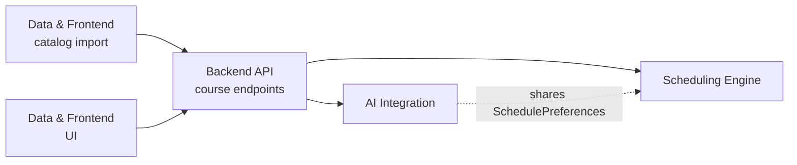

# HANDOFF.md

Live record of project progress. **Read it at the start of every session; update your module's section at the end.** Update rules are in [development-guide.md § 9](docs/development-guide.md#9-updating-handoffmd). In short: pull first, edit only your section, add a session-log line, record only real results, and never delete others' entries.

| | |
|---|---|
| **Last updated** | 2026-10-15 16:45 EDT, by a Claude Code session for @04michael4 |
| **Current milestone** | Phase 1: backend foundation. ✅ Implemented and verified locally; committed on `feature/backend-foundation`. **Awaiting review before merging to `main`.** |
| **Next milestone** | Phase 2: _to be defined by the team_ (see [Next recommended tasks](#next-recommended-tasks)) |

## Repository state

| | |
|---|---|
| Branch | `feature/backend-foundation`, pushed to `origin/feature/backend-foundation` for review |
| Base commit | `8ea194c` "Initial commit" (`main` is still at this commit) |
| Phase 1 commit | `feat: initialize Spring Boot backend and team documentation`, the commit directly after `8ea194c` on this branch (run `git log` for the hash). Contains the backend skeleton, health endpoint, tests and docs. |
| Merged to `main`? | **No.** Waiting for review. |
| Toolchain verified | OpenJDK 21.0.12 (Homebrew), Maven 3.10.0 via wrapper, Spring Boot 4.1.1, macOS |

## Latest test results

**Run 2026-10-15 16:45 EDT** (just before the Phase 1 commit), command `cd backend && ./mvnw -B clean test`:

```
Tests run: 2, Failures: 0, Errors: 0, Skipped: 0 -- in io.github.michael04.registration.health.HealthControllerTest
Tests run: 1, Failures: 0, Errors: 0, Skipped: 0 -- in io.github.michael04.registration.RegistrationBackendApplicationTests
Tests run: 3, Failures: 0, Errors: 0, Skipped: 0
BUILD SUCCESS   (Total time: 2.655 s)
```

**Manual verification, same session:** `./mvnw spring-boot:run` started in 0.489 s. Then:
```
$ curl -i http://localhost:8080/api/health
HTTP/1.1 200
Content-Type: application/json
{"status":"UP","service":"registration-backend"}
```
Also observed earlier the same day: an unknown path returns `404` and `POST /api/health` returns `405`, both with Spring Boot's default error JSON.

## Known bugs and blockers

| # | Item | Type | Owner | Status |
|---|---|---|---|---|
| 1 | Module owners not yet assigned (README team table is `_TBD_`) | Blocker (coordination) | Team | Open |
| 2 | **Lehigh course data source not chosen.** Blocks real course search and scheduling. | Blocker | Data (_TBD_) | Open |
| 3 | Phase 1 is committed and pushed on `feature/backend-foundation` but not merged to `main` | Process | @04michael4 | Open: awaiting review |
| 4 | No CI; tests run only locally | Gap | _TBD_ | Open |
| 5 | Mockito prints JDK "dynamic agent loading" warnings during tests | Cosmetic | — | Accepted (harmless) |

No known functional bugs.

## Important decisions

| Date | Decision | Where |
|---|---|---|
| 2026-10-15 | Java 21 + Spring Boot instead of Python + FastAPI | [ADR-0001](docs/decisions/0001-java-spring-boot-over-python-fastapi.md) |
| 2026-10-15 | Spring Boot 4.1.1 pinned; Maven Wrapper; minimal dependencies; hand-written health endpoint; package by feature | [architecture.md § 15](docs/architecture.md#15-phase-1-decisions-implemented) |
| 2026-10-15 | The AI proposes and explains; the deterministic engine alone decides validity | [architecture.md § 1](docs/architecture.md#1-system-overview) |
| 2026-10-15 | Base package `io.github.michael04.registration` (independent project) | [CLAUDE.md](CLAUDE.md) |
| 2026-10-15 | **Team-agreed** API contract: course search, preference extraction and schedule generation shapes, formats (`"FRIDAY"`, `"15:00"`, `"CSE-017"`), weights 0–5. Agreed, not yet implemented. |
| 2026-10-15 | **Credit limits** follow Lehigh's overload policy: hard cap 21 credits (team rule), default 12–18, normal load 17 (first semester) / 18, schedules over 18 flagged `overload: true` | [api-contract.md § Credit limits](docs/api-contract.md#credit-limits) | [api-contract.md](docs/api-contract.md) |
| 2026-10-15 | **Team-agreed** four-module split and owners: Michael (AI), David (Frontend & DB), Marpu (Backend), Sunny (Engine) | [README § Team](README.md#team-and-responsibilities) |

## Module ownership and dependencies



| Module | Owner | Depends on | Depended on by |
|---|---|---|---|
| Backend API | _TBD_ (Phase 1: @04michael4) | — | everyone |
| Scheduling Engine | _TBD_ | Backend API (course data), `SchedulePreferences` contract | Frontend |
| AI Integration | _TBD_ | Backend API (course ID validation), `SchedulePreferences` contract | Frontend |
| Data and Frontend | _TBD_ | Backend API (endpoints), data source decision | — |

The engine **logic** can be built and unit-tested now, before the database or catalog exist, using hand-made test data.

---

## Backend API

**Owner:** Marpu (per the team assignments in README; Phase 1 foundation: @04michael4) · **Status:** ✅ Foundation/common available; 🟡 Schedule API layer implemented and tested on `feature/backend-schedule`, based on testing branch `pre-main`; production engine/catalog integration pending

**Completed**
- 2026-10-15: Spring Boot 4.1.1 / Java 21 project from Spring Initializr in `backend/`, with Maven Wrapper (Maven 3.10.0).
- 2026-10-15: `GET /api/health` → `{"status":"UP","service":"registration-backend"}` (`health` package).
- 2026-10-15: Tests: `HealthControllerTest` (2 × `@WebMvcTest`) and a context-load test. All passing; see [Latest test results](#latest-test-results).
- 2026-10-15: Root `.gitignore` (ignores `.env`/`.env.*`, keeps `.env.example`; verified with `git check-ignore`), `.env.example`, docs.
- 2026-10-15: Codex implemented `common`: centralized RFC 9457 Problem Details, sorted validation errors, safe application exceptions, request IDs, servlet fallback, and exact-origin CORS. Added `spring-boot-starter-validation` for Bean Validation and documented the error-contract change and `CORS_ALLOWED_ORIGINS`. Production changes stay within `common`, `pom.xml`, and `application.properties`; other modules are untouched.
- 2026-10-15: Codex implemented the Schedule API layer: `POST /api/schedules/generate`, nested/cross-field validation, original-list optional limit (10), stable required/optional normalization, term/status section filtering, component/link/time mapping, unchanged score/breakdown and result ordering, actual-credit overload flag, and validated `scheduling.node-cap`. No solver algorithm or production sample results were added. Reuses the existing global advice; no duplicate exception handler.

**Verification — 2026-10-15 22:01 EDT**
- Phase 0: read `docs/development-guide.md`, `AGENTS.md`, `CLAUDE.md`, and this handoff in order; `PLANS.md` is absent. Fetched `origin`, confirmed a clean tree, checked that the task branch did not exist, then created and verified `feature/backend-common` from `origin/main` at `098cf092d49379ec32c634bd6e6c1432229fd7bc`. Local `main` matched `origin/main`, so no merge was needed. Git metadata writes required sandbox approval. No commit, push, or PR was made.
- Baseline: `./mvnw -B test` via Git Bash and JDK 21 → `Tests run: 3, Failures: 0, Errors: 0, Skipped: 0`; `BUILD SUCCESS`.
- Final command from `backend/`, in PowerShell: `$env:JAVA_HOME='C:\Program Files\Java\jdk-21'; & 'C:\Program Files\Git\bin\bash.exe' ./mvnw -B test` → `Tests run: 48, Failures: 0, Errors: 0, Skipped: 0`; `BUILD SUCCESS` (2026-10-15 21:59 EDT). Tests cover nested/body/parameter validation, malformed JSON, missing input, 404/405/406/415/422/429/500/502/503, safe errors, request IDs, default/custom/disabled CORS, and rejected origins/methods/headers. They need no DB, AI service, or secrets.
- Live: `./mvnw -B spring-boot:run '-Dspring-boot.run.arguments=--server.port=0'`, using the same JDK/Git Bash setup, started on port 58982. `curl.exe -i` verified health GET/HEAD 200; unknown route 404; POST health 405 with `Allow: GET`; XML Accept 406; allowed JSON POST preflight 200; untrusted origin 403; allowed-origin headers on a 404; `/error` fallback 500 even with HTML Accept. Error bodies are `application/problem+json`, include `type: about:blank`, and match `requestId` to `X-Request-Id`; query strings are omitted.
- Initial feature test run: `Tests run: 48, Failures: 22, Errors: 0, Skipped: 0` because Spring leaves the problem type unset by default. Resolved by setting `about:blank` explicitly in the shared renderer; all final tests pass.
- **Environment issue:** Windows `mvnw.cmd` fails before Maven starts with `Cannot index into a null array`; the Unix wrapper via Git Bash works. The wrapper files were left unchanged, and README documents the workaround. Existing Mockito dynamic-agent notices remain.
- **Documentation discrepancy:** the repository-state/ownership summaries above and some older design notes are stale. Git shows the foundation merged in `76a8310`; README assigns owners. This entry records the discrepancy without replacing other modules' history. The user explicitly assigned CORS; it is implemented while preserving the frontend's option to use a same-origin proxy.
- **Review note:** error JSON and CORS configuration are shared interfaces. Frontend/AI/backend consumers should review the documented contract when a PR is authorized. The API endpoints for course search, scheduling, and AI remain planned.
- **Pre-push recheck — 2026-10-15 22:26 EDT:** the same `./mvnw -B test` command via Git Bash/JDK 21 returned `Tests run: 48, Failures: 0, Errors: 0, Skipped: 0` and `BUILD SUCCESS`. `git diff --check` is clean. Target: `origin/pre-main`, explicitly requested by the user.

**In progress**
- Common implementation and the authorized push are complete: `origin/pre-main` contains `533633d`.
- 2026-10-15 23:18 EDT: Codex claims Schedule API on `feature/backend-schedule`, created and verified from freshly fetched `origin/pre-main` (`533633d`), following the user's testing-branch direction. Clean tree verified before edits; baseline `./mvnw -B test` via Git Bash/JDK 21: `Tests run: 48, Failures: 0, Errors: 0, Skipped: 0`, `BUILD SUCCESS`.
- Integration gap: no engine implementation or section catalog exists in the fetched repository. Section 7 describes a planned algorithm; README examples lack final scores, total credits, and component links. Preparing the API boundary and tests without implementing or fabricating a solver. Shared preference types will retain the shapes already introduced on `origin/feature/ai-preference-extractor`; consuming owners must review the integration boundary.

**Schedule API verification — 2026-10-15 23:51 EDT**
- Branch: `feature/backend-schedule`, base `origin/pre-main` at `533633dedc6ac885903f1a6853d7ed5db953c6fc`. Fetched origin, read the required guides/contracts, checked existing branches and the clean worktree, then created/switched/verified the task branch before edits. `PLANS.md` is absent. The user's prior testing-branch instruction takes precedence over the guide's default `main` integration workflow. No commit, push, merge or PR for this task.
- Final command from `backend/`: `$env:JAVA_HOME='C:\Program Files\Java\jdk-21'; & 'C:\Program Files\Git\bin\bash.exe' ./mvnw -B verify` → **`Tests run: 158, Failures: 0, Errors: 0, Skipped: 0`**, **`BUILD SUCCESS`**, 2026-10-15 23:49 EDT. Includes all 48 existing tests and 110 new tests: 86 controller/service tests, 13 mapper tests, 9 configuration tests and 2 full-context unavailable-integration tests. Executable JAR packaging succeeded. Tests use synthetic fixtures/mocked solver; no DB or live AI calls.
- Tests cover every required range/boundary, invalid requests never reaching catalog/engine, 10/11 optional entries (including duplicates/overlaps), all five weights, strict JSON types and times, required/optional deduplication, closed lectures/labs/recitations, UNKNOWN status, term filtering, component/link preservation, TBA/online empty meetings, stable preparation, score precision/order, overload at 18/19/21, normal empty results, 422/500/503 errors, cap defaults/custom values and invalid startup config.
- Live: `./mvnw -B spring-boot:run '-Dspring-boot.run.arguments=--server.port=0'` via Git Bash/JDK 21 started on port 54069. `curl.exe -i` verified health 200; empty required list 400 with nested field errors; 11 overlapping optional entries at weight 0 still 400; valid scheduling request 503 because production adapters are absent. Error bodies use the shared Problem Details format and matching request IDs; allowed-origin CORS headers present on 503. Server stopped gracefully after checks. A live successful schedule cannot be verified until the native engine and catalog exist.
- Failures found and resolved: initial 146-test run had one test-only 503 wording mismatch; expanded tests caught Jackson's numeric/boolean-to-string coercion (2 failures in an 85-test targeted run), then lenient `24:00` normalization (1 failure in a 156-test full run). Strict coercion/time settings fixed both parsing defects. Subsequent targeted 86-test run and final 158-test build passed. Mockito's existing dynamic-agent warning and Windows wrapper workaround remain unchanged.
- Files created: `schedule/{ScheduleController,ScheduleService,EngineMapper,GenerateScheduleRequest,GenerateScheduleResponse,ScheduleRequestValidator,ValidScheduleRequest,SchedulingProperties,SchedulingConfiguration}.java`, `schedule/integration/SchedulingEngine.java`; `course/{CourseCatalog,CourseSummary,SectionCatalog,CatalogSection}.java`; `common/json/JsonConfiguration.java`; `common/preferences/{SchedulePreferences,HardConstraints,SoftPreferences,Weighted,GapsPreference,TimeBlock,CreditLimits,Weights}.java`; four `schedule` test classes (`ScheduleControllerTest`, `EngineMapperTest`, `SchedulingConfigurationTest`, `ScheduleUnavailableTest`). Modified: `application.properties`, `.env.example`, README, this handoff, `docs/api-contract.md`, `docs/architecture.md`. No build dependencies, engine algorithm, AI implementation, frontend, or persistence files changed.
- Shared-interface notes: preference/catalog Java shapes were taken from AI branch `c6c7121`, without merging its implementation. Request validation/JSON parsing are stricter. Schedule credit bounds remain the fixed 1–21 public contract, centralized in shared `CreditLimits`; the old contract's request to configure those numbers has been clarified. Reversed credit bounds now return 400 as explicitly required by this task (old contract said 422). Frontend/AI/engine/data owners should review these shared changes when integration is authorized.
- Remaining work: obtain Sunny's actual native solver interface and finalized scoring/component-link rules; implement its `SchedulingEngine` adapter, supply `CourseCatalog`/`SectionCatalog` implementations, then run real-engine/catalog end-to-end tests. The provisional adapter boundary preserves metadata as supplied but cannot prove compatibility with an unavailable engine schema. Full Schedule API Definition of Done is **not yet met**; API-layer checks pass. No user answer identifying another engine location was received during this session.

**Pre-push recheck — 2026-10-16 11:34 EDT**
- User authorized committing all pending changes and pushing to `pre-main`. Fetched `origin/pre-main`; it matches the feature branch base (`533633d`), allowing a normal fast-forward push.
- `./mvnw -B test` via Git Bash/JDK 21: `Tests run: 158, Failures: 0, Errors: 0, Skipped: 0`; `BUILD SUCCESS`. Initial sandbox attempt could not create `C:\.m2\repository`; the approved run outside the sandbox used the existing user cache and passed. `git diff --check` is clean. Production engine/catalog adapters remain pending as documented above.

**Next recommended**
1. ~~Review Phase 1, then open a PR from `feature/backend-foundation` into `main` and merge it.~~ Resolved 2026-10-15: Git records the merge as `76a8310`.
2. Add GitHub Actions CI running `./mvnw test` on PRs.
3. ~~`common`: global error handling with RFC 9457 Problem Details, plus `spring-boot-starter-validation`. This is a contract change, so update [api-contract.md](docs/api-contract.md).~~ Implemented and verified 2026-10-15 on `feature/backend-common`; test on `pre-main` and review the contract before promotion to `main`.
4. Persistence phase: PostgreSQL, a migration tool and the `course` package, once the data source is decided.

**Blockers:** no blocker for the completed foundation/common work. Production Schedule API integration is blocked on the missing engine and catalog adapters; persistence still depends on the data-source decision.

---

## Scheduling Engine

**Owner:** Sunny (per the [README team table](README.md#team-and-responsibilities)) · **Status:** 🟡 Solver implemented and unit-tested, and integrated into `/api/schedules/generate` on `integrate/engine-into-pre-main` (PR into `pre-main` pending review). The live endpoint still returns 503 until a production catalog exists.

**Scope:** `engine/` only. Per the team-agreed README work plan, the `schedule/` package and `POST /api/schedules/generate` belong to the Backend API module (Marpu). See the discrepancy note below.

**Completed**
- 2026-10-15: Engine input/output records and the `ScheduleSolver` interface: `Meeting`, `SectionOption`, `CourseOption`, `Constraints`, `SoftWeights`, `ScheduleProblem`, `ScoredSchedule`, `ScheduleResult`. Compact constructors validate the input and copy collections defensively. Committed as `d37eec8` (not pushed).
- 2026-10-15: **Linked sections** (owner decision): one lecture may allow several labs or recitations, and a lecture with linked sections must be taken with exactly one per component type (`SectionOption.component` + `parentCrn`).
- 2026-10-15: **Infeasible input** (owner decision): return diagnostics plus "make X optional" suggestions. No contract change.
- 2026-10-15: **`BacktrackingScheduleSolver`**. It expands lectures into lecture+lab bundles and pre-filters them, then searches with a conflict table, fewest-options-first ordering, credit pruning and branch-and-bound. It also has a deterministic node cap (default 1,000,000), top-K, diagnostics and suggestions. Supporting pieces:
  - `ScheduleScorer`: the scoring formula, using exact integer arithmetic;
  - `Bundle` (package-private);
  - `Meeting.overlaps`;
  - `CourseOption.excluding`, which removes closed sections safely for the caller.
  - Documented in [architecture.md § 7–8](docs/architecture.md#7-scheduling-engine), with measured search sizes.
- 2026-10-15: Engine tests, plain JUnit 5 with no Spring:
  - `MeetingTest` (9);
  - `ScheduleProblemTest` (14);
  - `CourseOptionTest` (4);
  - `BacktrackingScheduleSolverTest` (25), which includes the README worked example, lecture/lab bundles, every diagnostic, determinism under shuffled input, and 200 seeded random catalogs. Each catalog is checked by an independent validity checker and against a **brute-force solver**: the returned schedules must be exactly the true top K.
  - Also: 7 × 10 sections solving in under 1 s (`assertTimeout`).
- 2026-10-16: **Manual mode support: `SelectionChecker`** (owner decisions: grey out + warn on bad drops; lecture and lab dragged separately, with the lab prompted). It checks a hand-picked set of CRNs and returns:
  - conflicts and missing pieces, each with a message the UI can show;
  - for every unplaced section, whether it fits, why not, and whether it completes a placed lecture;
  - credits and a score computed the same way as for generated schedules.

  `SelectionCheckerTest` (12) includes a cross-check: every schedule the solver generates passes the checker with zero issues and an identical score. Documented in architecture.md § 7 "Manual mode".

**In progress:** Sunny. `feature/engine-core` is done. It has been merged into `integrate/engine-into-pre-main` (from `origin/pre-main` at `9cd9cdf`), following the integration process in development-guide.md. That branch is waiting for a PR review.

**Integration (2026-10-16, `integrate/engine-into-pre-main`)**
- Merged the engine into the latest `pre-main`. Doc conflicts were resolved by keeping both sides.
- **Adapter:** `schedule/integration/NativeSchedulingEngine` (`@Component`) implements Marpu's `SchedulingEngine` with `BacktrackingScheduleSolver(nodeCap)`. It's translation only. Catalog data the engine rejects becomes a safe 500.
- **`lectureLink` defined** as the lecture's CRN (`null` for lectures), matching David's `section_link`. Updated the `CatalogSection` Javadoc and api-contract.md (rule 6 and the change log). Marpu's test fixtures used `"lecture-crn:1"`; they now use real CRNs.
- **Closed-section fix:** `EngineMapper` now removes closed sections with the engine's `CourseOption.excluding`, so a lecture whose labs are all closed is removed too. New `EngineMapperTest` cases fail without the fix. One existing test expected the old behavior and was split and updated.
- **Tests:**
  - `NativeSchedulingEngineTest` (5);
  - `ScheduleEngineIntegrationTest` (4): the full app with a test catalog built from David's CSE-007 snapshot plus one synthetic course. It covers lecture + exactly one lab, ranking by score (98, then 95), a lecture whose only lab is closed, `includeClosedSections`, and a blocked-time diagnostic.
  - `./mvnw -B test` → `Tests run: 221, Failures: 0, Errors: 0, Skipped: 0`, BUILD SUCCESS.
- **Live:** `spring-boot:run`, then `curl`: health 200. `generate` 503, as designed, because no production `CourseCatalog`/`SectionCatalog` exists on `pre-main`.

**Merge notes for `pre-main`** (kept for history)
- ~~No `SchedulingEngine` implementation registered~~ Resolved 2026-10-16: `NativeSchedulingEngine`.
- ~~`lectureLink` meaning unconfirmed~~ Resolved 2026-10-16: the lecture's CRN; needs review by Marpu and David.
- ~~Closed labs could leave a lecture without its lab~~ Resolved 2026-10-16 in `EngineMapper`.
- ~~**Node cap:** `pre-main` defaults to 200,000 vs. the engine's 1,000,000~~ Resolved 2026-10-16: the default is now **1,000,000** (`application.properties`, `.env.example`, README, contract).
- ~~**Optional-course limit:** 10~~ Resolved 2026-10-16: lowered to **8** (`ScheduleRequestValidator.MAX_OPTIONAL_COURSES`, also used by `EngineMapper`; contract updated).

**Owner decisions, 2026-10-16** (recorded in architecture.md § 7 and api-contract.md)
- Two modes: **suggested** (`maxResults: 4`, sent by the frontend) and **manual** (drag and drop, using `SelectionChecker`).
- Manual mode: bad drops are greyed out and warned about, not blocked. Lecture and lab are dragged separately, with the lab prompted.
- **Optional-course limit 8**; **node cap 1,000,000**.
- Earliest start, latest end and days off stay **soft**. The score caps stay at **300/600 min**.
- The major's required courses come from **one demo major entered by hand** (data: David; endpoint: Marpu).

**Needs team agreement** (details in architecture.md § 7)
1. **Marpu:** review the adapter, the `EngineMapper` closed-section change and the `lectureLink` definition (contract change); also the scoring formula and the node-cap default.
2. **David:** the production `SectionCatalog` must set `lectureLink` = the lecture's CRN for each lab or recitation (from `section_link`), and `null` for lectures. Labs carry 0 credits, the lecture carries the course credits. Note: earliest start and days off are **soft** preferences. The data README's "no classes before 10 yields no complete pair" holds only if the team wants those as hard filters; the engine ranks such schedules lower instead.
3. **Michael:** `integrate/ai-into-pre-main` is based on the older `pre-main` (`533633d`). Whichever PR lands second has to merge the other; see the trial-merge notes in the PR.
4. **Marpu:** add `POST /api/schedules/check` (proposed in architecture.md § 7 "Manual mode") and a `check` method on the `SchedulingEngine` adapter. **David:** the frontend's two modes: suggested (`generate` with `maxResults: 4`), and manual (calendar with every section of the student's courses, grey-out and highlight from `/check`). Manual mode also needs `GET /api/courses/{courseId}` (endpoint 4) for section times.
5. **Whole team, scope change (owner chose the demo-sized version on 2026-10-16: one major, requirements entered by hand):** the owner wants manual mode to list **the major's required courses automatically**. The README currently puts degree requirements out of scope. It needs degree-requirement data per major (David), the student's major and completed courses as input (frontend/AI), and an endpoint that returns the courses still required and offered this term (Marpu). A hand-entered requirement list for one demo major would be a feasible hackathon version. Not engine work.

**Next recommended**
1. Review and merge `integrate/engine-into-pre-main` → `pre-main`.
2. A production `CourseCatalog`/`SectionCatalog` (David/Marpu). After that, `generate` returns real schedules with no engine changes.
3. After the team agrees: tune the score caps (300/600 min), choose the node-cap default, and decide the optional-course limit.

**Blockers:** none for the engine. A live demo needs a production catalog.

**Discrepancies found 2026-10-15** (flagged, not edited, because they're outside this module):
- CLAUDE.md (module table) and architecture.md § 4 list `schedule` under the Scheduling Engine module, but the README team plan gives it to Backend API (Marpu). The owners should pick one and fix the other docs.
- The repo header, the *Repository state* section and the README "Current phase" line still say Phase 1 isn't merged and `main` is at `8ea194c`. In fact PR #1 was merged, and `main`/`origin/main` are at `098cf09`. Module owners in the *Module ownership* table here are also still _TBD_.

---

## AI Integration

**Owner:** _TBD_ · **Status:** ⬜ Not started

**Completed:** _none_. The design is proposed in [architecture.md § 9](docs/architecture.md#9-ai-integration-and-validation).

**In progress:** _none_.

**Next recommended**
1. Agree with the Engine owner on the final `SchedulePreferences` shape; the proposal is in the [contract](docs/api-contract.md#5-post-apipreferencesextract).
2. Add `com.anthropic:anthropic-java` (pin the version; check Jackson compatibility with Boot 4) behind a `PreferenceExtractor` interface, with a fake for tests.
3. Build `POST /api/preferences/extract` with server-side validation. `./mvnw test` must not call the real API.

**Blockers:** each developer needs their own Anthropic API key, kept in a local `.env` or shell environment and never committed.

---

## Data and Frontend

**Owner:** _TBD_ · **Status:** ⬜ Not started (placeholders: [data/README.md](data/README.md), [frontend/README.md](frontend/README.md))

**Completed:** _none_.

**In progress:** _none_.

**Next recommended**
1. **Data:** identify a permitted source for Lehigh course/section data, and record its format, terms of use and refresh process in `data/README.md`. Meanwhile, create a small **synthetic** sample catalog so the Engine and Backend API work can proceed.
2. **Frontend:** scaffold Next.js + TypeScript + Tailwind in `frontend/`; add a page that calls `GET /api/health`; document the run commands in `frontend/README.md` and the README.
3. Decide CORS vs. a Next.js proxy with the Backend API owner.

**Blockers:** real data depends on step 1.

---

## Next recommended tasks

In priority order, across the team:
1. Review Phase 1 on `feature/backend-foundation`, then merge it to `main`.
2. Assign module owners, and fill in the README team table and this file.
3. Decide the course data source (or agree on a synthetic dataset for the hackathon).
4. Start, in parallel: engine core (no dependencies), frontend scaffold, CI.

## Instructions for the next developer or AI agent

1. Read [README.md](README.md), this file, and [docs/architecture.md](docs/architecture.md). Follow [CLAUDE.md](CLAUDE.md).
2. Run `git status` and `git log --oneline -5`. **Confirm the repository state matches this file**, and note any discrepancy in the session log.
3. Run `cd backend && ./mvnw test` to confirm a green baseline before you change anything.
4. Claim your task under *In progress* in your module's section, with your handle and branch.
5. When you finish: run the tests, update your section with real results, add a session-log line, and leave changes uncommitted unless you were told to commit.

---

## Session log

Newest first, one line per session. Append only.

| When | Who | Module | Summary |
|---|---|---|---|
| 2026-10-16 14:21 EDT | Claude Code for Sunny | Scheduling Engine | Applied the owner's decisions on `integrate/engine-into-pre-main`: optional-course limit 10 → 8 (one constant, validator plus mapper; tests now check the 8/9 boundary) and node-cap default 200,000 → 1,000,000 (properties, `.env.example`, README, contract, tests). Recorded soft time preferences, the 300/600 caps and the demo-major decision. `cd backend && ./mvnw -B test` → `Tests run: 233, Failures: 0, Errors: 0, Skipped: 0`, BUILD SUCCESS. |
| 2026-10-16 14:11 EDT | Claude Code for Sunny | Scheduling Engine | Manual-mode support on `feature/engine-core`: added `SelectionChecker`, `SelectionReport`, `SelectionIssue` and `SectionFit`, plus 12 tests including a cross-check with the solver. Documented the manual mode and a proposed `/api/schedules/check` endpoint, and flagged the "major's required courses" scope change. `cd backend && ./mvnw -B test` → `Tests run: 67, Failures: 0, Errors: 0, Skipped: 0`, BUILD SUCCESS. |
| 2026-10-16 12:55 EDT | Claude Code for Sunny | Scheduling Engine | Created `integrate/engine-into-pre-main` from `origin/pre-main` (`9cd9cdf`) and merged `feature/engine-core`. Added the `NativeSchedulingEngine` adapter, defined `lectureLink` as the lecture's CRN, and fixed the closed-lab case in `EngineMapper` using `CourseOption.excluding`. Added adapter tests and a full-app integration test with CSE-007 data. `cd backend && ./mvnw -B test` → `Tests run: 221, Failures: 0, Errors: 0, Skipped: 0`, BUILD SUCCESS. Live: health 200; generate 503 (no production catalog yet). |
| 2026-10-16 12:44 EDT | Claude Code for Sunny | Scheduling Engine | Owner asked to commit and push `feature/engine-core`. Added merge notes for `origin/pre-main`'s `SchedulingEngine` boundary (adapter mapping, closed-section risk, node-cap mismatch). Test run before commit: 55/55 pass (see 22:44 entry); no code changed since. |
| 2026-10-16 11:34 EDT | Codex | Backend API | User authorized commit/push of all pending Schedule API changes to `pre-main`. Fetched target and confirmed matching base `533633d`. Pre-push `./mvnw -B test` via Git Bash/JDK 21: `Tests run: 158, Failures: 0, Errors: 0, Skipped: 0`, `BUILD SUCCESS`. Prepared normal fast-forward push with explicit `HEAD:refs/heads/pre-main`; production adapters remain pending. |
| 2026-10-15 23:51 EDT | Codex | Backend API | Created and verified `feature/backend-schedule` from testing base `origin/pre-main` (`533633d`) before edits. Implemented Schedule API validation/preparation/response mapping, node-cap config and docs; reused AI-branch shared type shapes. Final `./mvnw -B verify` via Git Bash/JDK 21: `Tests run: 158, Failures: 0, Errors: 0, Skipped: 0`, `BUILD SUCCESS`; JAR packaged, live curl 400/503 checks passed. Native solver/section catalog absent; successful real integration remains blocked and documented. Changes uncommitted; no push/merge/PR. |
| 2026-10-15 22:44 EDT | Claude Code for Sunny | Scheduling Engine | Committed the engine types as `d37eec8` (owner's request; not pushed). Implemented `BacktrackingScheduleSolver`, `ScheduleScorer`, `Bundle`, `Meeting.overlaps` and `CourseOption.excluding`, plus 35 new engine tests (including a brute-force optimality check). Measured search size; default node cap raised to 1,000,000. `cd backend && ./mvnw -B test` → `Tests run: 55, Failures: 0, Errors: 0, Skipped: 0`, BUILD SUCCESS. Solver uncommitted. |
| 2026-10-15 22:26 EDT | Codex | Backend API | User authorized commit and push of the common package to testing branch `pre-main`. Fetched origin and confirmed `origin/pre-main` matches the feature base (`098cf09`). Pre-push `./mvnw -B test` via Git Bash/JDK 21: `Tests run: 48, Failures: 0, Errors: 0, Skipped: 0`, `BUILD SUCCESS`; diff check clean. Prepared normal fast-forward push with explicit `HEAD:refs/heads/pre-main`; `main` is not a push target. |
| 2026-10-15 22:08 EDT | Claude Code for Sunny | Scheduling Engine | Lecture/lab links added to the engine types (`component`, `parentCrn`; one lecture → many labs). Documented the infeasibility suggestion, the 8 caller rules for the Backend API, and the search-size plan in architecture.md § 7–8. `cd backend && ./mvnw -B test` → `Tests run: 23, Failures: 0, Errors: 0, Skipped: 0`, BUILD SUCCESS. Nothing committed. |
| 2026-10-15 22:01 EDT | Codex | Backend API | Created and verified `feature/backend-common` from freshly fetched `origin/main` (`098cf09`) before edits; implemented common errors, validation, CORS, and docs. Final `./mvnw -B test` via Git Bash/JDK 21: `Tests run: 48, Failures: 0, Errors: 0, Skipped: 0`, `BUILD SUCCESS`; live curl checks passed. Windows wrapper issue/workaround and stale handoff summaries recorded in Backend API. Uncommitted; no push or PR. |
| 2026-10-15 21:42 EDT | Claude Code for Sunny | Scheduling Engine | Renamed the local branch `Scheduling-Engine` → `feature/engine-core`. Added the engine records and the `ScheduleSolver` interface (types only, no solver), 17 plain-JUnit tests, and architecture.md § 7–8 (engine API, scoring formula). `cd backend && ./mvnw -B test` → `Tests run: 20, Failures: 0, Errors: 0, Skipped: 0`, BUILD SUCCESS. Nothing committed. |
| 2026-10-15 21:30 EDT | Claude Code for @04michael4 | docs | Credit limits updated from Lehigh's overload policy (cap 21, overload flag); updated api-contract.md, architecture.md, README, HANDOFF.md. Docs only. |
| 2026-10-15 21:22 EDT | Claude Code for @04michael4 | docs | Team agreed the API contract as written; removed "provisional" markers from api-contract.md, architecture.md and HANDOFF.md. Docs only, no code changes. |
| 2026-10-15 16:45 EDT | Claude Code for @04michael4 | Backend API / docs | Pre-commit checks; marked API contract, credit limits and team roles as provisional; re-ran tests (3/3 pass) and verified health with curl. Committed Phase 1 and pushed to `origin/feature/backend-foundation`; not merged to `main`. |
| 2026-10-15 16:40 EDT | Claude Code for @04michael4 | Backend API / docs | Wrote README, CLAUDE.md, AGENTS.md, HANDOFF.md, architecture.md, api-contract.md, development-guide.md, ADR-0001. Re-ran tests: 3/3 pass; health verified with curl. Nothing committed. |
| 2026-10-15 16:27 EDT | Claude Code for @04michael4 | Backend API | Phase 1 backend foundation: Spring Boot 4.1.1 skeleton, `/api/health`, tests (3/3 pass), `.gitignore`, `.env.example`. Nothing committed. |
