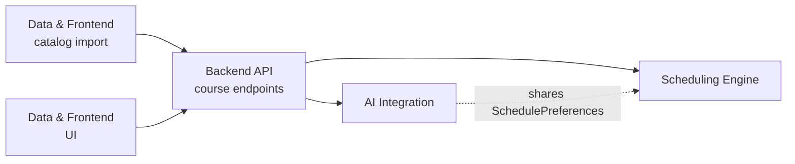

# HANDOFF.md

Live record of project progress. **Read it at the start of every session; update your module's section at the end.** Update rules are in [development-guide.md § 9](docs/development-guide.md#9-updating-handoffmd). In short: pull first, edit only your section, add a session-log line, record only real results, and never delete others' entries.

| | |
|---|---|
| **Last updated** | 2026-10-17, a Claude Code session for Michael (@04michael4): `origin/pre-main` (`d26fc6e`, with PR #7, #9 and #10 merged) merged into `integrate/catalog-promotion-on-pre-main` (PR #8); `catalog_research`, the promotion layer and the non-CSE data now come from pre-main, this PR keeps the feature-flagged demo |
| **Current milestone** | Phase 1 ✅ on `main`. Phase 2 on `pre-main`: Marpu's `common` error handling, CORS and Schedule API (validation and mapping; 503 until a production catalog and engine exist). **Michael's AI module (live-verified, eval 19/20 = 95%) is merged with the latest `pre-main` (`9cd9cdf`) on the local branch `reconcile/ai-pre-main`.** Marpu's two PR #2 review findings (`24:00` accepted as `00:00`; a model reply of `{}` accepted as complete) are fixed there with regression tests: **460/460 tests pass.** Not pushed. |
| **Next milestone** | Michael reviews `reconcile/ai-pre-main`; then PR #2 (`integrate/ai-into-pre-main` → `pre-main`) is updated and Marpu reviews it. Sunny's engine branch and David's data branch follow through their own PRs. `main` stays untouched. |
| **Latest backend acceptance** | Local draft 4969f25 and pre-main 5aa3e82 reconciled on feature/backend-course-schedule-completion-integrated. Real database/native-solver/HTTP verification: 763 tests passed, no failures/errors/skips. See [merge evidence](docs/merge-resolution.md). Earlier status summaries below are historical. |
| **Latest backend integration** | 2026-10-16 19:20 EDT: authoritative PostgreSQL/native-solver Schedule integration verified on `feature/backend-schedule-final-integration`; 702 tests and 16 standalone HTTP checks passed. Original checkout preserved. [Current report](docs/schedule-final-integration.md); older summaries below are historical. |

## Repository state

| | |
|---|---|
| `main` | `098cf09` "docs: finalize API contract and apply Lehigh credit-load policy". Phase 1 was merged via PR #1 (`76a8310`). |
| AI branch | `feature/ai-preference-extractor`, created from `098cf09`. Step 1 is in the commit "feat(ai): implement validated preference extraction with dummy provider" (run `git log` for the hash), pushed to `origin/feature/ai-preference-extractor`. Step 2 is in the commit "feat(ai): integrate Claude API and validate live extraction" on top of it, also pushed. **Not merged into `pre-main` or `main`.** |
| `pre-main` | **Shared integration branch** (team decision, 2026-10-15). At `9cd9cdf` "feat(schedule): add validated schedule API and integration boundary" (Marpu), on top of `533633d` (`common` error handling and CORS). `main` must stay untouched. |
| Integration branch | `integrate/ai-into-pre-main`, pushed, **PR #2** into `pre-main` (open). At `4abcddb`, based on `pre-main` `533633d`: the AI merge, the shared-handler fix, docs, and the minimum-credit and student-text escaping fixes (195/195 tests at `4abcddb`). |
| Reconcile branch | `reconcile/ai-pre-main` (**local only, not pushed**): `integrate/ai-into-pre-main` (`4abcddb`) plus a `--no-ff` merge of `pre-main` `9cd9cdf`, with 11 conflicts resolved. Intended to update PR #2 after review. |
| Other branches | `integrate/engine-into-pre-main` and `feature/engine-core` (Sunny's engine, not yet in `pre-main`); `feature/data-cse007-snapshot` (David's CSE 007 database fixtures, no PR); `dev-marpu`; `feature/backend-foundation` (merged) |
| Toolchain verified | OpenJDK 21.0.12 (Homebrew), Maven 3.10.0 via wrapper, Spring Boot 4.1.1, macOS |

## Latest test results

**Course/Schedule completion, 2026-10-16 18:33 EDT**, on `feature/backend-course-schedule-completion-integrated`, based on team-integrated `origin/pre-main` `b715f86`: `cd backend` then `./mvnw -B -Pdatabase-it clean verify` -> **`Tests run: 588, Failures: 0, Errors: 0, Skipped: 0`** (regular suite), **`Tests run: 40, Failures: 0, Errors: 0, Skipped: 0`** (PostgreSQL/HTTP), **BUILD SUCCESS**. Separate original-source SQL verification, `./mvnw -B -Dtest=SourceCatalogVerification test` -> **`Tests run: 3, Failures: 0, Errors: 0, Skipped: 0`**, **BUILD SUCCESS**. **631 distinct cases, all passed; no blocked/skipped tests.** A separately launched backend passed 14 Course/generation HTTP checks and 3 explanation HTTP checks. Real database and solver; official AI SDK against a local provider fake only, no paid call. [Per-class counts](docs/verification/automated-results.json), [HTTP bodies/statuses](docs/verification/course-schedule-http.json), [explanation HTTP](docs/verification/schedule-explanation-http.json).


**Review-fix run, 2026-10-16 15:10 EDT**, on the local branch `reconcile/ai-pre-main` after Marpu's two PR #2 findings were fixed, with no `ANTHROPIC_API_KEY`, `RUN_LIVE_AI`, `AI_PROVIDER` or `CATALOG_SOURCE` set, command `cd backend && ./mvnw -B clean test`: **`Tests run: 460, Failures: 0, Errors: 0, Skipped: 0`, BUILD SUCCESS (7.213 s)**. `ClaudeLiveEval` did not run; no real Anthropic call was made (a localhost fake only).

| Finding | Root cause | Fix | Tests |
|---|---|---|---|
| `24:00` accepted as `00:00` | `PreferenceAssembler` parsed times with `DateTimeFormatter.ofPattern("H:mm")`, whose default SMART resolver reads `24:00` as end-of-day and returns midnight. The single `H` also accepted `009:30`. | `ResolverStyle.STRICT` plus an explicit `H:mm`/`HH:mm` shape check; an invalid endpoint drops the preference, or the whole blocked time, with a warning | `PreferenceAssemblerTest` 22 → 104 |
| `{}` accepted as a complete reply | The SDK's typed parse turns a missing property into `null`, and `ClaudeExtraction.toRawPreferences()` turns that into an empty list | `ClaudeExtractionValidator` checks the raw JSON (`rawTextBlock().text()`) for every property and its type, derived from the record; a failure is `MALFORMED` (existing retry once, then 502) | `ClaudeExtractionValidatorTest` 24 (new), `AnthropicClaudeGatewayTest` 17 → 57, `ClaudeEndpointFakeServerIntegrationTest` 10 → 17 |

Both probes were also sent to the packaged app against a localhost stand-in for the Anthropic API (fake key): `{}` twice → 502 after exactly 2 model calls; `{}` then a valid reply → 200 after 2 calls; a partial reply or a blocked time without `end`, twice → 502 after 2 calls; a complete reply with empty course lists → 200 with the no-courses warning after 1 call; `24:00` as block start, block end, `earliestStart` and `latestEnd` → all dropped with warnings, and the one valid block is kept.

**Earlier: reconcile run, 2026-10-16 14:40 EDT**, on the local branch `reconcile/ai-pre-main` (`integrate/ai-into-pre-main` `4abcddb` merged with `pre-main` `9cd9cdf`), with no `ANTHROPIC_API_KEY`, `RUN_LIVE_AI`, `AI_PROVIDER` or `CATALOG_SOURCE` set, command `cd backend && ./mvnw -B clean test`: **`Tests run: 307, Failures: 0, Errors: 0, Skipped: 0`, BUILD SUCCESS (5.871 s).** `ClaudeLiveEval` did not run.

| Group | Tests |
|---|---|
| AI branch at `4abcddb` (all kept): AI module, `common`, health, app context | 195 |
| `pre-main` Schedule API: `ScheduleControllerTest` 86, `EngineMapperTest` 13, `SchedulingConfigurationTest` 9, `ScheduleUnavailableTest` 2 | 110 |
| **New regression tests** in `ClaudeEndpointFakeServerIntegrationTest`: a request naming no known course still returns `200` with a warning and `unresolved`; blocked-time days are de-duplicated and sorted by the AI layer | 2 |

The 195 + 158 (`pre-main`) tests overlap in 48 shared `common`/health/app tests, so the merge itself ran 305 before the 2 new tests.

**Live app check, 14:39 EDT** (packaged jar, `PORT=8093`, no API key, no database; no external calls):

| Mode | Result |
|---|---|
| Defaults (`AI_PROVIDER` none, catalog dummy) | Starts without a database. `GET /api/health` `200`. Extract `503`. Generate `503` (no `SectionCatalog`/engine registered) |
| `AI_PROVIDER=dummy` | Extract `200`, contract JSON with `"15:00"`-style times, no extra `ordered` field; unknown term `422`; generate still `503` |
| `AI_PROVIDER=claude` without a key | Extract `503` (never falls back to dummy) |
| Strict validation (generate) | `400` for weight `"3"`, `3.5`, `6`, missing or null; times `"9:00"`, `"25:00"`; start after end; empty or null days; `FUNDAY`; empty, blank or null course IDs; number as course ID; `maxCredits` 22; min above max; credits as a string; 11 optional courses. `422` for an unknown course or term |
| Strict validation (extract) | `400` for numeric `text`, blank `text` and malformed JSON |

Every error was `application/problem+json` with an `X-Request-Id` header.

### Earlier: AI integration run (before the `pre-main` Schedule API)


**Integration run, 2026-10-15 23:22 EDT**, on `integrate/ai-into-pre-main`, with no `ANTHROPIC_API_KEY`, `RUN_LIVE_AI` or `AI_PROVIDER` set, command `cd backend && ./mvnw -B clean test`: **`Tests run: 177, Failures: 0, Errors: 0, Skipped: 0`, BUILD SUCCESS (5.335 s).**

| Group | Tests |
|---|---|
| Marpu's `common`, unchanged: `GlobalExceptionHandlerTest` 21, `WebConfigTest` 20, `ConfiguredCorsTest` 3, `DisabledCorsTest` 1 | 45 |
| Shared: `HealthControllerTest` 2, `RegistrationBackendApplicationTests` 1 | 3 |
| AI module (all 109 from the feature branch kept; `PreferenceControllerTest` strengthened) | 109 |
| **New integration tests:** `PreferenceEndpointIntegrationTest` 7 (dummy 200, 400, 422, CORS allowed/blocked/errors), `PreferenceEndpointFailureIntegrationTest` 5 (429/502/502/503 + unique request IDs), `ClaudeEndpointFakeServerIntegrationTest` 8 (real Claude path vs. local fake API) | 20 |

**Before the fix** (the merge commit alone): 157 tests, **5 failures**. All were AI status checks returning 500 instead of 422/429/502/502/503, confirming the predicted handler conflict. `dependency:tree`: 0 conflicts; validation starter, `anthropic-java` 2.71.0, Jackson 3.1.5 and Jackson 2.21.5 each present once. `git diff --check` clean. No paid calls.

### Earlier: AI feature branch

**Run 2026-10-15 23:09 EDT** on `feature/ai-preference-extractor`, immediately before the step 2 commit, with no `ANTHROPIC_API_KEY`, `RUN_LIVE_AI` or `AI_PROVIDER` set, command `cd backend && ./mvnw -B clean test`:

```
Tests run: 4,  Failures: 0 -- course.CourseCatalogSelectionTest
Tests run: 2,  Failures: 0 -- health.HealthControllerTest
Tests run: 4,  Failures: 0 -- common.json.JsonConfigurationTest
Tests run: 17, Failures: 0 -- ai.AnthropicClaudeGatewayTest      (new: real SDK vs. local fake API)
Tests run: 10, Failures: 0 -- ai.AiConfigurationTest              (new)
Tests run: 9,  Failures: 0 -- ai.PreferenceControllerTest         (+2: 429, 502)
Tests run: 10, Failures: 0 -- ai.ClaudePreferenceExtractorTest    (new)
Tests run: 15, Failures: 0 -- ai.PreferenceAssemblerTest
Tests run: 4,  Failures: 0 -- ai.PreferenceExtractionServiceTest
Tests run: 14, Failures: 0 -- ai.CourseMentionResolverTest
Tests run: 22, Failures: 0 -- ai.AiEvalDatasetTest                (new: 20 eval cases + 2 checks)
Tests run: 1,  Failures: 0 -- RegistrationBackendApplicationTests
Tests run: 112, Failures: 0, Errors: 0, Skipped: 0
BUILD SUCCESS   (Total time: 4.637 s)
```

`ClaudeLiveEval` did not run. Run explicitly without the opt-in variables, it reports `Skipped: 1`, with no API call.

**Live app check, 22:26 EDT** (packaged jar, `PORT=8091`, no API key; no external calls):

| `AI_PROVIDER` | `POST /api/preferences/extract` |
|---|---|
| `claude` | `503`, and the log warns "AI_PROVIDER=claude but ANTHROPIC_API_KEY is not set". The app starts normally. |
| `dummy` | `200`, fixed example |
| `none` | `503` |

### Live Claude API verification (2026-10-15, `claude-haiku-5-5`, SDK 2.71.0, run by Michael with his own key)

**Single request, 22:50 EDT** (`AI_PROVIDER=claude`, app bound to 127.0.0.1:8091):
- Models API: HTTP 200, `claude-haiku-5-5` active, with structured outputs and effort `low` supported.
- Extraction: **HTTP 200, 16/16 checks**.
  - Courses `CSE-017`, `MATH-021`.
  - Hard blocked time Tue/Thu 15:00–18:00.
  - Soft `earliestStart` 10:00, weight 3.
  - Default credits 12–18, with warnings.
- 3.89 s (first request after startup), 1 Claude call, 3,542 input / 197 output tokens, about $0.00045.

**20-case evaluation, 23:01 EDT** (`ClaudeLiveEval`): **19/20 = 95%** (threshold 80%).
- 20 Claude responses, all `end_turn`: 0 re-asks, 0 refusals, 0 provider errors.
- 70,713 input / 3,787 output tokens: **about $0.009 in total**.
- 32.2 s overall, about 1.6 s per case (median 1.33 s, max 3.67 s for the long request).
- **Failed: `vague-time`.** "I'm not a morning person. CSE 140 and ECO 1." Courses and blocked times were correct, but no `earliestStart` was produced. This is model behavior: the prompt lists that phrase as an example, but also says not to invent times. A soft preference was omitted; nothing was invented. The expectation was left as it is.
- **Serious errors: none observed.**
  - 0 invented required courses (all 20 cases check an exact set).
  - All 4 blocked-time cases exact, and 6 cases correctly had none.
  - All times exact.
  - Credit cap and overload rules correct.
  - Both prompt-injection attempts resisted in the final output.

**Known limits of this verification:**
- One run only, so variation between runs is unmeasured.
- `ClaudeLiveEval` saves only failure reasons, not full responses.
- About 12 cases don't check for invented soft preferences (`absentSoft`).
- For the injection cases, "ignored by the model" and "set aside by Java as unresolved" look the same.
- Dummy catalog only.
- Costs use Haiku 5.5's list price ($0.10 / $0.50 per MTok, per the 2026-10-06 reference).

Results and logs were saved outside the repo, and no API key appears in them (checked).

### Earlier: Step 1 commit

**Run 2026-10-15 22:00 EDT** on `feature/ai-preference-extractor`, immediately before the step 1 commit, command `cd backend && ./mvnw -B clean test`:

```
Tests run: 4,  Failures: 0 -- course.CourseCatalogSelectionTest
Tests run: 2,  Failures: 0 -- health.HealthControllerTest
Tests run: 4,  Failures: 0 -- common.json.JsonConfigurationTest
Tests run: 7,  Failures: 0 -- ai.PreferenceControllerTest
Tests run: 15, Failures: 0 -- ai.PreferenceAssemblerTest
Tests run: 4,  Failures: 0 -- ai.PreferenceExtractionServiceTest
Tests run: 14, Failures: 0 -- ai.CourseMentionResolverTest
Tests run: 1,  Failures: 0 -- RegistrationBackendApplicationTests
Tests run: 51, Failures: 0, Errors: 0, Skipped: 0
BUILD SUCCESS   (Total time: 3.131 s)
```

**Live check, 21:57 EDT, same code** (packaged jar on `localhost:8080`):

| Case | Result |
|---|---|
| `AI_PROVIDER=dummy`: `POST /api/preferences/extract` | `200`, contract JSON with times as `"15:00"` |
| `AI_PROVIDER=none`: `POST /api/preferences/extract` | `503` |
| No env vars set (defaults: `none`, catalog `dummy`) | `503`; the app starts without a database |
| `CATALOG_SOURCE=database` (no database catalog exists yet) | Startup fails as intended: "required a bean of type 'CourseCatalog' that could not be found", and the process exits |
| `GET /api/health` | `200` |

Earlier the same evening (21:40, before the catalog change): unknown term → `422`, blank text → `400`.

**Checks:** `git diff --check` clean. No credentials or secret patterns in any of the 39 changed or new files. No `.env` files or build artifacts.

### Earlier: Phase 1 baseline

**Run 2026-10-15 16:45 EDT** (just before the Phase 1 commit), command `cd backend && ./mvnw -B clean test`:

```
Tests run: 2, Failures: 0, Errors: 0, Skipped: 0 -- in io.github.michael04.registration.health.HealthControllerTest
Tests run: 1, Failures: 0, Errors: 0, Skipped: 0 -- in io.github.michael04.registration.RegistrationBackendApplicationTests
Tests run: 3, Failures: 0, Errors: 0, Skipped: 0
BUILD SUCCESS   (Total time: 2.655 s)
```

**Manual verification, same session:** `./mvnw spring-boot:run` started in 0.489 s. Then:
```
$ curl -i http://localhost:8080/api/health
HTTP/1.1 200
Content-Type: application/json
{"status":"UP","service":"registration-backend"}
```
Also observed earlier the same day: an unknown path returns `404` and `POST /api/health` returns `405`, both with Spring Boot's default error JSON.

## Known bugs and blockers

| # | Item | Type | Owner | Status |
|---|---|---|---|---|
| 1 | ~~Module owners not yet assigned~~ | Blocker (coordination) | Team | Resolved 2026-10-15 (Michael AI, David Frontend & Database, Marpu Backend API, Sunny Scheduling Engine) |
| 2 | **Lehigh course data source not chosen.** Blocks real course search and scheduling. | Blocker | Data (_TBD_) | Open |
| 3 | ~~Phase 1 is committed and pushed on `feature/backend-foundation` but not merged to `main`~~ | Process | @04michael4 | Resolved 2026-10-15 (PR #1, `76a8310`) |
| 4 | No CI; tests run only locally | Gap | _TBD_ | Open |
| 5 | Mockito prints JDK "dynamic agent loading" warnings during tests | Cosmetic | — | Accepted (harmless) |

No known functional bugs.

## Important decisions

| Date | Decision | Where |
|---|---|---|
| 2026-10-15 | Java 21 + Spring Boot instead of Python + FastAPI | [ADR-0001](docs/decisions/0001-java-spring-boot-over-python-fastapi.md) |
| 2026-10-15 | Spring Boot 4.1.1 pinned; Maven Wrapper; minimal dependencies; hand-written health endpoint; package by feature | [architecture.md § 15](docs/architecture.md#15-phase-1-decisions-implemented) |
| 2026-10-15 | The AI proposes and explains; the deterministic engine alone decides validity | [architecture.md § 1](docs/architecture.md#1-system-overview) |
| 2026-10-15 | Base package `io.github.michael04.registration` (independent project) | [CLAUDE.md](CLAUDE.md) |
| 2026-10-15 | **Team-agreed** API contract: course search, preference extraction and schedule generation shapes, formats (`"FRIDAY"`, `"15:00"`, `"CSE-017"`), weights 0–5. Agreed, not yet implemented. |
| 2026-10-15 | **Credit limits** follow Lehigh's overload policy: hard cap 21 credits (team rule), default 12–18, normal load 17 (first semester) / 18, schedules over 18 flagged `overload: true` | [api-contract.md § Credit limits](docs/api-contract.md#credit-limits) | [api-contract.md](docs/api-contract.md) |
| 2026-10-15 | **Team-agreed** four-module split and owners: Michael (AI), David (Frontend & DB), Marpu (Backend), Sunny (Engine) | [README § Team](README.md#team-and-responsibilities) |

## Module ownership and dependencies



| Module | Owner | Depends on | Depended on by |
|---|---|---|---|
| Backend API | _TBD_ (Phase 1: @04michael4) | — | everyone |
| Scheduling Engine | _TBD_ | Backend API (course data), `SchedulePreferences` contract | Frontend |
| AI Integration | _TBD_ | Backend API (course ID validation), `SchedulePreferences` contract | Frontend |
| Data and Frontend | _TBD_ | Backend API (endpoints), data source decision | — |

The engine **logic** can be built and unit-tested now, before the database or catalog exist, using hand-made test data.

---

## Backend API

**Owner:** Marpu (per README; Phase 1 foundation: @04michael4). **Status:** Local merge conflicts resolved against pre-main 5aa3e82; authoritative persistence/native engine and local metadata/terms/explanation features verified together. Merge commit pending.

**Merge resolution - 2026-10-16 20:34 EDT (Codex)**

- User requested fixing the conflicts from their pull. Reconciled 14 paths; kept incoming manual/elective functionality and authoritative Hikari/JDBC/views/native solver, while preserving local terms, metadata and explanation behavior. Old independent datasource/support types moved to test-only sources; no Data schema or engine algorithm changes. Both complete session histories retained.
- `cd backend` then `./mvnw -B -Pdatabase-it clean verify`: **Tests run: 715, Failures: 0, Errors: 0, Skipped: 0** and **Tests run: 45, Failures: 0, Errors: 0, Skipped: 0**, **BUILD SUCCESS**. Separate `./mvnw -B -Dtest=SourceCatalogVerification test`: **Tests run: 3, Failures: 0, Errors: 0, Skipped: 0**, **BUILD SUCCESS**. Total **763 distinct passed**, real PostgreSQL/HTTP/native solver, local external-AI fake only.
- First attempt exposed three obsolete provider-free-context test assumptions; adapted them to production database-outage behavior and reran successfully. No disabled tests. See [resolution, configuration and evidence](docs/merge-resolution.md). All resolutions staged, no new commit/push; main/pre-main and backup stashes untouched.


**Authorized pre-main push check - 2026-10-16 19:42 EDT**

- User explicitly authorized committing/pushing the final Schedule integration directly to pre-main. This supersedes the repository's default PR-only workflow for this action; main remains untouched.
- Fresh fetch confirmed origin/pre-main still equals the integration base 4fb4ff2b97dbab2323532aa342b97a1a13c402c7, with HEAD...origin/pre-main counts 0/0. No upstream merge or conflict resolution is required; prepared a normal fast-forward push (never force).
- Pre-push `cd backend` then `./mvnw -B test`: **Tests run: 683, Failures: 0, Errors: 0, Skipped: 10**, **BUILD SUCCESS** (2026-10-16 19:41 EDT). The ten opt-in DB cases were intentionally not enabled for this DB-free recheck; the previous full run of 702 tests including all DB/integration cases passed with zero skips, and 16 standalone HTTP checks passed. No code changes since that full verification beyond comments/XML formatting/documentation.
- Diff whitespace/conflict-marker checks passed; no credential/private-key patterns found in the integration files. Original checkout's prior uncommitted work remains untouched in its separate worktree. Actual remote push confirmation is reported after the push completes.


**Final Schedule integration - 2026-10-16 19:20 EDT (Codex)**

- Branch `feature/backend-schedule-final-integration`, based on approved `origin/pre-main` `4fb4ff2b97dbab2323532aa342b97a1a13c402c7`, in linked worktree `C:/Users/puram/AppData/Local/Temp/smartcourse-schedule-final-integration`. Fetched references and confirmed no local pre-main. Original checkout's uncommitted/staged/new work preserved without stash/reset/discard. No merge, cherry-pick, commit, push or PR; main/pre-main untouched.
- Reused the actual pre-main `CatalogDatabaseConfiguration`/Hikari datasource, `JdbcCatalogDao`, `JdbcCourseCatalog`, `JdbcSectionCatalog`, `CatalogProperties`, `TermMapping`, Data schema/catalog_api views, `NativeSchedulingEngine`, existing controller/service/mapper and native solver. Production persistence/engine algorithm/scoring files are unchanged. No new datasource, repository, schema model, engine or production dependency.
- Removed obsolete hardcoded Course/Section catalogs from production by moving `DummyCourseCatalog` and `DummySectionCatalog` into src/test, preserving fixtures and all existing regressions. Maven test profile selects those fixtures; packaged application defaults to database and contains neither fixture nor test profile. Missing DB settings fail startup; unreachable DB returns safe 503 without fallback. Kept valid DAO/solver mocks and the unrelated explicitly selected AI dummy provider.
- Applied explicit task requirements: ten original optional entries (11 returns 400 before lookups/solve), configured API default node cap 200000. The native class default remains 1M; generation always passes API config. Shared setting/contract changes documented; consuming Backend/Data/frontend/AI/engine owners should review when a PR is authorized. Other response fields/manual/elective behavior preserved.
- Final `cd backend` then `./mvnw -B -Pdatabase-it clean verify`, with isolated PostgreSQL and RUN_DB_IT=true: **Tests run: 683, Failures: 0, Errors: 0, Skipped: 0** (regular, including 10 existing real DB tests); **Tests run: 19, Failures: 0, Errors: 0, Skipped: 0** (new integration/packaging); **BUILD SUCCESS**. Total **702 passed**, no failures/errors/skips/blocked cases. Baseline was 683 with ten opt-in skips; all were enabled in the final run.
- New primary tests execute actual random-port HTTP -> authoritative Hikari/JDBC/catalog_api -> real native solver. Source-only case uses unchanged Data SQL/views and returns both CSE 007 lecture/lab choices. Synthetic rows use the same schema; only the isolated availability test view overlays explicit statuses because source status is truthfully UNKNOWN. Verified closed lectures/labs, links, multiple meetings, TBA/async empty meetings, conflicts, optional/required normalization, exact native score/breakdown/order cross-check, overload at 18/19/21 and real cap 1 flag.
- Standalone `./mvnw -B spring-boot:run` in production default DB mode (no test profile or AI key), loopback port 65311: `python scripts/verify_schedule_integration.py http://127.0.0.1:65311 ../docs/verification/schedule-final-http.json` -> **14 passed, 0 failed**. Then stopping only the task-owned test PostgreSQL process gave valid generation **503** and health **200**, both verified: **16 standalone HTTP checks passed**. Real persisted pair 12275/13132, credits 4, score 100, overload false. App/DB services stopped afterward; test databases retained, nothing dropped.
- Failure resolved: first fixture loader sent psql client directives through JDBC. It now separates client directives and executes all original SQL verification assertions; failing tests reran successfully without weakened assertions or production SQL changes. Existing recording-engine DB test explicitly marks its double Primary to avoid ambiguous DI beside the real adapter; production has one adapter and primary real-pipeline tests use no doubles. A process command-line cleanup guard could not inspect Maven's argument-file launch, so verified listener/PID 25292 was stopped explicitly; no unrelated process touched.
- Remaining boundaries: authoritative source coverage is CSE 007, historical seats UNKNOWN, readiness excludes uncertified/fractional credits; broader catalog discovery/standalone-status/eligibility/deployment remain Data/API decisions. Original richer Course/AI-explanation draft stays intact in the original checkout and is not imported here. No integration acceptance item is blocked for generate.
- [Full report and cleanup inventory](docs/schedule-final-integration.md), [automated evidence](docs/verification/schedule-final-automated.json), [HTTP requests/responses](docs/verification/schedule-final-http.json), [DB-outage evidence](docs/verification/schedule-database-unavailable-http.json).


**Historical integration status (retained):** · **Status:** ✅ Final Schedule integration verified with authoritative PostgreSQL/native solver/HTTP on `feature/backend-schedule-final-integration`; uncommitted. Earlier dated entries below preserve the implementation/review history.

**Completed**
- 2026-10-15: Spring Boot 4.1.1 / Java 21 project from Spring Initializr in `backend/`, with Maven Wrapper (Maven 3.10.0).
- 2026-10-15: `GET /api/health` → `{"status":"UP","service":"registration-backend"}` (`health` package).
- 2026-10-15: Tests: `HealthControllerTest` (2 × `@WebMvcTest`) and a context-load test. All passing; see [Latest test results](#latest-test-results).
- 2026-10-15: Root `.gitignore` (ignores `.env`/`.env.*`, keeps `.env.example`; verified with `git check-ignore`), `.env.example`, docs.
- 2026-10-15: Codex implemented `common`: centralized RFC 9457 Problem Details, sorted validation errors, safe application exceptions, request IDs, servlet fallback, and exact-origin CORS. Added `spring-boot-starter-validation` for Bean Validation and documented the error-contract change and `CORS_ALLOWED_ORIGINS`. Production changes stay within `common`, `pom.xml`, and `application.properties`; other modules are untouched.
- 2026-10-15: Codex implemented the Schedule API layer: `POST /api/schedules/generate`, nested/cross-field validation, original-list optional limit (10), stable required/optional normalization, term/status section filtering, component/link/time mapping, unchanged score/breakdown and result ordering, actual-credit overload flag, and validated `scheduling.node-cap`. No solver algorithm or production sample results were added. Reuses the existing global advice; no duplicate exception handler.

**Verification — 2026-10-15 22:01 EDT**
- Phase 0: read `docs/development-guide.md`, `AGENTS.md`, `CLAUDE.md`, and this handoff in order; `PLANS.md` is absent. Fetched `origin`, confirmed a clean tree, checked that the task branch did not exist, then created and verified `feature/backend-common` from `origin/main` at `098cf092d49379ec32c634bd6e6c1432229fd7bc`. Local `main` matched `origin/main`, so no merge was needed. Git metadata writes required sandbox approval. No commit, push, or PR was made.
- Baseline: `./mvnw -B test` via Git Bash and JDK 21 → `Tests run: 3, Failures: 0, Errors: 0, Skipped: 0`; `BUILD SUCCESS`.
- Final command from `backend/`, in PowerShell: `$env:JAVA_HOME='C:\Program Files\Java\jdk-21'; & 'C:\Program Files\Git\bin\bash.exe' ./mvnw -B test` → `Tests run: 48, Failures: 0, Errors: 0, Skipped: 0`; `BUILD SUCCESS` (2026-10-15 21:59 EDT). Tests cover nested/body/parameter validation, malformed JSON, missing input, 404/405/406/415/422/429/500/502/503, safe errors, request IDs, default/custom/disabled CORS, and rejected origins/methods/headers. They need no DB, AI service, or secrets.
- Live: `./mvnw -B spring-boot:run '-Dspring-boot.run.arguments=--server.port=0'`, using the same JDK/Git Bash setup, started on port 58982. `curl.exe -i` verified health GET/HEAD 200; unknown route 404; POST health 405 with `Allow: GET`; XML Accept 406; allowed JSON POST preflight 200; untrusted origin 403; allowed-origin headers on a 404; `/error` fallback 500 even with HTML Accept. Error bodies are `application/problem+json`, include `type: about:blank`, and match `requestId` to `X-Request-Id`; query strings are omitted.
- Initial feature test run: `Tests run: 48, Failures: 22, Errors: 0, Skipped: 0` because Spring leaves the problem type unset by default. Resolved by setting `about:blank` explicitly in the shared renderer; all final tests pass.
- **Environment issue:** Windows `mvnw.cmd` fails before Maven starts with `Cannot index into a null array`; the Unix wrapper via Git Bash works. The wrapper files were left unchanged, and README documents the workaround. Existing Mockito dynamic-agent notices remain.
- **Documentation discrepancy:** the repository-state/ownership summaries above and some older design notes are stale. Git shows the foundation merged in `76a8310`; README assigns owners. This entry records the discrepancy without replacing other modules' history. The user explicitly assigned CORS; it is implemented while preserving the frontend's option to use a same-origin proxy.
- **Review note:** error JSON and CORS configuration are shared interfaces. Frontend/AI/backend consumers should review the documented contract when a PR is authorized. The API endpoints for course search, scheduling, and AI remain planned.
- **Pre-push recheck — 2026-10-15 22:26 EDT:** the same `./mvnw -B test` command via Git Bash/JDK 21 returned `Tests run: 48, Failures: 0, Errors: 0, Skipped: 0` and `BUILD SUCCESS`. `git diff --check` is clean. Target: `origin/pre-main`, explicitly requested by the user.

**In progress**
- 2026-10-16 initial claim (resolved by the acceptance entry below): Codex began Course/Schedule completion on new `feature/backend-course-schedule-completion`, created from freshly fetched `origin/pre-main` (`7ca189e`) before edits. Baseline `./mvnw -B test`: `Tests run: 460, Failures: 0, Errors: 0, Skipped: 0`; `BUILD SUCCESS`. Course endpoints and persistence are missing; Schedule API validation/mapping are present. Engine implementation is on `origin/integrate/engine-into-pre-main` (`a31a4fe`); David's schema/fixtures are on `origin/feature/data-cse007-snapshot` (`ee07e18`). Requested explicit authorization to integrate those branches; independent Course API work proceeds meanwhile. Docker daemon and local PostgreSQL are unavailable on this host; investigating an isolated native PostgreSQL test instance. This task explicitly retains ten optional courses and a 200,000-node API default. No commit/push/PR authorized.

- Completed claim: see final integration acceptance above. Codex: final Schedule API consolidation on `feature/backend-schedule-final-integration` from approved `origin/pre-main` `4fb4ff2`, in an isolated linked worktree. Original uncommitted work is untouched. Reuse authoritative JDBC/catalog_api and native solver; move demo catalogs to test sources; verify real HTTP/DB/solver and explicit 10-optionals/200000 defaults. No merge, stash, commit, push or PR.
- Common implementation and the authorized push are complete: `origin/pre-main` contains `533633d`.
- 2026-10-15 23:18 EDT: Codex claims Schedule API on `feature/backend-schedule`, created and verified from freshly fetched `origin/pre-main` (`533633d`), following the user's testing-branch direction. Clean tree verified before edits; baseline `./mvnw -B test` via Git Bash/JDK 21: `Tests run: 48, Failures: 0, Errors: 0, Skipped: 0`, `BUILD SUCCESS`.
- Integration gap: no engine implementation or section catalog exists in the fetched repository. Section 7 describes a planned algorithm; README examples lack final scores, total credits, and component links. Preparing the API boundary and tests without implementing or fabricating a solver. Shared preference types will retain the shapes already introduced on `origin/feature/ai-preference-extractor`; consuming owners must review the integration boundary.

**Schedule API verification — 2026-10-15 23:51 EDT**
- Branch: `feature/backend-schedule`, base `origin/pre-main` at `533633dedc6ac885903f1a6853d7ed5db953c6fc`. Fetched origin, read the required guides/contracts, checked existing branches and the clean worktree, then created/switched/verified the task branch before edits. `PLANS.md` is absent. The user's prior testing-branch instruction takes precedence over the guide's default `main` integration workflow. No commit, push, merge or PR for this task.
- Final command from `backend/`: `$env:JAVA_HOME='C:\Program Files\Java\jdk-21'; & 'C:\Program Files\Git\bin\bash.exe' ./mvnw -B verify` → **`Tests run: 158, Failures: 0, Errors: 0, Skipped: 0`**, **`BUILD SUCCESS`**, 2026-10-15 23:49 EDT. Includes all 48 existing tests and 110 new tests: 86 controller/service tests, 13 mapper tests, 9 configuration tests and 2 full-context unavailable-integration tests. Executable JAR packaging succeeded. Tests use synthetic fixtures/mocked solver; no DB or live AI calls.
- Tests cover every required range/boundary, invalid requests never reaching catalog/engine, 10/11 optional entries (including duplicates/overlaps), all five weights, strict JSON types and times, required/optional deduplication, closed lectures/labs/recitations, UNKNOWN status, term filtering, component/link preservation, TBA/online empty meetings, stable preparation, score precision/order, overload at 18/19/21, normal empty results, 422/500/503 errors, cap defaults/custom values and invalid startup config.
- Live: `./mvnw -B spring-boot:run '-Dspring-boot.run.arguments=--server.port=0'` via Git Bash/JDK 21 started on port 54069. `curl.exe -i` verified health 200; empty required list 400 with nested field errors; 11 overlapping optional entries at weight 0 still 400; valid scheduling request 503 because production adapters are absent. Error bodies use the shared Problem Details format and matching request IDs; allowed-origin CORS headers present on 503. Server stopped gracefully after checks. A live successful schedule cannot be verified until the native engine and catalog exist.
- Failures found and resolved: initial 146-test run had one test-only 503 wording mismatch; expanded tests caught Jackson's numeric/boolean-to-string coercion (2 failures in an 85-test targeted run), then lenient `24:00` normalization (1 failure in a 156-test full run). Strict coercion/time settings fixed both parsing defects. Subsequent targeted 86-test run and final 158-test build passed. Mockito's existing dynamic-agent warning and Windows wrapper workaround remain unchanged.
- Files created: `schedule/{ScheduleController,ScheduleService,EngineMapper,GenerateScheduleRequest,GenerateScheduleResponse,ScheduleRequestValidator,ValidScheduleRequest,SchedulingProperties,SchedulingConfiguration}.java`, `schedule/integration/SchedulingEngine.java`; `course/{CourseCatalog,CourseSummary,SectionCatalog,CatalogSection}.java`; `common/json/JsonConfiguration.java`; `common/preferences/{SchedulePreferences,HardConstraints,SoftPreferences,Weighted,GapsPreference,TimeBlock,CreditLimits,Weights}.java`; four `schedule` test classes (`ScheduleControllerTest`, `EngineMapperTest`, `SchedulingConfigurationTest`, `ScheduleUnavailableTest`). Modified: `application.properties`, `.env.example`, README, this handoff, `docs/api-contract.md`, `docs/architecture.md`. No build dependencies, engine algorithm, AI implementation, frontend, or persistence files changed.
- Shared-interface notes: preference/catalog Java shapes were taken from AI branch `c6c7121`, without merging its implementation. Request validation/JSON parsing are stricter. Schedule credit bounds remain the fixed 1–21 public contract, centralized in shared `CreditLimits`; the old contract's request to configure those numbers has been clarified. Reversed credit bounds now return 400 as explicitly required by this task (old contract said 422). Frontend/AI/engine/data owners should review these shared changes when integration is authorized.
- Remaining work: obtain Sunny's actual native solver interface and finalized scoring/component-link rules; implement its `SchedulingEngine` adapter, supply `CourseCatalog`/`SectionCatalog` implementations, then run real-engine/catalog end-to-end tests. The provisional adapter boundary preserves metadata as supplied but cannot prove compatibility with an unavailable engine schema. Full Schedule API Definition of Done is **not yet met**; API-layer checks pass. No user answer identifying another engine location was received during this session.

**Pre-push recheck — 2026-10-16 11:34 EDT**
- User authorized committing all pending changes and pushing to `pre-main`. Fetched `origin/pre-main`; it matches the feature branch base (`533633d`), allowing a normal fast-forward push.
- `./mvnw -B test` via Git Bash/JDK 21: `Tests run: 158, Failures: 0, Errors: 0, Skipped: 0`; `BUILD SUCCESS`. Initial sandbox attempt could not create `C:\.m2\repository`; the approved run outside the sandbox used the existing user cache and passed. `git diff --check` is clean. Production engine/catalog adapters remain pending as documented above.

**Integration review — 2026-10-16**
- Read the fetched engine integration changes at `origin/integrate/engine-into-pre-main` (`9a35770`) without merging them into this branch. That branch already sets a 1,000,000 node-cap default and an eight-entry optional-course limit; `origin/pre-main` remains at `9cd9cdf` with 200,000 and ten.
- Review concern: `NativeSchedulingEngine.parentCrn` converts blank/self-referencing lecture links to null, turning malformed linked sections into standalone sections. Prefer rejecting those values under the documented lecture-CRN-or-null contract; the native `SectionOption` already rejects them. No adapter change made on this branch, where the adapter is absent.
- Updated `ScheduleUnavailableTest`'s comment to describe unavailable integrations without asserting that the solver is absent. Comment/docs only; tests were not rerun. Production catalogs remain pending; earliest-start remains a soft preference in the API contract. No merge, commit or push performed in this review.

**PR #2 review — 2026-10-16 (head `9183a29`)**
- Reviewed the current AI integration against `pre-main` (`9cd9cdf`), including the reconciliation of shared validation/JSON/catalog files. Used an isolated archive under the system temporary directory, preserving the current checkout and its existing edits.
- Existing suite, `./mvnw -B test` via Git Bash/JDK 21: `Tests run: 307, Failures: 0, Errors: 0, Skipped: 0`; `BUILD SUCCESS`. No paid AI calls; gateway tests used local fakes.
- P2: `PreferenceAssembler.parseTime` uses SMART time resolution, so model output `24:00` silently becomes `00:00`. Reproduced a Monday block `24:00`–`10:00` becoming `00:00`–`10:00`, plus an earliest-start preference of midnight, with no warnings. Use strict resolution and add regression coverage.
- P2: `AnthropicClaudeGateway.interpret` accepts a parsed but schema-incomplete `{}` as COMPLETE. Required list fields become null, and `ClaudeExtraction.toRawPreferences` substitutes empty lists, bypassing malformed-output retry/failure handling. Validate required output fields before marking the reply complete; test missing required fields separately from explicit empty lists/null optional values.
- Two temporary regression probes in the isolated copy: `Tests run: 2, Failures: 2, Errors: 0, Skipped: 0`; `BUILD FAILURE`, confirming both findings. Recommendation: request these fixes before merging. No application source change, merge, commit, push or GitHub review submission in this review.

**PR #2 follow-up review — 2026-10-16 (head `4b288b7`)**
- Reviewed the fix commit against previously reviewed `9183a29`, using another isolated temporary archive. Both prior P2 findings are resolved: strict time resolution plus an ASCII time-shape check reject `24:00` with warnings; raw JSON presence/type validation rejects incomplete replies before the SDK's typed conversion. Required-property checks cover nested blocked times and preserve explicit null optional fields and legitimate empty lists. Retry-once/502 behavior is exercised through local fake-server integration tests.
- PR suite, `./mvnw -B clean test` via Git Bash/JDK 21: `Tests run: 460, Failures: 0, Errors: 0, Skipped: 0`; `BUILD SUCCESS` (27.014 s). Re-ran the exact two probes from the initial review, copied only into the isolated temporary tree: `Tests run: 2, Failures: 0, Errors: 0, Skipped: 0`; `BUILD SUCCESS` (9.413 s). No paid AI calls.
- `git diff --check` on the fix commit is clean. Confirmed GitHub's current PR head still matches `4b288b7`. No new blocking findings; recommend approval of this revision. This supersedes the prior request-changes recommendation above. Production catalog integration remains separate work. No GitHub review submission, merge, commit or push; only this local handoff record updated.

**PR #3 update — 2026-10-16 15:29 EDT**
- User explicitly requested pushing these local changes into PR #3. Its head is `pre-main` and its base is `main`. Fetched head `fef4857` (which includes the merged PR #2 fixes), created `feature/backend-pr3-review-notes` from it, and carried over the review notes and test-comment correction while preserving the newer AI handoff entries. Original local edits are retained in the `PR3 local review notes backup` stash. An initial patch check found moved handoff context; transferred the same additions at their current section locations.
- Pre-push command, `./mvnw -B -Dtest=ScheduleUnavailableTest test` via Git Bash/JDK 21: `Tests run: 2, Failures: 0, Errors: 0, Skipped: 0`; `BUILD SUCCESS` (11.142 s). Comment/documentation changes only. Prepared a normal fast-forward push to the existing PR head using `HEAD:refs/heads/pre-main`, under the user's explicit instruction. No promotion or merge into `main` is part of this update.

**Next recommended**
1. ~~Review Phase 1, then open a PR from `feature/backend-foundation` into `main` and merge it.~~ Resolved 2026-10-15: Git records the merge as `76a8310`.
2. Add GitHub Actions CI running `./mvnw test` on PRs.
3. ~~`common`: global error handling with RFC 9457 Problem Details, plus `spring-boot-starter-validation`. This is a contract change, so update [api-contract.md](docs/api-contract.md).~~ Implemented and verified 2026-10-15 on `feature/backend-common`; test on `pre-main` and review the contract before promotion to `main`.
4. Persistence phase: PostgreSQL, a migration tool and the `course` package, once the data source is decided.

**Local draft commit - 2026-10-16 20:02 EDT**

- User authorized committing all remaining workspace changes. Preserve this earlier draft on `feature/backend-course-schedule-completion-integrated`; no merge or push is part of this step. The final integration worktree is clean at `5aa3e82`, already pushed to `pre-main`; the backup stashes remain intact.
- Fresh pre-commit `cd backend` then `./mvnw -B test` via Git Bash/JDK 21: **588 tests, zero failures/errors/skips, BUILD SUCCESS**. Database and standalone HTTP verification below are the earlier executed results, not rerun by this commit-only task.

**Course/Schedule acceptance - 2026-10-16 18:33 EDT (historical checkpoint)**

- Branch safety: read all required instructions/docs before edits; initial clean branch from `pre-main` `7ca189e`. While work proceeded, the team merged PR #4 into `pre-main` `b715f86`. Preserved task edits in a backup stash, created new `feature/backend-course-schedule-completion-integrated` from that integrated base and applied the task edits, preserving both sides of README/contract documentation. Original feature branch and backup stash retained. No teammate merge/cherry-pick, commit, push or PR by this task; `main` untouched. Mixed staged/unstaged/new files remain for review, no unresolved conflicts.
- Added exact documented Course routes (`/api/terms`, `/api/courses`, `/api/courses/{courseId}`), request validation, service/DTOs and one opt-in authoritative database provider. `CatalogPersistenceConfiguration` and `CatalogRepository` use Spring JDBC/PostgreSQL with enforced read-only transactions; no existing JPA implementation was present, and no ORM DDL or production seed writes were added. Queries preserve metadata/nulls, literal search, stable paging, meeting groups, section status and lecture links. The dependency additions are required by these repository classes.
- Connected the same database catalog to the existing Schedule API and native solver already present in the base. Closed component bundles, normal zero-result responses, preference mapping, exact score/breakdown/order pass-through, overload at 18/19/21 and configured cap propagation are exercised with the real solver. Native algorithm/scoring files remain unchanged.
- Per the user's explicit completion requirements, API optional limit is **10 original entries**, cap default **200000**; this supersedes integrated eight/1M API settings. The engine's own class default remains unchanged and is overridden by the configured API value. Shared contract/config updates are in README, .env.example, api-contract and architecture; frontend, Data, AI and engine consumers should review when a PR is authorized.
- Implemented the already documented `/api/schedules/explain` route in `ai/` because the task requires every Schedule endpoint. It reloads DB sections, validates preferences and delegates selection feasibility/scoring to native `SelectionChecker`, then sends only catalog/engine facts to the official SDK. Invalid selections never call AI. Output validation, refusal/retry and safe upstream errors are tested against local provider fixtures. No engine/schedule dependency on AI, fabricated production explanation or paid call.
- Verification: final clean suite **588 regular + 40 database HTTP tests**, then **3 original-source schema tests**, all zero failures/errors/skips and BUILD SUCCESS. Source SQL was exported read-only from Data's existing `ee07e18` snapshot into TEMP and tested in an isolated schema, without importing or merging that branch. Both real source lecture/lab pairs generate; earliestStart remains soft, blockedTimes hard. Database tests create/drop only validated schemas inside a loopback course_schedule_test database.
- Standalone app: `./mvnw -B spring-boot:run` with database fixture mode and loopback binding on port **54382**. `python scripts/verify_course_schedule.py http://127.0.0.1:54382 ../docs/verification/course-schedule-http.json` -> **14 passed, 0 failed**. Three extra actual explanation requests -> **200/422/400**, all as expected, using a local provider fixture. Real persisted CRNs 12275/13132, total 4, score 100, overload false. No production DB or external AI service used.
- Resolved failures: the first app probe on the old base returned six scheduling 503s; the integrated solver base resolved those without a teammate merge. Fixed Request.method in the Python harness. Temporary native PostgreSQL shared timezone files and plpgsql library were missing during later verification attempts; restored them from the checksum-verified archive and reran the failing checks successfully. No failures were suppressed and no tests disabled. Docker daemon was unavailable; isolated native PostgreSQL 17.6 was used instead.
- Remaining limits: production schema/data provisioning and full-university/current-seat content belong to Data/deployment; app startup never seeds. Prerequisite JSON/assessment states are preserved internally, but student eligibility and public prerequisite fields are outside the MVP contract. Fractional/unknown scheduling credits, multiple lecture parents and unsupported component cardinalities cannot be represented by the existing native boundary and return safe internal errors instead of being rounded/guessed; extending that contract needs Data/engine review. Paid-provider explanation quality, frontend and deployment were not tested. Temporary app/provider/database services are stopped after verification.
- Full changed-file inventory, commands, acceptance behavior and actual request/response bodies: [Course/Schedule verification](docs/course-schedule-verification.md). No commit/push/PR authorized or performed.

**Blockers:** none for the locally verified documented Course/Schedule MVP. Production deployment/data coverage and extensions to the native credit/component model remain separate work; limits above are explicit.


---

## Scheduling Engine

**Owner:** Sunny (per the [README team table](README.md#team-and-responsibilities)) · **Status:** 🟡 Solver implemented and unit-tested, and integrated into `/api/schedules/generate` on `integrate/engine-into-pre-main` (PR into `pre-main` pending review). The live endpoint still returns 503 until a production catalog exists.

**Scope:** `engine/` only. Per the team-agreed README work plan, the `schedule/` package and `POST /api/schedules/generate` belong to the Backend API module (Marpu). See the discrepancy note below.

**Completed**
- 2026-10-15: Engine input/output records and the `ScheduleSolver` interface: `Meeting`, `SectionOption`, `CourseOption`, `Constraints`, `SoftWeights`, `ScheduleProblem`, `ScoredSchedule`, `ScheduleResult`. Compact constructors validate the input and copy collections defensively. Committed as `d37eec8` (not pushed).
- 2026-10-15: **Linked sections** (owner decision): one lecture may allow several labs or recitations, and a lecture with linked sections must be taken with exactly one per component type (`SectionOption.component` + `parentCrn`).
- 2026-10-15: **Infeasible input** (owner decision): return diagnostics plus "make X optional" suggestions. No contract change.
- 2026-10-15: **`BacktrackingScheduleSolver`**. It expands lectures into lecture+lab bundles and pre-filters them, then searches with a conflict table, fewest-options-first ordering, credit pruning and branch-and-bound. It also has a deterministic node cap (default 1,000,000), top-K, diagnostics and suggestions. Supporting pieces:
  - `ScheduleScorer`: the scoring formula, using exact integer arithmetic;
  - `Bundle` (package-private);
  - `Meeting.overlaps`;
  - `CourseOption.excluding`, which removes closed sections safely for the caller.
  - Documented in [architecture.md § 7–8](docs/architecture.md#7-scheduling-engine), with measured search sizes.
- 2026-10-15: Engine tests, plain JUnit 5 with no Spring:
  - `MeetingTest` (9);
  - `ScheduleProblemTest` (14);
  - `CourseOptionTest` (4);
  - `BacktrackingScheduleSolverTest` (25), which includes the README worked example, lecture/lab bundles, every diagnostic, determinism under shuffled input, and 200 seeded random catalogs. Each catalog is checked by an independent validity checker and against a **brute-force solver**: the returned schedules must be exactly the true top K.
  - Also: 7 × 10 sections solving in under 1 s (`assertTimeout`).
- 2026-10-16: **Manual mode support: `SelectionChecker`** (owner decisions: grey out + warn on bad drops; lecture and lab dragged separately, with the lab prompted). It checks a hand-picked set of CRNs and returns:
  - conflicts and missing pieces, each with a message the UI can show;
  - for every unplaced section, whether it fits, why not, and whether it completes a placed lecture;
  - credits and a score computed the same way as for generated schedules.

  `SelectionCheckerTest` (12) includes a cross-check: every schedule the solver generates passes the checker with zero issues and an identical score. Documented in architecture.md § 7 "Manual mode".
- 2026-10-16: **Elective recommendations: `ElectiveAdvisor`** (owner chose "both"):
  - `explainElectives` says, for each typed elective, whether it's in the suggestions, and if not, why and how to fix it (section swap, free a blocked time, raise max credits, take a required course later).
  - `suggestElectives` ranks candidate courses that fit a given schedule.
  - **Solver ranking change:** on an equal score, the schedule with more of the student's electives now ranks first. This fixes electives being dropped at a weight of 0; the new test fails without the fix.
  - Flow recorded: suggested mode with required courses → add electives in manual mode (no limit) or type them up front (≤ 8). `ElectiveAdvisorTest` (11). Documented in architecture.md § 7 "Electives".

**In progress:** Sunny. `feature/engine-core` is done. It has been merged into `integrate/engine-into-pre-main` (from `origin/pre-main` at `9cd9cdf`), following the integration process in development-guide.md. That branch is waiting for a PR review.

**Integration (2026-10-16, `integrate/engine-into-pre-main`)**
- Merged the engine into the latest `pre-main`. Doc conflicts were resolved by keeping both sides.
- **Adapter:** `schedule/integration/NativeSchedulingEngine` (`@Component`) implements Marpu's `SchedulingEngine` with `BacktrackingScheduleSolver(nodeCap)`. It's translation only. Catalog data the engine rejects becomes a safe 500.
- **`lectureLink` defined** as the lecture's CRN (`null` for lectures), matching David's `section_link`. Updated the `CatalogSection` Javadoc and api-contract.md (rule 6 and the change log). Marpu's test fixtures used `"lecture-crn:1"`; they now use real CRNs.
- **Closed-section fix:** `EngineMapper` now removes closed sections with the engine's `CourseOption.excluding`, so a lecture whose labs are all closed is removed too. New `EngineMapperTest` cases fail without the fix. One existing test expected the old behavior and was split and updated.
- **Tests:**
  - `NativeSchedulingEngineTest` (5);
  - `ScheduleEngineIntegrationTest` (4): the full app with a test catalog built from David's CSE-007 snapshot plus one synthetic course. It covers lecture + exactly one lab, ranking by score (98, then 95), a lecture whose only lab is closed, `includeClosedSections`, and a blocked-time diagnostic.
  - `./mvnw -B test` → `Tests run: 221, Failures: 0, Errors: 0, Skipped: 0`, BUILD SUCCESS.
- **Live:** `spring-boot:run`, then `curl`: health 200. `generate` 503, as designed, because no production `CourseCatalog`/`SectionCatalog` exists on `pre-main`.

**Merge notes for `pre-main`** (kept for history)
- ~~No `SchedulingEngine` implementation registered~~ Resolved 2026-10-16: `NativeSchedulingEngine`.
- ~~`lectureLink` meaning unconfirmed~~ Resolved 2026-10-16: the lecture's CRN; needs review by Marpu and David.
- ~~Closed labs could leave a lecture without its lab~~ Resolved 2026-10-16 in `EngineMapper`.
- ~~Marpu's review: a blank or self-referencing `lectureLink` was turned into a standalone section~~ Resolved 2026-10-16: it's now rejected as malformed (`IllegalStateException` → safe 500) in both `EngineMapper` and `NativeSchedulingEngine`. New tests fail without the fix (4 failures).
- **Checked 2026-10-16:** `origin/pre-main` (`7ca189e`) and `main` still keep a lecture whose only lab is closed. A throwaway probe on `pre-main` returned `["12275"]` (the lecture alone) where it should return nothing. The fix is on this branch; merging the PR fixes `pre-main`.
- ~~**Node cap:** `pre-main` defaults to 200,000 vs. the engine's 1,000,000~~ Resolved 2026-10-16: the default is now **1,000,000** (`application.properties`, `.env.example`, README, contract).
- ~~**Optional-course limit:** 10~~ Resolved 2026-10-16: lowered to **8** (`ScheduleRequestValidator.MAX_OPTIONAL_COURSES`, also used by `EngineMapper`; contract updated).

**Owner decisions, 2026-10-16** (recorded in architecture.md § 7 and api-contract.md)
- Two modes: **suggested** (`maxResults: 4`, sent by the frontend) and **manual** (drag and drop, using `SelectionChecker`).
- Manual mode: bad drops are greyed out and warned about, not blocked. Lecture and lab are dragged separately, with the lab prompted.
- **Optional-course limit 8**; **node cap 1,000,000**.
- Earliest start, latest end and days off stay **soft**. The score caps stay at **300/600 min**.
- The major's required courses come from **one demo major entered by hand** (data: David; endpoint: Marpu).

**Backend work done for the team, 2026-10-16** (at the engine owner's request, on `feature/backend-catalog-endpoints`; it touches the Backend API and Data areas, so **Marpu and David should review the PR**):
- **Demo section catalog** `course/DummySectionCatalog`: made-up sections (labs, recitations, a closed section, clashes) under the default `CATALOG_SOURCE=dummy`, so `generate` returns real schedules with no database. In `database` mode, PR #5's PostgreSQL catalogs replace it; no overlap.
- **Endpoints 3–4** (course search and detail; sections also carry `componentType`, `lectureLink`, `credits`).
- **Endpoint 8** `/api/schedules/check` (manual mode).
- **Endpoint 9** `/api/schedules/suggest-electives`.
- **`electiveAdvice`** in `generate`.
- **Engine:** when the minimum credits can't be reached, diagnostics now say how many credits to add or what to lower the minimum to.
- `ScheduleUnavailableTest` now runs with `CATALOG_SOURCE=none` plus a course catalog only, keeping its purpose: safe 503 without section data.
- **Live verification** (`AI_PROVIDER=dummy`): health 200; AI extract 200; `generate` with the dummy AI's preferences returns no schedules, because CSE-017 + MATH-021 total only 7 credits against the default minimum of 12, and now says how to fix it; search, detail, check and suggest all return 200 with correct content.
- ~~**Merging with PR #5**~~ Resolved 2026-10-16 on `integrate/catalog-endpoints-into-pre-main`, which merges PR #5 and this branch into `pre-main` with both adjustments below applied; 683 tests, 0 failures, 10 opt-in skipped. Original note: the code merges cleanly, and the combined suite gives 683 tests, 1 failure, 10 skipped. Whichever PR lands second must make two small changes:
  1. `README.md`: the `DB_URL`/`CATALOG_SOURCE` rows conflict. Keep PR #5's `DB_URL` row and database description, and add "`dummy` now includes demo sections".
  2. `DefaultModeStartsWithoutDatabaseTest` asserts no `SectionCatalog` in default mode. Change it to `hasSize(1).containsOnlyKeys("dummySectionCatalog")`; the "no database objects" intent is unchanged.
- **Still needed:** the frontend (David). It should send `maxResults: 4`, show `diagnostics` and `electiveAdvice`, and use `/check` + `/suggest-electives` for manual mode.

**Needs team agreement** (details in architecture.md § 7)
1. **Marpu:** review the adapter, the `EngineMapper` closed-section change and the `lectureLink` definition (contract change); also the scoring formula and the node-cap default.
2. **David:** the production `SectionCatalog` must set `lectureLink` = the lecture's CRN for each lab or recitation (from `section_link`), and `null` for lectures. Labs carry 0 credits, the lecture carries the course credits. Note: earliest start and days off are **soft** preferences. The data README's "no classes before 10 yields no complete pair" holds only if the team wants those as hard filters; the engine ranks such schedules lower instead.
3. **Michael:** `integrate/ai-into-pre-main` is based on the older `pre-main` (`533633d`). Whichever PR lands second has to merge the other; see the trial-merge notes in the PR.
4. **Marpu:** add `POST /api/schedules/check` (proposed in architecture.md § 7 "Manual mode") and a `check` method on the `SchedulingEngine` adapter. **David:** the frontend's two modes: suggested (`generate` with `maxResults: 4`), and manual (calendar with every section of the student's courses, grey-out and highlight from `/check`). Manual mode also needs `GET /api/courses/{courseId}` (endpoint 4) for section times.
5. **Whole team, scope change (owner chose the demo-sized version on 2026-10-16: one major, requirements entered by hand):** the owner wants manual mode to list **the major's required courses automatically**. The README currently puts degree requirements out of scope. It needs degree-requirement data per major (David), the student's major and completed courses as input (frontend/AI), and an endpoint that returns the courses still required and offered this term (Marpu). A hand-entered requirement list for one demo major would be a feasible hackathon version. Not engine work.
6. **Marpu:** expose elective recommendations by adding `electiveAdvice` to the `generate` response and adding `POST /api/schedules/suggest-electives` (candidates from course search). Proposed in architecture.md § 7 "Electives".

**Next recommended**
1. Review and merge `integrate/engine-into-pre-main` → `pre-main`.
2. A production `CourseCatalog`/`SectionCatalog` (David/Marpu). After that, `generate` returns real schedules with no engine changes.
3. After the team agrees: tune the score caps (300/600 min), choose the node-cap default, and decide the optional-course limit.

**Blockers:** none for the engine. A live demo needs a production catalog.

**Discrepancies found 2026-10-15** (flagged, not edited, because they're outside this module):
- CLAUDE.md (module table) and architecture.md § 4 list `schedule` under the Scheduling Engine module, but the README team plan gives it to Backend API (Marpu). The owners should pick one and fix the other docs.
- The repo header, the *Repository state* section and the README "Current phase" line still say Phase 1 isn't merged and `main` is at `8ea194c`. In fact PR #1 was merged, and `main`/`origin/main` are at `098cf09`. Module owners in the *Module ownership* table here are also still _TBD_.

---

## AI Integration

**Owner:** Michael (@04michael4) · **Status:** ✅ Steps 1 and 2 committed and pushed on `feature/ai-preference-extractor`. **Live-verified: 1 request 16/16 checks; eval 19/20 = 95%.** In PR #2 (`integrate/ai-into-pre-main`); merged with the latest `pre-main` Schedule API on the local branch `reconcile/ai-pre-main` (307/307 tests), not pushed yet.

**Completed** (2026-10-15, branch `feature/ai-preference-extractor`)
- `POST /api/preferences/extract`: request validation (400), unknown term (422, checked before any AI call), AI unavailable (503), invalid AI output (502).
- `PreferenceExtractor` interface with providers chosen by `AI_PROVIDER`: `none` (default, 503) and `dummy` (fixed example, no key).
- `CourseMentionResolver`: "CSE 17", "cse017", "CSE-017" become `CSE-017`; title nicknames like "Calc 1" become `MATH-021`. It only resolves when exactly one course matches; otherwise the mention goes to `unresolved`. Course IDs never come from the AI.
- `PreferenceAssembler`: validates everything from the AI. Defaults 12–18, caps at 21, overload warning above 18, drops invalid times and days with warnings, clamps weights to 0–5, drops weight-0 preferences.
- **Shared stand-ins for Marpu to take over:**
  - `common/preferences/` (`SchedulePreferences` records, `CreditLimits`, `Weights`);
  - `course/CourseCatalog` and `DummyCourseCatalog` (8 fake courses, term `2027-SPRING`);
  - `common/json/JsonConfiguration`, which writes times as `"HH:mm"`.
- Added `spring-boot-starter-validation` to `pom.xml`.
- Tests: 40 new (resolver 14, assembler 15, service 4, controller 7).
- Cleanup, 2026-10-15 21:57:
  - `DummyCourseCatalog` is now active only when `app.catalog.source=dummy` (env `CATALOG_SOURCE`, the default), so it can't conflict with a database catalog. `CourseCatalogSelectionTest` (4) proves exactly one catalog exists for each setting.
  - `JsonConfigurationTest` (4) proves the contract's `SchedulePreferences` JSON reads and writes losslessly, with `"HH:mm"` times.
  - README "Michael: AI Integration" now matches the code, and David's section explains how to replace the dummy catalog.

**Notes for teammates** (shared stand-ins created on this branch; please review them in the PR)
- **Marpu:**
  - Take over `common/preferences/`, `course/CourseCatalog`, `course/CourseSummary` and `common/json/JsonConfiguration`, rather than writing new versions.
  - `spring-boot-starter-validation` is already in `pom.xml`.
  - The records enforce 1–21 credits with `@Max`, but nothing checks `minCredits ≤ maxCredits` or start-before-end on incoming requests. Your generate endpoint needs those checks.
  - `@WebMvcTest` needs `@Import(JsonConfiguration.class)`.
- **David:**
  - Annotate your catalog with `@ConditionalOnProperty(name = CourseCatalog.SOURCE_PROPERTY, havingValue = "database")` and run with `CATALOG_SOURCE=database`. Steps are in README, David's Part A, step 5.
  - The frontend can use `AI_PROVIDER=dummy` now.
  - Times arrive as `"15:00"`; days as `"FRIDAY"`, sorted Monday to Sunday.
- **Sunny:** nothing to integrate yet. Your engine shouldn't use `SchedulePreferences` directly; Marpu's `schedule` package converts it into your engine's own records. Weights are 0–5, and a preference with weight 0 is omitted.

**Step 2: Claude provider** (2026-10-15, uncommitted)
- **Implemented and tested offline:**
  - `com.anthropic:anthropic-java` **2.71.0**, pinned. Jackson 2.21 from the SDK sits next to Boot's Jackson 3.1, with no conflicts in `dependency:tree`.
  - `ClaudePreferenceExtractor`, `ClaudeGateway` / `AnthropicClaudeGateway`, `ClaudeExtraction` (the structured-output schema), `ClaudeProperties`, and the new exceptions `AiRateLimitedException` (429) and `AiProviderException` (502).
  - System prompt: `backend/src/main/resources/ai/preference-extraction-system-prompt.md`.
  - `AI_PROVIDER=claude`. Without a key the app starts and returns 503; it never falls back to dummy.
  - Model `claude-haiku-5-5` by default (`ANTHROPIC_MODEL`), effort `low`, 20 s timeout, 1 SDK retry, one application re-ask for truncated or malformed output, refusal final.
  - Eval set `backend/src/test/resources/ai-eval/cases.json` (20 cases), checked offline by `AiEvalDatasetTest`.
  - The live runner `ClaudeLiveEval` runs only on explicit request.
- **Verified only with fakes:** request shape, response parsing, refusal and truncation handling, and the 429/502/503 mapping.
- **Live-verified 2026-10-15:** see [Latest test results § Live Claude API verification](#live-claude-api-verification-2026-10-15-claude-haiku-5-5-sdk-2710-run-by-michael-with-his-own-key). Eval 19/20; the only failure is `vague-time`.

**In progress:** _none_. Step 2 is complete.

**Integration notes for merging into `pre-main`** (originally checked read-only against `origin/pre-main` at `533633d`). **All four were resolved 2026-10-15 on `integrate/ai-into-pre-main`**; see the resolution after the list.
1. ~~⚠️ **Error-handler conflict, which must be fixed during integration.**~~ **Resolved:** the AI exceptions now use the shared types, with no change to `GlobalExceptionHandler`. Original note: `pre-main`'s `common/GlobalExceptionHandler` has a catch-all `@ExceptionHandler(Exception.class)` that always returns **500** and ignores `@ResponseStatus`. Once merged, the AI exceptions would all become 500 instead of 422 / 429 / 502 / 503:
   - `ai.UnknownTermException` (422)
   - `ai.AiRateLimitedException` (429)
   - `ai.AiProviderException` (502)
   - `ai.AiOutputInvalidException` (502)
   - `ai.AiUnavailableException` (503)

   `pre-main` also has its own `common.AiUnavailableException`, which is a different class from `ai.AiUnavailableException`.

   **Options** (agree with Marpu):
   - (a) The catch-all honors `@ResponseStatus` via `AnnotatedElementUtils.findMergedAnnotation(ex.getClass(), ResponseStatus.class)`.
   - (b) Add explicit handlers for the AI exceptions.
   - (c) Move the AI exceptions onto `common` types, adding 429/502 types there.

   **Safety net:** after a merge, `PreferenceControllerTest`'s 422/429/502/503 tests will fail if this isn't resolved, because `@WebMvcTest` loads controller advice.
2. **Overlapping files**, expect merge conflicts: `backend/pom.xml` (both add `spring-boot-starter-validation`, so keep one), `application.properties` and `.env.example` (keep both sides' keys), and `HANDOFF.md`, `README.md`, `docs/api-contract.md`, `docs/architecture.md` (combine both sides).
3. **Error body format.** `pre-main` turns on Problem Details (`spring.mvc.problemdetails.enabled=true`). The AI exceptions' messages are generic and safe to show as `detail`.
4. ~~**Docs still say PRs go to `main`.**~~ **Resolved:** `CLAUDE.md`, `docs/development-guide.md` and `README.md` now say PRs target `pre-main` and `main` stays untouched.

**Resolution (2026-10-15, `integrate/ai-into-pre-main`, local)**
- **422:** `UnknownTermException` extends `common.UnprocessableException`, with the fixed public message "Term is not available". The term is never echoed.
- **429 / 502:** `AiRateLimitedException`, `AiProviderException` and `AiOutputInvalidException` extend Spring's `ResponseStatusException`. That's the pattern `GlobalExceptionHandlerTest` already uses. They're rendered with generic `detail` texts: "Too many requests" and "Upstream service returned an invalid response".
- **503:** `ai.AiUnavailableException` was **removed**. The AI module throws `common.AiUnavailableException` ("AI service is unavailable"), keeping the SDK error as an internal cause that is never rendered.
- **Unchanged:** every file in `common/` that Marpu wrote, plus Problem Details, `X-Request-Id`/`requestId`, CORS and 5xx logging.
- **Conflicts:** resolved by keeping both sides. Overlapping files: `pom.xml` (one validation starter plus the SDK), `application.properties` (Problem Details, CORS, AI and catalog keys), `README.md`, `HANDOFF.md` (session-log rows merged by time), and `api-contract.md`. `.env.example` and `architecture.md` merged automatically, and were reviewed.

**Next recommended**
1. Michael: review `integrate/ai-into-pre-main`, then push it (a new branch, no force-push) and open a PR **into `pre-main`**. Marpu reviews the exception mapping onto his types, the resolved `pom.xml`/`application.properties`, the contract's error section and 429 row, and the shared stand-ins; David reviews the catalog switch.
2. Optional evaluation improvements, test-only:
   - save full responses in `ClaudeLiveEval`;
   - add `absentSoft` checks to the cases missing them;
   - re-run once (about $0.01) to measure stability.

   Decide as a team whether vague morning wording should produce an `earliestStart`, and only then change the prompt or the expectation.
3. Marpu: take over the shared stand-ins. David: replace `DummyCourseCatalog` with the database catalog.

**Blockers:** none for the AI module. Live runs need a developer's own `ANTHROPIC_API_KEY`, in the shell environment and never committed.

---

## Data and Frontend

**Owner:** _TBD_ · **Status:** ⬜ Not started (placeholders: [data/README.md](data/README.md), [frontend/README.md](frontend/README.md))

**Completed:** _none_.

**In progress:** _none_.

**Next recommended**
1. **Data:** identify a permitted source for Lehigh course/section data, and record its format, terms of use and refresh process in `data/README.md`. Meanwhile, create a small **synthetic** sample catalog so the Engine and Backend API work can proceed.
2. **Frontend:** scaffold Next.js + TypeScript + Tailwind in `frontend/`; add a page that calls `GET /api/health`; document the run commands in `frontend/README.md` and the README.
3. Decide CORS vs. a Next.js proxy with the Backend API owner.

**Blockers:** real data depends on step 1.

**Spring 2027 demo (feature-flagged, local; `CATALOG_SOURCE=demo`, 2026-10-17):** 🟡 all 42 researched offerings (52 sections) load from a local fixture and generate real timetables through the existing schedule service and engine; the engine, the shared endpoints, `catalog_live`, the promotion gates and every database are untouched. New code: `backend/.../demo/` (catalog, eligibility warnings, `/api/demo/*`, `/demo` page), `data/catalog-promotion/tools/build_demo_fixture.py`. The fixture holds real CRNs/times, so it is built from the scratch evidence copy and the workbook into a file **outside the repository** (`DEMO_FIXTURE_PATH`). Shared-interface additions (additive, off by default): the value `demo` for `CATALOG_SOURCE`, `app.demo.fixture-path` / `DEMO_FIXTURE_PATH`, and the demo-only endpoints noted in `docs/api-contract.md`. Everything shown is a proposed option, not a registration; prerequisites are always "not verified", a missing profile is "unresolved", and nothing is reported as eligible. Run it: README section 4b. Results (2026-10-17): default `./mvnw -B test` 741 run, 0 failures, 0 errors, 29 skipped (9 are the opt-in real-fixture tests, which also pass: `DEMO_FIXTURE_PATH=... ./mvnw test -Dtest=DemoRealFixtureTest`, 9/9); `ProductionPackagingIT` passes; fixture builder tests 15/15. Limits: no seat data (sections are never CLOSED), prerequisites and credit exclusions are warnings and not enforced, CSE 367/467's extra team meeting is a warning only.

**Spring 2027 course database (`catalog_research`, 2026-10-17, PR #8; see [data/catalog-research](data/catalog-research/README.md), its [INTEGRATION.md](data/catalog-research/INTEGRATION.md) and [ADR-0005](docs/decisions/0005-store-the-researched-term-catalog-separately-from-serving.md))**
- 🟡 All 42 researched offerings and 52 sections (43 lectures, 9 labs) are stored in an **isolated local PostgreSQL 17 database** (`registration_spring2027`, own cluster, own non-superuser owner and read-only roles; the shared database was only read, through a forced read-only `pg_dump` of `banner_evidence`). Stored: CRNs, section codes, titles, credits, meeting days/times/locations, lecture/lab links, the exactly-one-lab and zero-incremental-lab-credit structure, Banner restrictions (class standing, level, college, major, department approval) with verbatim Banner text, prerequisites (28 structured into AND/OR expressions, including 4 hand-structured from `prerequisite_expressions.json` whose course set equals Banner's own text and CSE 109's concurrent flag; 1 kept as text, CSE 303, whose Banner text mixes OR and AND without a clear grouping; 12 "none listed", 1 user-confirmed none), 17 credit-exclusion statements, 6 course aliases, the two CSE 398 topics as separate offerings, CSE 367/467's unscheduled mandatory meeting, and CSE 217-010's Independent Study type with its `TEAM_POLICY` decision (a role, not a name). New schema only; `catalog_api`, `catalog_promoted`, `catalog_live`, `banner_evidence`, `cse007_snapshot`, the backend and the engine are unchanged.
- **Still not approved or served:** research tiers 1 READY (CSE 007) / 39 CONDITIONAL / 2 BLOCKED (CSE 398-042, -052: topic-identity scheme undecided). All 40 Banner courses are `BLOCKED` in `promotion_readiness`; no `approval` or `promotion` row exists; every enforcement capability is `false`; `catalog_live` serves only CSE 007. Where Banner lists no prerequisite, corequisite or restriction, the designated reviewer decided (2026-10-17) to treat that as none: stored as `NONE_LISTED`, labelled `USER_CLARIFICATION`, not Registrar certification (12 prerequisites, 41 corequisites, 2 restriction sets); it opens no serving gate. Nothing certifies registration.
- Verified 2026-10-17 (actual runs): `run_research_validation.py` 97 probes in 6 scenarios + 17 mutation checks, all caught; `test_import_research_catalog.py` 24 pass; `verify_local_database.py` 32 checks as the owner, 30 as the read-only role (it skips what that role may not read), 0 failed, no row disagrees with the Banner evidence or `catalog_api`; the stored content has an identical fingerprint after a PostgreSQL restart and after a second import (idempotent; the policy decision is not duplicated); `DB_CATALOG_SCHEMA=catalog_research` makes the backend fail at startup (the allow-list is `catalog_api`/`catalog_live`); a from-scratch rebuild with `build_local_database.py` produced identical schema definitions and passes the same verification; the backend started twice (restart) with `DB_CATALOG_SCHEMA=catalog_live` against this database serves only CSE-007 (`GET /api/courses` total 1, CSE-017 404, `generate` for CSE-007 returns 2 schedules, for CSE-017 returns 422 unknown course); default `./mvnw -B test` 741 run, 0 failures, 0 errors, 29 skipped (no Java changed); reconcile tests 74 and fixture-builder tests 15 pass.
- **Needed before any stored offering can be served:** the ADR-0004 decisions by the backend API and scheduling-engine modules (student profile, conditions in responses, topic ids, arranged meetings, exclusions); a person's recorded `catalog_promoted` approvals with supporting sources; `CONDITIONS_DISPLAYED`; and a decision on how `catalog_live` reads approved rows from `catalog_research`. The `candidate_*` views already have `catalog_live`'s exact columns and types for that step.
- Not installed in the shared database (a separate approval would be needed; installing `catalog_promoted` there would also break the evidence structure check, see data/catalog-promotion/README.md).

**Unified course database, CSE + non-CSE (`integrate/unified-course-db`, 2026-10-17, draft PR; see [data/catalog-research](data/catalog-research/README.md) and its [INTEGRATION.md](data/catalog-research/INTEGRATION.md) section 8)**
- 🟡 One isolated local PostgreSQL 17 database, `registration_unified_spring2027` (127.0.0.1:55437, owner `catalog_owner`, read-only `catalog_reader`), built by `build_local_database.py` from the CSE export, a read-only copy of the collected Banner evidence and the non-CSE staging pipeline's export. The original `registration_spring2027` was not touched. Stored in schema `catalog_research`: 72 offerings (42 CSE, 30 non-CSE), **243 unique sections** (52 CSE + 191 non-CSE; 143 lectures, 38 labs, 62 recitations), 431 meeting rows (395 weekly per-day rows from 93 CSE + 302 non-CSE, plus **36 dated Common Hour Exam meetings**; the staging pipeline's 227 meeting records = 191 + 36), **5 degree programs** with 28 requirement groups (ALL 9, ANY 9, CHOOSE_N 2, CREDITS 8), 121 options and 73 catalog courses, 17 + 4 credit-exclusion statements, unverified cross-list assertions and 17 carried-forward open items. No CRN occurs in both datasets.
- Schema extension (V3 plus in-place edits to the unmerged V1/V2): `RECITATION` components, link statuses (`CONFIRMED`, `LISTED_BY_LECTURE_ONLY`, `NOT_COLLECTED`), grid-displayed credits, varying-credit offerings, dated one-time meetings with Banner meeting types and recurrence dates, verbatim grid rows with provenance, program tables. Non-CSE data has its own cross-check (`grid_mismatch` against the verbatim grid rows); it was not forced through the `banner_evidence` check.
- **Nothing is approved or schedulable:** all 30 non-CSE offerings are `BLOCKED` (grid only, details never inspected), absent from the `candidate_*` views, every requirement is `UNKNOWN`; no `approval`/`promotion` row exists; `catalog_live` still serves only CSE 007; all 40 Banner CSE courses are still `BLOCKED` in `promotion_readiness`. Instructor names are not imported (verified: none of the 34 names occurs anywhere in the stored data).
- Verified 2026-10-17 (actual runs): `verify_unified_database.py` 45 checks as the owner and 43 as the read-only role, 0 failed; the stored content has an identical fingerprint after a repeat import of both datasets and after a PostgreSQL restart; `run_research_validation.py` 195 probes in 11 scenarios + 31 mutation checks, all caught; unit tests `test_import_research_catalog.py` 24, `test_import_noncse_catalog.py` 22, PR #9's `test_staging_db`+`test_export` 39; promotion validation (`run_promotion_validation.py`) all checks passed on this base; default `./mvnw -B test` 728 run, 0 failures, 0 errors, 20 skipped; `./mvnw -B -Pdatabase-it verify` 45 run, 0 failures; the backend started twice against the unified database with `DB_CATALOG_SCHEMA=catalog_live` serves only CSE-007 (CSE-017 and MATH-021 detail 404; `generate` for MATH-021 returns 422).
- Fixed 2026-10-17: `GET /api/courses/{id}` and `/api/terms` returned 503 for the least-privilege reader on `pre-main` (`JdbcCourseMetadataCatalog` reads `cse007_snapshot` directly); `grant_reader.sql` now grants exactly the columns it reads. Open: the real research files stay local-only (redistribution of authenticated-Banner data is not verified); merging PR #8 or #9 first will conflict textually with this branch's cherry-picked copies.

**Catalog promotion layer (ported onto `pre-main` 5aa3e82 and committed locally, not pushed; see [data/catalog-promotion](data/catalog-promotion/README.md) and [ADR-0003](docs/decisions/0003-promote-evidence-through-approvals-into-catalog-live.md))**
- 🟡 Implemented on synthetic data only: `catalog_promoted` (approvals, immutable promotions, read-only `promotion_readiness`) and `catalog_live` (verified snapshot plus still-valid promoted courses). **No real course is approved or promoted.** The backend reads it only with `DB_CATALOG_SCHEMA=catalog_live` (default `catalog_api`, unchanged behavior). The new `application.properties` key needs review by the Backend API owner.
- Verified 2026-10-16 in an isolated local PostgreSQL 17 database (not the shared one), on this tree: default `./mvnw -B test` 696 run, 0 failures, 0 errors, 20 skipped; `./mvnw -B -Pdatabase-it verify` 19 integration tests, 0 failures (`ScheduleDatabaseIT` 16, `SourceCatalogDatabaseIT`, `SchedulingNodeCapDatabaseIT`, `ProductionPackagingIT`); `LiveCatalogIntegrationTest` 8 and `DefaultSchemaHidesPromotedCoursesIntegrationTest` 2 pass as the read-only role with the real engine (CSE 007 gives its two schedules); promotion scenarios (13 scenarios, 104 probes, all 20 mutation checks; on a fresh database and again after the synthetic fixture was loaded) and structure checks pass.
- `DatabaseCatalogIntegrationTest.theConnectionIsReadOnlyAndRefusesWrites` failed for a least-privilege role (it expected "read-only transaction", the role gets "permission denied" first). Its two assertions now accept either message (the same narrow change as in PR #7); the write must still throw. Rerun 2026-10-16: 10/10 pass as both the read-only role and the database owner.
- 🟡 `data/catalog-promotion/tools/reconcile_tracker.py` (read-only; synthetic tests `test_reconcile_tracker.py`, 74 pass) compares the exported research workbook with the collected Banner evidence. Latest run on the reconciled workbook (2026-10-16): tier preview (the script's own output, before the CSE 217 decision below) 1 READY / 38 CONDITIONAL / 3 BLOCKED; 0 CRN, credit or restriction differences; the 28 recorded restriction gaps are all backed by Banner evidence and all 'pending human review'; no reviewer of record is named anywhere in the workbook. It writes nothing and approves nothing.
- All 40 collected Banner courses are `BLOCKED` in `promotion_readiness` (unenforced prerequisites/restrictions, unapproved credits, standalone status, cross-listing and credit-exclusion). Proposed next step: [ADR-0004](docs/decisions/0004-proposed-class-standing-eligibility.md) (eligibility model, conditional tier; not implemented).
- **Research classification (target, 2026-10-16): 1 READY / 39 CONDITIONAL / 2 BLOCKED** of the 42 Spring 2027 offerings; research level only, nothing is promoted or served. `READY`: CSE 007. `BLOCKED`: CSE 398-042 and 398-052 until the topic-identity decision (then 1 / 41 / 0). `CONDITIONAL`: the other 39, including **CSE 217**. `CONDITIONAL` never means eligible to register. The reconciliation script still previews 217 as `BLOCKED` (its section type is Independent Study), so its summary reads 1 / 38 / 3 until the policy decision exists as data (ADR-0004 point 8).
- **CSE 217-010 (CRN 14003), demo-policy decision by the designated academic evidence reviewer (2026-10-16, `TEAM_POLICY`; not Registrar approval and no waiver of any Banner restriction):** included in proposed schedules conditionally. 3 credits, Mon/Wed 15:00-16:15, prerequisite CSE 216, first-year students cannot normally enroll, no instructor approval needed for students who meet the prerequisite and standing (`USER_CLARIFICATION`). Banner's Independent Study section type is kept as metadata and does not exclude the course. Registration eligibility is not guaranteed. No `approval` or promotion row exists for it, and the promotion layer still blocks it (`SECTION_TYPE_UNSUPPORTED`).
- **Before any conditional offering is served** ([ADR-0004](docs/decisions/0004-proposed-class-standing-eligibility.md) § Serving requirements): the Backend API and Scheduling Engine owners approve the profile, response, eligibility and engine items; the V3 additive schema is applied to a **demo** database; `CONDITIONS_DISPLAYED` is on together with the response field that shows the conditions; the offering's credits have a recorded approval; a recorded policy decision exists for any section type outside lecture and lab; evidence is current. None of these holds yet.

---

## Database integration (`catalog_api`, JDBC adapter, `banner_evidence`)

**Status:** 🟡 Implemented and tested on `integrate/database-into-pre-main` (merged with `origin/pre-main` `4fb4ff2`, which contains the scheduling engine, PR #5 and the catalog endpoints). One course, **CSE 007, is schedule-ready**; nothing else is. Full guide: [docs/database.md](docs/database.md); decision: [ADR-0002](docs/decisions/0002-read-only-database-catalog-through-catalog-api-views.md).

**Implemented**
- `data/cse007-snapshot/`: the verified CSE 007 PostgreSQL schema and seed (copied unchanged from `origin/feature/data-cse007-snapshot` at `ee07e18`; images and PDFs not included).
- `data/catalog-api/`: five read-only views, six fail-closed readiness rules, tests that prove each rule matters.
- `backend/.../course/persistence/`: `JdbcCourseCatalog` and `JdbcSectionCatalog` (read-only pool, lazy connect, safe 503 on outage, inconsistent rows rejected, explicit term map `2027-SPRING` to `202710`). Selected by `CATALOG_SOURCE` (`database` is now the default on `pre-main`); dummy mode is unchanged and needs no PostgreSQL.
- `data/banner-evidence/`: append-only evidence schema (v1 + v2), the seven user-reported lecture/lab links, a read-only Banner collector (whitelist-only browser extractors and a sanitizing importer) and synthetic fixtures. No Banner records are published.
- `data/setup-local-database.sh`: builds a private local cluster, loads and verifies every layer, creates a read-only role for the backend.

**Test results (run on this branch, 2026-10-16)**
- Re-run 2026-10-17 on this branch merged with `origin/pre-main` `fa3f95e` (no push): `cd backend && ./mvnw -B test` (no database variables): `Tests run: 716, Failures: 0, Errors: 0, Skipped: 11`, BUILD SUCCESS (the 11 skipped are the opt-in `DatabaseCatalogIntegrationTest`); that test with `RUN_DB_IT=true` against a database built by `data/setup-local-database.sh`: `Tests run: 11, Failures: 0, Errors: 0, Skipped: 0` as both the read-only and the owner role (the 11th, `theTermListAndCourseDetailAlsoWorkForTheLeastPrivilegeRole`, fails with a 503 when the reader's `cse007_snapshot` column grants are revoked); `./mvnw -B -Pdatabase-it verify` against a local PostgreSQL 17: `Tests run: 45, Failures: 0, Errors: 0, Skipped: 0`, BUILD SUCCESS.
- **Found in review (2026-10-17):** on `pre-main`, `JdbcCourseMetadataCatalog` reads `cse007_snapshot.term/source_asset/course/section` directly, but the setup script's read-only role had `SELECT` on `catalog_api` only, so `/api/terms` and `GET /api/courses/{id}` returned 503 for it. The script now grants that role `USAGE` on `cse007_snapshot` and column-level `SELECT` on exactly the columns those two queries read (term_id/term_code/name/source_id; source_id/captured_at; course_id/code/description; section_id/course_id/term_id/crn/instructor), nothing else (verified: other tables and columns still give `permission denied`). Note the script's default port (55433) is the shared database's port; pass `--port` and `--dir` when the shared one is running.
- Before the merge (2026-10-16, base `4fb4ff2`): `./mvnw -B clean test` gave `Tests run: 683, Failures: 0, Errors: 0, Skipped: 10`.
- Opt-in database tests as the read-only role, on a database built from scratch by the setup script: `DatabaseCatalogIntegrationTest`, `Tests run: 10, Failures: 0, Errors: 0, Skipped: 0`. One of them generates CSE 007 schedules with the real engine through the database.
- Packaged app in database mode, `POST /api/schedules/generate` with `CSE-007`, `minCredits=4`, `maxCredits=4`: 2 schedules, each lecture 12275 plus exactly one lab (12638 in rank 1, 13132 in rank 2), both 4 credits, both scored 100, no diagnostics. `CSE-017` returns 422. Dummy mode starts with no database variables.
- On the fresh database: `verify.sql` PASS; `catalog_api` readiness test PASS (9 probes, 8 fail-closed); `check_rules_matter.py` all six rules covered; `banner_evidence` probes 78/78; collector unit tests 31/31; `run_validation.py` ALL CHECKS PASSED (it also weakens 17 schema guards and 10 importer checks one at a time; each must make a test fail).

**Run it**
- Database: `data/setup-local-database.sh` (PostgreSQL 15+). Backend: set `PGPASSFILE`, `CATALOG_SOURCE=database`, `DB_URL`, `DB_USERNAME` (environment only; commands in [docs/database.md](docs/database.md)).

**What data is confirmed**
- CSE 007: lecture 12275 (4 credits) with labs 13132 and 12638 (0 credits), exactly one lab required, term `202710`. Confirmed by the team.
- Seven lecture-to-lab links (CSE 017, 109, 202, 216, 241) were reported by a user from Banner screenshots and recorded as user reports; they are **not** schedule-ready (see below).

**Not schedule-ready (all courses except CSE 007)**
- CSE 017, 109, 202, 216, 241 (lecture + lab): lab credits, the required lab count and a reviewed link status are unresolved, and they are not in the snapshot. Lecture-only courses (for example CSE 003): the schema has no "verified standalone" status. All other CSE sections: never imported (only a provisional, untracked extraction exists).

**Continuing the Banner collector safely** (details in `data/banner-evidence/README.md`)
- Collect only with an authorized session, read-only, at least 5 seconds between loads, selecting "2027 Spring Semester (View Only)" explicitly. Run `banner_collect.py --dry-run --twice` first. Never commit anything under `captures/`. The terms of use were not reviewed.
- Evidence is not approval: a person records a `claim_review`; only then can a claim be proposed for the catalog, and the six `catalog_api` rules still decide readiness.

**Known limitations and next tasks**
- Decide which credit display counts for labs (Banner's search grid shows "Hours" 0; Class Details shows the course credit). Banner states no required lab count.
- Promote reviewed evidence into the catalog (target schema undecided) and add a verified-standalone link status.
- Course discovery vs readiness: an uncertified offered course looks unknown. The two-step fix (`CourseCatalog.isSchedulable`, a shared-interface change) needs the Backend API owner's approval.
- CSE 007 lab 062's room is `Room 11` in the seed; Banner shows Room 112. The seed is unchanged.
- The collector assumes 10 grid rows per page and parseable meeting text; larger courses, TBA/online meetings and recitation chains need work.

## Next recommended tasks

In priority order, across the team:
1. ~~Review Phase 1 on `feature/backend-foundation`, then merge it to `main`.~~ Resolved 2026-10-15 (PR #1).
2. ~~Assign module owners, and fill in the README team table and this file.~~ Resolved 2026-10-15 (README team table).
3. Decide the course data source (or agree on a synthetic dataset for the hackathon).
4. Start, in parallel: engine core (no dependencies), frontend scaffold, CI.
5. Integrate the feature branches into **`pre-main`** (the shared integration branch; `main` stays untouched). AI: done locally on `integrate/ai-into-pre-main` (177/177 tests); PR pending.

## Instructions for the next developer or AI agent

1. Read [README.md](README.md), this file, and [docs/architecture.md](docs/architecture.md). Follow [CLAUDE.md](CLAUDE.md).
2. Run `git status` and `git log --oneline -5`. **Confirm the repository state matches this file**, and note any discrepancy in the session log.
3. Run `cd backend && ./mvnw test` to confirm a green baseline before you change anything.
4. Claim your task under *In progress* in your module's section, with your handle and branch.
5. When you finish: run the tests, update your section with real results, add a session-log line, and leave changes uncommitted unless you were told to commit.

---

## Session log

Newest first, one line per session. Append only.

| When | Who | Module | Summary |
|---|---|---|---|
| 2026-10-16 (evening) | Claude Code for Michael | Database | Created `integrate/database-into-pre-main` from `origin/pre-main` `b715f86` (later merged with `4fb4ff2`) and integrated the CSE 007 snapshot, `catalog_api` views, `banner_evidence` schema and collector, JDBC catalog adapter and a local database setup script; reconciled `pom.xml`, `application.properties`, `.env.example` and `README.md` with the engine-bearing pre-main. Replaced the adapter's recording engine double with the real engine: CSE 007 at 4 credits yields two valid schedules. Default build 683 tests (merged tree), 0 failures, 10 skipped (opt-in); opt-in database tests 10/10. |
| 2026-10-16 20:34 EDT | Codex | Backend API | Resolved 14 local pull conflicts against pre-main 5aa3e82, retaining authoritative persistence/native solver plus local terms/metadata/explanation. Moved obsolete draft datasource to test-only; 715 regular + 45 integration + 3 source tests passed, zero failures/errors/skips. All resolutions staged; merge commit pending, no push. |
| 2026-10-16 20:02 EDT | Codex | Backend API | User authorized local commit of all remaining earlier Course/Schedule draft files on feature/backend-course-schedule-completion-integrated. Fresh Maven test: 588 passed, zero failures/errors/skips. Final integration already clean and pushed separately at pre-main 5aa3e82; no additional merge/push, backup stashes retained. |
| 2026-10-16 19:42 EDT | Codex | Backend API | User authorized final Schedule integration push to pre-main. Fresh fetch shows unchanged base 4fb4ff2 and no merge needed. Pre-push regression: 683 tests, zero failures/errors, ten opt-in DB skips, BUILD SUCCESS; previous complete 702-case run and 16 HTTP checks passed. Normal fast-forward push prepared; original checkout preserved. |

| 2026-10-16 19:20 EDT | Codex | Backend API | Final Schedule consolidation from approved pre-main 4fb4ff2 in new linked worktree; moved demo catalogs to test-only, reused authoritative Hikari/JDBC/views/native solver. Clean build: 702 tests and 16 standalone HTTP checks passed, including actual DB outage503 without fallback. No commit/push/merge/PR; original uncommitted work preserved. |
| 2026-10-17 | Claude Code for Michael | Database | Merged `origin/pre-main` (`fa3f95e`) into a copy of PR #7's head (`717f5ca`) and resolved four conflicts (HANDOFF.md, README.md, docs/architecture.md, `DatabaseCatalogIntegrationTest`): kept pre-main's statements about the default database catalog and test-only demo catalogs, kept PR #7's database guide, setup script and real-engine end-to-end test, and dropped the obsolete `RecordingEngine` test double. Results are in the section above. Not pushed. |
| 2026-10-16 18:41 EDT | Claude Code for Sunny | Integration | `integrate/catalog-endpoints-into-pre-main` from `pre-main` `b715f86`: merged PR #5 (database catalog, Michael) and `feature/backend-catalog-endpoints`. Resolved the README `CATALOG_SOURCE`/`DB_URL` conflict (both kept) and updated one assertion in `DefaultModeStartsWithoutDatabaseTest` (demo section catalog now expected). `cd backend && ./mvnw -B clean test` → `Tests run: 683, Failures: 0, Errors: 0, Skipped: 10` (opt-in live AI / DB tests), BUILD SUCCESS. Live: default mode generate 4 schedules (top 100), search/check 200; database mode with no DB → health 200, generate 503. For review via PR into `pre-main`. |
| 2026-10-16 18:33 EDT | Codex | Backend API | Completed Course/Schedule integration on new feature branch from integrated pre-main b715f86; 631 automated cases and 17 standalone HTTP checks passed using real PostgreSQL/native solver and offline AI fixtures. Docs and exact evidence saved; all work uncommitted, no merge/push/PR. |
| 2026-10-16 18:33 EDT | Claude Code for Sunny | Scheduling Engine (+ Backend API / Data, at the owner's request) | `feature/backend-catalog-endpoints` from `pre-main` `b715f86`: demo section catalog, course search/detail, `/check`, `/suggest-electives`, `electiveAdvice`, min-credit suggestion. Docs updated. `cd backend && ./mvnw -B test` → `Tests run: 588, Failures: 0, Errors: 0, Skipped: 0`, BUILD SUCCESS. Live: all endpoints verified with `AI_PROVIDER=dummy`. |
| 2026-10-16 15:58 EDT | Claude Code for Sunny | Scheduling Engine | Addressed Marpu's integration review on `integrate/engine-into-pre-main`: blank or self-referencing lecture links are rejected (mapper and adapter), with new tests (they fail without the fix). Probed `pre-main`: the closed-lab bug is still there (fixed on this branch). `cd backend && ./mvnw -B test` → `Tests run: 550, Failures: 0, Errors: 0, Skipped: 0`, BUILD SUCCESS. |
| 2026-10-16 15:43 EDT | Claude Code for Sunny | Scheduling Engine | Elective recommendations on `feature/engine-core`: `ElectiveAdvisor` (explain and fix typed electives; suggest electives that fit a schedule), `ElectiveAdvice` and `ElectiveSuggestion`, 11 tests. Solver tie-break: more electives first on an equal score; the new test fails without the change. Documented the elective flow. `cd backend && ./mvnw -B test` → `Tests run: 79, Failures: 0, Errors: 0, Skipped: 0`, BUILD SUCCESS. |
| 2026-10-16 15:29 EDT | Codex | Backend API | User authorized updating PR #3 (`pre-main` head). Carried local review notes and unavailable-integration test comment onto fresh `pre-main` at `fef4857`, preserving the merged AI changes and retaining a backup stash. Targeted availability tests: 2 tests, zero failures/errors, BUILD SUCCESS; normal fast-forward push prepared. |
| 2026-10-16 15:25 EDT | Claude Code for Michael | AI Integration | Fixed Marpu's two PR #2 review findings on the local `reconcile/ai-pre-main`: strict `H:mm`/`HH:mm` times (`24:00` is no longer read as `00:00`) and required-property validation of the model's raw JSON (`{}` is malformed: retry once, then 502). 153 new tests; `./mvnw -B clean test`: 460/460 pass; both probes also checked on the packaged app against a localhost fake of the Anthropic API. No real Anthropic call. Not pushed. |
| 2026-10-16 14:45 EDT | Claude Code for Michael | AI Integration | Local branch `reconcile/ai-pre-main` (worktree) from `integrate/ai-into-pre-main` `4abcddb`; `--no-ff` merge of `pre-main` `9cd9cdf`. 11 conflicts resolved: shared records and `JsonConfiguration` take Marpu's strict versions; comment-only and property conflicts combined; docs combined and stale status corrected. Added 2 AI regression tests. `./mvnw -B clean test`: 307/307 pass; live app checks in all three AI modes. Not pushed. |
| 2026-10-16 14:21 EDT | Claude Code for Sunny | Scheduling Engine | Applied the owner's decisions on `integrate/engine-into-pre-main`: optional-course limit 10 → 8 (one constant, validator plus mapper; tests now check the 8/9 boundary) and node-cap default 200,000 → 1,000,000 (properties, `.env.example`, README, contract, tests). Recorded soft time preferences, the 300/600 caps and the demo-major decision. `cd backend && ./mvnw -B test` → `Tests run: 233, Failures: 0, Errors: 0, Skipped: 0`, BUILD SUCCESS. |
| 2026-10-16 14:11 EDT | Claude Code for Sunny | Scheduling Engine | Manual-mode support on `feature/engine-core`: added `SelectionChecker`, `SelectionReport`, `SelectionIssue` and `SectionFit`, plus 12 tests including a cross-check with the solver. Documented the manual mode and a proposed `/api/schedules/check` endpoint, and flagged the "major's required courses" scope change. `cd backend && ./mvnw -B test` → `Tests run: 67, Failures: 0, Errors: 0, Skipped: 0`, BUILD SUCCESS. |
| 2026-10-16 12:55 EDT | Claude Code for Sunny | Scheduling Engine | Created `integrate/engine-into-pre-main` from `origin/pre-main` (`9cd9cdf`) and merged `feature/engine-core`. Added the `NativeSchedulingEngine` adapter, defined `lectureLink` as the lecture's CRN, and fixed the closed-lab case in `EngineMapper` using `CourseOption.excluding`. Added adapter tests and a full-app integration test with CSE-007 data. `cd backend && ./mvnw -B test` → `Tests run: 221, Failures: 0, Errors: 0, Skipped: 0`, BUILD SUCCESS. Live: health 200; generate 503 (no production catalog yet). |
| 2026-10-16 12:44 EDT | Claude Code for Sunny | Scheduling Engine | Owner asked to commit and push `feature/engine-core`. Added merge notes for `origin/pre-main`'s `SchedulingEngine` boundary (adapter mapping, closed-section risk, node-cap mismatch). Test run before commit: 55/55 pass (see 22:44 entry); no code changed since. |
| 2026-10-16 11:34 EDT | Codex | Backend API | User authorized commit/push of all pending Schedule API changes to `pre-main`. Fetched target and confirmed matching base `533633d`. Pre-push `./mvnw -B test` via Git Bash/JDK 21: `Tests run: 158, Failures: 0, Errors: 0, Skipped: 0`, `BUILD SUCCESS`. Prepared normal fast-forward push with explicit `HEAD:refs/heads/pre-main`; production adapters remain pending. |
| 2026-10-16 | Codex | Backend API | Re-reviewed PR #2 at `4b288b7`: both prior P2 validation findings fixed; no new blocking findings. Full clean suite: 460 tests, zero failures/errors, BUILD SUCCESS. Both original independent regression probes now pass (2/2). Recommend approval of this revision; no GitHub submission or merge. |
| 2026-10-16 | Codex | Backend API | Reviewed PR #2 at `9183a29` in an isolated copy. Existing suite: 307 tests, zero failures/errors, BUILD SUCCESS. Two added review-only probes both fail: AI `24:00` silently becomes midnight; incomplete `{}` model output is accepted as complete. Both P2 findings recorded above; recommend fixes before merge. No GitHub submission or application source changes. |
| 2026-10-16 | Codex | Backend API | Inspected remote engine integration adapter/mapping/contracts; flagged permissive blank/self lecture-link normalization and confirmed integration branch already uses eight optional courses and 1M nodes. Clarified unavailable-integration test comment locally; no runtime changes or test rerun, merge, commit or push. |
| 2026-10-15 23:51 EDT | Codex | Backend API | Created and verified `feature/backend-schedule` from testing base `origin/pre-main` (`533633d`) before edits. Implemented Schedule API validation/preparation/response mapping, node-cap config and docs; reused AI-branch shared type shapes. Final `./mvnw -B verify` via Git Bash/JDK 21: `Tests run: 158, Failures: 0, Errors: 0, Skipped: 0`, `BUILD SUCCESS`; JAR packaged, live curl 400/503 checks passed. Native solver/section catalog absent; successful real integration remains blocked and documented. Changes uncommitted; no push/merge/PR. |
| 2026-10-15 23:24 EDT | Claude Code for Michael | AI Integration | Integrated AI into a local `integrate/ai-into-pre-main` from `origin/pre-main` `533633d`: `--no-ff` merge, 5 conflicts resolved keeping both sides; AI errors moved onto shared `common` types and `ResponseStatusException` (no `common/` changes); 20 integration tests added. Before the fix: 157 tests, 5 failures (AI errors returned 500). After: 177/177. Workflow docs retargeted to `pre-main`. Nothing pushed. |
| 2026-10-15 23:10 EDT | Claude Code for Michael | AI Integration | Recorded the live verification (1 request 16/16; eval 19/20 = 95%; failure `vague-time` and evaluation limits documented). Marked endpoint 5 live-verified. Found the `pre-main` error-handler conflict (read-only). Committed and pushed step 2 to `feature/ai-preference-extractor`; not merged. |
| 2026-10-15 22:44 EDT | Claude Code for Sunny | Scheduling Engine | Committed the engine types as `d37eec8` (owner's request; not pushed). Implemented `BacktrackingScheduleSolver`, `ScheduleScorer`, `Bundle`, `Meeting.overlaps` and `CourseOption.excluding`, plus 35 new engine tests (including a brute-force optimality check). Measured search size; default node cap raised to 1,000,000. `cd backend && ./mvnw -B test` → `Tests run: 55, Failures: 0, Errors: 0, Skipped: 0`, BUILD SUCCESS. Solver uncommitted. |
| 2026-10-15 22:30 EDT | Claude Code for Michael | AI Integration | Step 2: Claude provider with the official SDK 2.71.0, structured output, prompt, 429/502/503 mapping, 20-case eval set and opt-in live runner. 112/112 tests pass offline; app modes verified with no key. No live API call made. Uncommitted. |
| 2026-10-15 22:26 EDT | Codex | Backend API | User authorized commit and push of the common package to testing branch `pre-main`. Fetched origin and confirmed `origin/pre-main` matches the feature base (`098cf09`). Pre-push `./mvnw -B test` via Git Bash/JDK 21: `Tests run: 48, Failures: 0, Errors: 0, Skipped: 0`, `BUILD SUCCESS`; diff check clean. Prepared normal fast-forward push with explicit `HEAD:refs/heads/pre-main`; `main` is not a push target. |
| 2026-10-15 22:08 EDT | Claude Code for Sunny | Scheduling Engine | Lecture/lab links added to the engine types (`component`, `parentCrn`; one lecture → many labs). Documented the infeasibility suggestion, the 8 caller rules for the Backend API, and the search-size plan in architecture.md § 7–8. `cd backend && ./mvnw -B test` → `Tests run: 23, Failures: 0, Errors: 0, Skipped: 0`, BUILD SUCCESS. Nothing committed. |
| 2026-10-15 22:01 EDT | Codex | Backend API | Created and verified `feature/backend-common` from freshly fetched `origin/main` (`098cf09`) before edits; implemented common errors, validation, CORS, and docs. Final `./mvnw -B test` via Git Bash/JDK 21: `Tests run: 48, Failures: 0, Errors: 0, Skipped: 0`, `BUILD SUCCESS`; live curl checks passed. Windows wrapper issue/workaround and stale handoff summaries recorded in Backend API. Uncommitted; no push or PR. |
| 2026-10-15 22:01 EDT | Claude Code for Michael | AI Integration | Pre-commit checks passed (51/51 tests, diff-check clean, no secrets or artifacts); committed step 1 and pushed `feature/ai-preference-extractor`. Not merged. Claude provider not built. |
| 2026-10-15 21:58 EDT | Claude Code for Michael | AI Integration | Step 1 cleanup: dummy catalog switchable via `CATALOG_SOURCE`; JSON contract round-trip tests; README AI section corrected; David's replacement steps added. 51/51 tests pass; live-checked dummy 200, none 503, database setting fails clearly. Uncommitted. |
| 2026-10-15 21:45 EDT | Claude Code for Michael | AI Integration | Step 1 on `feature/ai-preference-extractor`: extract endpoint, resolver, validator, dummy/none providers, shared stand-ins (preferences, catalog, JSON time format). 43/43 tests pass; live-checked 200/400/422/503. Uncommitted. |
| 2026-10-15 21:42 EDT | Claude Code for Sunny | Scheduling Engine | Renamed the local branch `Scheduling-Engine` → `feature/engine-core`. Added the engine records and the `ScheduleSolver` interface (types only, no solver), 17 plain-JUnit tests, and architecture.md § 7–8 (engine API, scoring formula). `cd backend && ./mvnw -B test` → `Tests run: 20, Failures: 0, Errors: 0, Skipped: 0`, BUILD SUCCESS. Nothing committed. |
| 2026-10-15 21:30 EDT | Claude Code for @04michael4 | docs | Credit limits updated from Lehigh's overload policy (cap 21, overload flag); updated api-contract.md, architecture.md, README, HANDOFF.md. Docs only. |
| 2026-10-15 21:22 EDT | Claude Code for @04michael4 | docs | Team agreed the API contract as written; removed "provisional" markers from api-contract.md, architecture.md and HANDOFF.md. Docs only, no code changes. |
| 2026-10-15 16:45 EDT | Claude Code for @04michael4 | Backend API / docs | Pre-commit checks; marked API contract, credit limits and team roles as provisional; re-ran tests (3/3 pass) and verified health with curl. Committed Phase 1 and pushed to `origin/feature/backend-foundation`; not merged to `main`. |
| 2026-10-15 16:40 EDT | Claude Code for @04michael4 | Backend API / docs | Wrote README, CLAUDE.md, AGENTS.md, HANDOFF.md, architecture.md, api-contract.md, development-guide.md, ADR-0001. Re-ran tests: 3/3 pass; health verified with curl. Nothing committed. |
| 2026-10-15 16:27 EDT | Claude Code for @04michael4 | Backend API | Phase 1 backend foundation: Spring Boot 4.1.1 skeleton, `/api/health`, tests (3/3 pass), `.gitignore`, `.env.example`. Nothing committed. |
