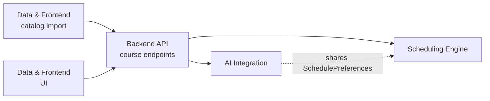

# HANDOFF.md

Live record of project progress. **Read it at the start of every session; update your module's section at the end.** Update rules are in [development-guide.md § 9](docs/development-guide.md#9-updating-handoffmd). In short: pull first, edit only your section, add a session-log line, record only real results, and never delete others' entries.

| | |
|---|---|
| **Last updated** | 2026-10-15 23:24 EDT, by a Claude Code session for Michael (@04michael4), on `integrate/ai-into-pre-main` (local) |
| **Current milestone** | Phase 1 ✅ on `main`. Phase 2: Marpu's `common` error handling and CORS are on `pre-main`. **Michael's AI module (live-verified, eval 19/20 = 95%) is integrated with it on the local branch `integrate/ai-into-pre-main`: 177/177 tests pass.** Not pushed; PR to `pre-main` pending review. |
| **Next milestone** | Michael reviews the integration branch, then pushes it and opens a PR into **`pre-main`** with Marpu as reviewer. `main` stays untouched. |

## Repository state

| | |
|---|---|
| `main` | `098cf09` "docs: finalize API contract and apply Lehigh credit-load policy". Phase 1 was merged via PR #1 (`76a8310`). |
| AI branch | `feature/ai-preference-extractor`, created from `098cf09`. Step 1 is in the commit "feat(ai): implement validated preference extraction with dummy provider" (run `git log` for the hash), pushed to `origin/feature/ai-preference-extractor`. Step 2 is in the commit "feat(ai): integrate Claude API and validate live extraction" on top of it, also pushed. **Not merged into `pre-main` or `main`.** |
| `pre-main` | **Shared integration branch** (team decision, 2026-10-15). At `533633d` "feat(backend): add common error handling and CORS" (Marpu). `main` must stay untouched. |
| Integration branch | `integrate/ai-into-pre-main` (**local only, not pushed**), created from `origin/pre-main` `533633d`. Three commits: a `--no-ff` merge of `feature/ai-preference-extractor` (`c6c7121`) with the conflicts resolved; `fix(ai)` routing AI errors through the shared handler; `docs`. The feature branch itself is unchanged. |
| Other branches | `dev-marpu` (at `76a8310`, no new commits); `feature/backend-foundation` (merged) |
| Toolchain verified | OpenJDK 21.0.12 (Homebrew), Maven 3.10.0 via wrapper, Spring Boot 4.1.1, macOS |

## Latest test results

**Integration run, 2026-10-15 23:22 EDT**, on `integrate/ai-into-pre-main`, with no `ANTHROPIC_API_KEY`, `RUN_LIVE_AI` or `AI_PROVIDER` set, command `cd backend && ./mvnw -B clean test`: **`Tests run: 177, Failures: 0, Errors: 0, Skipped: 0`, BUILD SUCCESS (5.335 s).**

| Group | Tests |
|---|---|
| Marpu's `common`, unchanged: `GlobalExceptionHandlerTest` 21, `WebConfigTest` 20, `ConfiguredCorsTest` 3, `DisabledCorsTest` 1 | 45 |
| Shared: `HealthControllerTest` 2, `RegistrationBackendApplicationTests` 1 | 3 |
| AI module (all 109 from the feature branch kept; `PreferenceControllerTest` strengthened) | 109 |
| **New integration tests:** `PreferenceEndpointIntegrationTest` 7 (dummy 200, 400, 422, CORS allowed/blocked/errors), `PreferenceEndpointFailureIntegrationTest` 5 (429/502/502/503 + unique request IDs), `ClaudeEndpointFakeServerIntegrationTest` 8 (real Claude path vs. local fake API) | 20 |

**Before the fix** (the merge commit alone): 157 tests, **5 failures**. All were AI status checks returning 500 instead of 422/429/502/502/503, confirming the predicted handler conflict. `dependency:tree`: 0 conflicts; validation starter, `anthropic-java` 2.71.0, Jackson 3.1.5 and Jackson 2.21.5 each present once. `git diff --check` clean. No paid calls.

### Earlier: AI feature branch

**Run 2026-10-15 23:09 EDT** on `feature/ai-preference-extractor`, immediately before the step 2 commit, with no `ANTHROPIC_API_KEY`, `RUN_LIVE_AI` or `AI_PROVIDER` set, command `cd backend && ./mvnw -B clean test`:

```
Tests run: 4,  Failures: 0 -- course.CourseCatalogSelectionTest
Tests run: 2,  Failures: 0 -- health.HealthControllerTest
Tests run: 4,  Failures: 0 -- common.json.JsonConfigurationTest
Tests run: 17, Failures: 0 -- ai.AnthropicClaudeGatewayTest      (new: real SDK vs. local fake API)
Tests run: 10, Failures: 0 -- ai.AiConfigurationTest              (new)
Tests run: 9,  Failures: 0 -- ai.PreferenceControllerTest         (+2: 429, 502)
Tests run: 10, Failures: 0 -- ai.ClaudePreferenceExtractorTest    (new)
Tests run: 15, Failures: 0 -- ai.PreferenceAssemblerTest
Tests run: 4,  Failures: 0 -- ai.PreferenceExtractionServiceTest
Tests run: 14, Failures: 0 -- ai.CourseMentionResolverTest
Tests run: 22, Failures: 0 -- ai.AiEvalDatasetTest                (new: 20 eval cases + 2 checks)
Tests run: 1,  Failures: 0 -- RegistrationBackendApplicationTests
Tests run: 112, Failures: 0, Errors: 0, Skipped: 0
BUILD SUCCESS   (Total time: 4.637 s)
```

`ClaudeLiveEval` did not run. Run explicitly without the opt-in variables, it reports `Skipped: 1`, with no API call.

**Live app check, 22:26 EDT** (packaged jar, `PORT=8091`, no API key; no external calls):

| `AI_PROVIDER` | `POST /api/preferences/extract` |
|---|---|
| `claude` | `503`, and the log warns "AI_PROVIDER=claude but ANTHROPIC_API_KEY is not set". The app starts normally. |
| `dummy` | `200`, fixed example |
| `none` | `503` |

### Live Claude API verification (2026-10-15, `claude-haiku-5-5`, SDK 2.71.0, run by Michael with his own key)

**Single request, 22:50 EDT** (`AI_PROVIDER=claude`, app bound to 127.0.0.1:8091):
- Models API: HTTP 200, `claude-haiku-5-5` active, with structured outputs and effort `low` supported.
- Extraction: **HTTP 200, 16/16 checks**.
  - Courses `CSE-017`, `MATH-021`.
  - Hard blocked time Tue/Thu 15:00–18:00.
  - Soft `earliestStart` 10:00, weight 3.
  - Default credits 12–18, with warnings.
- 3.89 s (first request after startup), 1 Claude call, 3,542 input / 197 output tokens, about $0.00045.

**20-case evaluation, 23:01 EDT** (`ClaudeLiveEval`): **19/20 = 95%** (threshold 80%).
- 20 Claude responses, all `end_turn`: 0 re-asks, 0 refusals, 0 provider errors.
- 70,713 input / 3,787 output tokens: **about $0.009 in total**.
- 32.2 s overall, about 1.6 s per case (median 1.33 s, max 3.67 s for the long request).
- **Failed: `vague-time`.** "I'm not a morning person. CSE 140 and ECO 1." Courses and blocked times were correct, but no `earliestStart` was produced. This is model behavior: the prompt lists that phrase as an example, but also says not to invent times. A soft preference was omitted; nothing was invented. The expectation was left as it is.
- **Serious errors: none observed.**
  - 0 invented required courses (all 20 cases check an exact set).
  - All 4 blocked-time cases exact, and 6 cases correctly had none.
  - All times exact.
  - Credit cap and overload rules correct.
  - Both prompt-injection attempts resisted in the final output.

**Known limits of this verification:**
- One run only, so variation between runs is unmeasured.
- `ClaudeLiveEval` saves only failure reasons, not full responses.
- About 12 cases don't check for invented soft preferences (`absentSoft`).
- For the injection cases, "ignored by the model" and "set aside by Java as unresolved" look the same.
- Dummy catalog only.
- Costs use Haiku 5.5's list price ($0.10 / $0.50 per MTok, per the 2026-10-06 reference).

Results and logs were saved outside the repo, and no API key appears in them (checked).

### Earlier: Step 1 commit

**Run 2026-10-15 22:00 EDT** on `feature/ai-preference-extractor`, immediately before the step 1 commit, command `cd backend && ./mvnw -B clean test`:

```
Tests run: 4,  Failures: 0 -- course.CourseCatalogSelectionTest
Tests run: 2,  Failures: 0 -- health.HealthControllerTest
Tests run: 4,  Failures: 0 -- common.json.JsonConfigurationTest
Tests run: 7,  Failures: 0 -- ai.PreferenceControllerTest
Tests run: 15, Failures: 0 -- ai.PreferenceAssemblerTest
Tests run: 4,  Failures: 0 -- ai.PreferenceExtractionServiceTest
Tests run: 14, Failures: 0 -- ai.CourseMentionResolverTest
Tests run: 1,  Failures: 0 -- RegistrationBackendApplicationTests
Tests run: 51, Failures: 0, Errors: 0, Skipped: 0
BUILD SUCCESS   (Total time: 3.131 s)
```

**Live check, 21:57 EDT, same code** (packaged jar on `localhost:8080`):

| Case | Result |
|---|---|
| `AI_PROVIDER=dummy`: `POST /api/preferences/extract` | `200`, contract JSON with times as `"15:00"` |
| `AI_PROVIDER=none`: `POST /api/preferences/extract` | `503` |
| No env vars set (defaults: `none`, catalog `dummy`) | `503`; the app starts without a database |
| `CATALOG_SOURCE=database` (no database catalog exists yet) | Startup fails as intended: "required a bean of type 'CourseCatalog' that could not be found", and the process exits |
| `GET /api/health` | `200` |

Earlier the same evening (21:40, before the catalog change): unknown term → `422`, blank text → `400`.

**Checks:** `git diff --check` clean. No credentials or secret patterns in any of the 39 changed or new files. No `.env` files or build artifacts.

### Earlier: Phase 1 baseline

**Run 2026-10-15 16:45 EDT** (just before the Phase 1 commit), command `cd backend && ./mvnw -B clean test`:

```
Tests run: 2, Failures: 0, Errors: 0, Skipped: 0 -- in io.github.michael04.registration.health.HealthControllerTest
Tests run: 1, Failures: 0, Errors: 0, Skipped: 0 -- in io.github.michael04.registration.RegistrationBackendApplicationTests
Tests run: 3, Failures: 0, Errors: 0, Skipped: 0
BUILD SUCCESS   (Total time: 2.655 s)
```

**Manual verification, same session:** `./mvnw spring-boot:run` started in 0.489 s. Then:
```
$ curl -i http://localhost:8080/api/health
HTTP/1.1 200
Content-Type: application/json
{"status":"UP","service":"registration-backend"}
```
Also observed earlier the same day: an unknown path returns `404` and `POST /api/health` returns `405`, both with Spring Boot's default error JSON.

## Known bugs and blockers

| # | Item | Type | Owner | Status |
|---|---|---|---|---|
| 1 | Module owners not yet assigned (README team table is `_TBD_`) | Blocker (coordination) | Team | Open |
| 2 | **Lehigh course data source not chosen.** Blocks real course search and scheduling. | Blocker | Data (_TBD_) | Open |
| 3 | ~~Phase 1 is committed and pushed on `feature/backend-foundation` but not merged to `main`~~ | Process | @04michael4 | Resolved 2026-10-15 (PR #1, `76a8310`) |
| 4 | No CI; tests run only locally | Gap | _TBD_ | Open |
| 5 | Mockito prints JDK "dynamic agent loading" warnings during tests | Cosmetic | — | Accepted (harmless) |

No known functional bugs.

## Important decisions

| Date | Decision | Where |
|---|---|---|
| 2026-10-15 | Java 21 + Spring Boot instead of Python + FastAPI | [ADR-0001](docs/decisions/0001-java-spring-boot-over-python-fastapi.md) |
| 2026-10-15 | Spring Boot 4.1.1 pinned; Maven Wrapper; minimal dependencies; hand-written health endpoint; package by feature | [architecture.md § 15](docs/architecture.md#15-phase-1-decisions-implemented) |
| 2026-10-15 | The AI proposes and explains; the deterministic engine alone decides validity | [architecture.md § 1](docs/architecture.md#1-system-overview) |
| 2026-10-15 | Base package `io.github.michael04.registration` (independent project) | [CLAUDE.md](CLAUDE.md) |
| 2026-10-15 | **Team-agreed** API contract: course search, preference extraction and schedule generation shapes, formats (`"FRIDAY"`, `"15:00"`, `"CSE-017"`), weights 0–5. Agreed, not yet implemented. |
| 2026-10-15 | **Credit limits** follow Lehigh's overload policy: hard cap 21 credits (team rule), default 12–18, normal load 17 (first semester) / 18, schedules over 18 flagged `overload: true` | [api-contract.md § Credit limits](docs/api-contract.md#credit-limits) | [api-contract.md](docs/api-contract.md) |
| 2026-10-15 | **Team-agreed** four-module split and owners: Michael (AI), David (Frontend & DB), Marpu (Backend), Sunny (Engine) | [README § Team](README.md#team-and-responsibilities) |

## Module ownership and dependencies



| Module | Owner | Depends on | Depended on by |
|---|---|---|---|
| Backend API | _TBD_ (Phase 1: @04michael4) | — | everyone |
| Scheduling Engine | _TBD_ | Backend API (course data), `SchedulePreferences` contract | Frontend |
| AI Integration | _TBD_ | Backend API (course ID validation), `SchedulePreferences` contract | Frontend |
| Data and Frontend | _TBD_ | Backend API (endpoints), data source decision | — |

The engine **logic** can be built and unit-tested now, before the database or catalog exist, using hand-made test data.

---

## Backend API

**Owner:** Marpu (per the team assignments in README; Phase 1 foundation: @04michael4) · **Status:** ✅ Foundation merged; `common` implemented and verified on `feature/backend-common`; integration target: `pre-main` for testing, as directed by the user

**Completed**
- 2026-10-15: Spring Boot 4.1.1 / Java 21 project from Spring Initializr in `backend/`, with Maven Wrapper (Maven 3.10.0).
- 2026-10-15: `GET /api/health` → `{"status":"UP","service":"registration-backend"}` (`health` package).
- 2026-10-15: Tests: `HealthControllerTest` (2 × `@WebMvcTest`) and a context-load test. All passing; see [Latest test results](#latest-test-results).
- 2026-10-15: Root `.gitignore` (ignores `.env`/`.env.*`, keeps `.env.example`; verified with `git check-ignore`), `.env.example`, docs.
- 2026-10-15: Codex implemented `common`: centralized RFC 9457 Problem Details, sorted validation errors, safe application exceptions, request IDs, servlet fallback, and exact-origin CORS. Added `spring-boot-starter-validation` for Bean Validation and documented the error-contract change and `CORS_ALLOWED_ORIGINS`. Production changes stay within `common`, `pom.xml`, and `application.properties`; other modules are untouched.

**Verification — 2026-10-15 22:01 EDT**
- Phase 0: read `docs/development-guide.md`, `AGENTS.md`, `CLAUDE.md`, and this handoff in order; `PLANS.md` is absent. Fetched `origin`, confirmed a clean tree, checked that the task branch did not exist, then created and verified `feature/backend-common` from `origin/main` at `098cf092d49379ec32c634bd6e6c1432229fd7bc`. Local `main` matched `origin/main`, so no merge was needed. Git metadata writes required sandbox approval. No commit, push, or PR was made.
- Baseline: `./mvnw -B test` via Git Bash and JDK 21 → `Tests run: 3, Failures: 0, Errors: 0, Skipped: 0`; `BUILD SUCCESS`.
- Final command from `backend/`, in PowerShell: `$env:JAVA_HOME='C:\Program Files\Java\jdk-21'; & 'C:\Program Files\Git\bin\bash.exe' ./mvnw -B test` → `Tests run: 48, Failures: 0, Errors: 0, Skipped: 0`; `BUILD SUCCESS` (2026-10-15 21:59 EDT). Tests cover nested/body/parameter validation, malformed JSON, missing input, 404/405/406/415/422/429/500/502/503, safe errors, request IDs, default/custom/disabled CORS, and rejected origins/methods/headers. They need no DB, AI service, or secrets.
- Live: `./mvnw -B spring-boot:run '-Dspring-boot.run.arguments=--server.port=0'`, using the same JDK/Git Bash setup, started on port 58982. `curl.exe -i` verified health GET/HEAD 200; unknown route 404; POST health 405 with `Allow: GET`; XML Accept 406; allowed JSON POST preflight 200; untrusted origin 403; allowed-origin headers on a 404; `/error` fallback 500 even with HTML Accept. Error bodies are `application/problem+json`, include `type: about:blank`, and match `requestId` to `X-Request-Id`; query strings are omitted.
- Initial feature test run: `Tests run: 48, Failures: 22, Errors: 0, Skipped: 0` because Spring leaves the problem type unset by default. Resolved by setting `about:blank` explicitly in the shared renderer; all final tests pass.
- **Environment issue:** Windows `mvnw.cmd` fails before Maven starts with `Cannot index into a null array`; the Unix wrapper via Git Bash works. The wrapper files were left unchanged, and README documents the workaround. Existing Mockito dynamic-agent notices remain.
- **Documentation discrepancy:** the repository-state/ownership summaries above and some older design notes are stale. Git shows the foundation merged in `76a8310`; README assigns owners. This entry records the discrepancy without replacing other modules' history. The user explicitly assigned CORS; it is implemented while preserving the frontend's option to use a same-origin proxy.
- **Review note:** error JSON and CORS configuration are shared interfaces. Frontend/AI/backend consumers should review the documented contract when a PR is authorized. The API endpoints for course search, scheduling, and AI remain planned.
- **Pre-push recheck — 2026-10-15 22:26 EDT:** the same `./mvnw -B test` command via Git Bash/JDK 21 returned `Tests run: 48, Failures: 0, Errors: 0, Skipped: 0` and `BUILD SUCCESS`. `git diff --check` is clean. Target: `origin/pre-main`, explicitly requested by the user.

**In progress**
- Common implementation is complete. The user authorized committing and pushing it to `pre-main` for testing; `main` is not a push target. Freshly fetched `origin/pre-main` matches the feature base (`098cf09`), so no merge is required. This explicit instruction takes precedence over the guide's default `main` PR destination.

**Next recommended**
1. ~~Review Phase 1, then open a PR from `feature/backend-foundation` into `main` and merge it.~~ Resolved 2026-10-15: Git records the merge as `76a8310`.
2. Add GitHub Actions CI running `./mvnw test` on PRs.
3. ~~`common`: global error handling with RFC 9457 Problem Details, plus `spring-boot-starter-validation`. This is a contract change, so update [api-contract.md](docs/api-contract.md).~~ Implemented and verified 2026-10-15 on `feature/backend-common`; test on `pre-main` and review the contract before promotion to `main`.
4. Persistence phase: PostgreSQL, a migration tool and the `course` package, once the data source is decided.

**Blockers:** none for items 1–3. Item 4 is blocked on the data-source decision.

---

## Scheduling Engine

**Owner:** _TBD_ · **Status:** ⬜ Not started

**Completed:** _none_. The design is proposed in [architecture.md § 7–8](docs/architecture.md#7-scheduling-engine).

**In progress:** _none_.

**Next recommended**
1. Create the `engine` package with immutable input records (`CourseOption`, `SectionOption`, `Meeting`) and the time-overlap check, plus unit tests.
2. Add backtracking search, top-K scoring and determinism tests, using hand-made fixtures. No DB is needed.
3. Then build the `schedule` package and `POST /api/schedules/generate`, per the [contract](docs/api-contract.md#6-post-apischedulesgenerate).

**Blockers:** none for steps 1–2.

---

## AI Integration

**Owner:** Michael (@04michael4) · **Status:** ✅ Steps 1 and 2 committed and pushed on `feature/ai-preference-extractor`. **Live-verified: 1 request 16/16 checks; eval 19/20 = 95%.** Integrated with `common` on the local branch `integrate/ai-into-pre-main` (177/177 tests); PR to `pre-main` pending.

**Completed** (2026-10-15, branch `feature/ai-preference-extractor`)
- `POST /api/preferences/extract`: request validation (400), unknown term (422, checked before any AI call), AI unavailable (503), invalid AI output (502).
- `PreferenceExtractor` interface with providers chosen by `AI_PROVIDER`: `none` (default, 503) and `dummy` (fixed example, no key).
- `CourseMentionResolver`: "CSE 17", "cse017", "CSE-017" become `CSE-017`; title nicknames like "Calc 1" become `MATH-021`. It only resolves when exactly one course matches; otherwise the mention goes to `unresolved`. Course IDs never come from the AI.
- `PreferenceAssembler`: validates everything from the AI. Defaults 12–18, caps at 21, overload warning above 18, drops invalid times and days with warnings, clamps weights to 0–5, drops weight-0 preferences.
- **Shared stand-ins for Marpu to take over:**
  - `common/preferences/` (`SchedulePreferences` records, `CreditLimits`, `Weights`);
  - `course/CourseCatalog` and `DummyCourseCatalog` (8 fake courses, term `2027-SPRING`);
  - `common/json/JsonConfiguration`, which writes times as `"HH:mm"`.
- Added `spring-boot-starter-validation` to `pom.xml`.
- Tests: 40 new (resolver 14, assembler 15, service 4, controller 7).
- Cleanup, 2026-10-15 21:57:
  - `DummyCourseCatalog` is now active only when `app.catalog.source=dummy` (env `CATALOG_SOURCE`, the default), so it can't conflict with a database catalog. `CourseCatalogSelectionTest` (4) proves exactly one catalog exists for each setting.
  - `JsonConfigurationTest` (4) proves the contract's `SchedulePreferences` JSON reads and writes losslessly, with `"HH:mm"` times.
  - README "Michael: AI Integration" now matches the code, and David's section explains how to replace the dummy catalog.

**Notes for teammates** (shared stand-ins created on this branch; please review them in the PR)
- **Marpu:**
  - Take over `common/preferences/`, `course/CourseCatalog`, `course/CourseSummary` and `common/json/JsonConfiguration`, rather than writing new versions.
  - `spring-boot-starter-validation` is already in `pom.xml`.
  - The records enforce 1–21 credits with `@Max`, but nothing checks `minCredits ≤ maxCredits` or start-before-end on incoming requests. Your generate endpoint needs those checks.
  - `@WebMvcTest` needs `@Import(JsonConfiguration.class)`.
- **David:**
  - Annotate your catalog with `@ConditionalOnProperty(name = CourseCatalog.SOURCE_PROPERTY, havingValue = "database")` and run with `CATALOG_SOURCE=database`. Steps are in README, David's Part A, step 5.
  - The frontend can use `AI_PROVIDER=dummy` now.
  - Times arrive as `"15:00"`; days as `"FRIDAY"`, sorted Monday to Sunday.
- **Sunny:** nothing to integrate yet. Your engine shouldn't use `SchedulePreferences` directly; Marpu's `schedule` package converts it into your engine's own records. Weights are 0–5, and a preference with weight 0 is omitted.

**Step 2: Claude provider** (2026-10-15, uncommitted)
- **Implemented and tested offline:**
  - `com.anthropic:anthropic-java` **2.71.0**, pinned. Jackson 2.21 from the SDK sits next to Boot's Jackson 3.1, with no conflicts in `dependency:tree`.
  - `ClaudePreferenceExtractor`, `ClaudeGateway` / `AnthropicClaudeGateway`, `ClaudeExtraction` (the structured-output schema), `ClaudeProperties`, and the new exceptions `AiRateLimitedException` (429) and `AiProviderException` (502).
  - System prompt: `backend/src/main/resources/ai/preference-extraction-system-prompt.md`.
  - `AI_PROVIDER=claude`. Without a key the app starts and returns 503; it never falls back to dummy.
  - Model `claude-haiku-5-5` by default (`ANTHROPIC_MODEL`), effort `low`, 20 s timeout, 1 SDK retry, one application re-ask for truncated or malformed output, refusal final.
  - Eval set `backend/src/test/resources/ai-eval/cases.json` (20 cases), checked offline by `AiEvalDatasetTest`.
  - The live runner `ClaudeLiveEval` runs only on explicit request.
- **Verified only with fakes:** request shape, response parsing, refusal and truncation handling, and the 429/502/503 mapping.
- **Live-verified 2026-10-15:** see [Latest test results § Live Claude API verification](#live-claude-api-verification-2026-10-15-claude-haiku-5-5-sdk-2710-run-by-michael-with-his-own-key). Eval 19/20; the only failure is `vague-time`.

**In progress:** _none_. Step 2 is complete.

**Integration notes for merging into `pre-main`** (originally checked read-only against `origin/pre-main` at `533633d`). **All four were resolved 2026-10-15 on `integrate/ai-into-pre-main`**; see the resolution after the list.
1. ~~⚠️ **Error-handler conflict, which must be fixed during integration.**~~ **Resolved:** the AI exceptions now use the shared types, with no change to `GlobalExceptionHandler`. Original note: `pre-main`'s `common/GlobalExceptionHandler` has a catch-all `@ExceptionHandler(Exception.class)` that always returns **500** and ignores `@ResponseStatus`. Once merged, the AI exceptions would all become 500 instead of 422 / 429 / 502 / 503:
   - `ai.UnknownTermException` (422)
   - `ai.AiRateLimitedException` (429)
   - `ai.AiProviderException` (502)
   - `ai.AiOutputInvalidException` (502)
   - `ai.AiUnavailableException` (503)

   `pre-main` also has its own `common.AiUnavailableException`, which is a different class from `ai.AiUnavailableException`.

   **Options** (agree with Marpu):
   - (a) The catch-all honors `@ResponseStatus` via `AnnotatedElementUtils.findMergedAnnotation(ex.getClass(), ResponseStatus.class)`.
   - (b) Add explicit handlers for the AI exceptions.
   - (c) Move the AI exceptions onto `common` types, adding 429/502 types there.

   **Safety net:** after a merge, `PreferenceControllerTest`'s 422/429/502/503 tests will fail if this isn't resolved, because `@WebMvcTest` loads controller advice.
2. **Overlapping files**, expect merge conflicts: `backend/pom.xml` (both add `spring-boot-starter-validation`, so keep one), `application.properties` and `.env.example` (keep both sides' keys), and `HANDOFF.md`, `README.md`, `docs/api-contract.md`, `docs/architecture.md` (combine both sides).
3. **Error body format.** `pre-main` turns on Problem Details (`spring.mvc.problemdetails.enabled=true`). The AI exceptions' messages are generic and safe to show as `detail`.
4. ~~**Docs still say PRs go to `main`.**~~ **Resolved:** `CLAUDE.md`, `docs/development-guide.md` and `README.md` now say PRs target `pre-main` and `main` stays untouched.

**Resolution (2026-10-15, `integrate/ai-into-pre-main`, local)**
- **422:** `UnknownTermException` extends `common.UnprocessableException`, with the fixed public message "Term is not available". The term is never echoed.
- **429 / 502:** `AiRateLimitedException`, `AiProviderException` and `AiOutputInvalidException` extend Spring's `ResponseStatusException`. That's the pattern `GlobalExceptionHandlerTest` already uses. They're rendered with generic `detail` texts: "Too many requests" and "Upstream service returned an invalid response".
- **503:** `ai.AiUnavailableException` was **removed**. The AI module throws `common.AiUnavailableException` ("AI service is unavailable"), keeping the SDK error as an internal cause that is never rendered.
- **Unchanged:** every file in `common/` that Marpu wrote, plus Problem Details, `X-Request-Id`/`requestId`, CORS and 5xx logging.
- **Conflicts:** resolved by keeping both sides. Overlapping files: `pom.xml` (one validation starter plus the SDK), `application.properties` (Problem Details, CORS, AI and catalog keys), `README.md`, `HANDOFF.md` (session-log rows merged by time), and `api-contract.md`. `.env.example` and `architecture.md` merged automatically, and were reviewed.

**Next recommended**
1. Michael: review `integrate/ai-into-pre-main`, then push it (a new branch, no force-push) and open a PR **into `pre-main`**. Marpu reviews the exception mapping onto his types, the resolved `pom.xml`/`application.properties`, the contract's error section and 429 row, and the shared stand-ins; David reviews the catalog switch.
2. Optional evaluation improvements, test-only:
   - save full responses in `ClaudeLiveEval`;
   - add `absentSoft` checks to the cases missing them;
   - re-run once (about $0.01) to measure stability.

   Decide as a team whether vague morning wording should produce an `earliestStart`, and only then change the prompt or the expectation.
3. Marpu: take over the shared stand-ins. David: replace `DummyCourseCatalog` with the database catalog.

**Blockers:** none for the AI module. Live runs need a developer's own `ANTHROPIC_API_KEY`, in the shell environment and never committed.

---

## Data and Frontend

**Owner:** _TBD_ · **Status:** ⬜ Not started (placeholders: [data/README.md](data/README.md), [frontend/README.md](frontend/README.md))

**Completed:** _none_.

**In progress:** _none_.

**Next recommended**
1. **Data:** identify a permitted source for Lehigh course/section data, and record its format, terms of use and refresh process in `data/README.md`. Meanwhile, create a small **synthetic** sample catalog so the Engine and Backend API work can proceed.
2. **Frontend:** scaffold Next.js + TypeScript + Tailwind in `frontend/`; add a page that calls `GET /api/health`; document the run commands in `frontend/README.md` and the README.
3. Decide CORS vs. a Next.js proxy with the Backend API owner.

**Blockers:** real data depends on step 1.

---

## Next recommended tasks

In priority order, across the team:
1. ~~Review Phase 1 on `feature/backend-foundation`, then merge it to `main`.~~ Resolved 2026-10-15 (PR #1).
2. ~~Assign module owners, and fill in the README team table and this file.~~ Resolved 2026-10-15 (README team table).
3. Decide the course data source (or agree on a synthetic dataset for the hackathon).
4. Start, in parallel: engine core (no dependencies), frontend scaffold, CI.
5. Integrate the feature branches into **`pre-main`** (the shared integration branch; `main` stays untouched). AI: done locally on `integrate/ai-into-pre-main` (177/177 tests); PR pending.

## Instructions for the next developer or AI agent

1. Read [README.md](README.md), this file, and [docs/architecture.md](docs/architecture.md). Follow [CLAUDE.md](CLAUDE.md).
2. Run `git status` and `git log --oneline -5`. **Confirm the repository state matches this file**, and note any discrepancy in the session log.
3. Run `cd backend && ./mvnw test` to confirm a green baseline before you change anything.
4. Claim your task under *In progress* in your module's section, with your handle and branch.
5. When you finish: run the tests, update your section with real results, add a session-log line, and leave changes uncommitted unless you were told to commit.

---

## Session log

Newest first, one line per session. Append only.

| When | Who | Module | Summary |
|---|---|---|---|
| 2026-10-15 23:24 EDT | Claude Code for Michael | AI Integration | Integrated AI into a local `integrate/ai-into-pre-main` from `origin/pre-main` `533633d`: `--no-ff` merge, 5 conflicts resolved keeping both sides; AI errors moved onto shared `common` types and `ResponseStatusException` (no `common/` changes); 20 integration tests added. Before the fix: 157 tests, 5 failures (AI errors returned 500). After: 177/177. Workflow docs retargeted to `pre-main`. Nothing pushed. |
| 2026-10-15 23:10 EDT | Claude Code for Michael | AI Integration | Recorded the live verification (1 request 16/16; eval 19/20 = 95%; failure `vague-time` and evaluation limits documented). Marked endpoint 5 live-verified. Found the `pre-main` error-handler conflict (read-only). Committed and pushed step 2 to `feature/ai-preference-extractor`; not merged. |
| 2026-10-15 22:30 EDT | Claude Code for Michael | AI Integration | Step 2: Claude provider with the official SDK 2.71.0, structured output, prompt, 429/502/503 mapping, 20-case eval set and opt-in live runner. 112/112 tests pass offline; app modes verified with no key. No live API call made. Uncommitted. |
| 2026-10-15 22:26 EDT | Codex | Backend API | User authorized commit and push of the common package to testing branch `pre-main`. Fetched origin and confirmed `origin/pre-main` matches the feature base (`098cf09`). Pre-push `./mvnw -B test` via Git Bash/JDK 21: `Tests run: 48, Failures: 0, Errors: 0, Skipped: 0`, `BUILD SUCCESS`; diff check clean. Prepared normal fast-forward push with explicit `HEAD:refs/heads/pre-main`; `main` is not a push target. |
| 2026-10-15 22:01 EDT | Codex | Backend API | Created and verified `feature/backend-common` from freshly fetched `origin/main` (`098cf09`) before edits; implemented common errors, validation, CORS, and docs. Final `./mvnw -B test` via Git Bash/JDK 21: `Tests run: 48, Failures: 0, Errors: 0, Skipped: 0`, `BUILD SUCCESS`; live curl checks passed. Windows wrapper issue/workaround and stale handoff summaries recorded in Backend API. Uncommitted; no push or PR. |
| 2026-10-15 22:01 EDT | Claude Code for Michael | AI Integration | Pre-commit checks passed (51/51 tests, diff-check clean, no secrets or artifacts); committed step 1 and pushed `feature/ai-preference-extractor`. Not merged. Claude provider not built. |
| 2026-10-15 21:58 EDT | Claude Code for Michael | AI Integration | Step 1 cleanup: dummy catalog switchable via `CATALOG_SOURCE`; JSON contract round-trip tests; README AI section corrected; David's replacement steps added. 51/51 tests pass; live-checked dummy 200, none 503, database setting fails clearly. Uncommitted. |
| 2026-10-15 21:45 EDT | Claude Code for Michael | AI Integration | Step 1 on `feature/ai-preference-extractor`: extract endpoint, resolver, validator, dummy/none providers, shared stand-ins (preferences, catalog, JSON time format). 43/43 tests pass; live-checked 200/400/422/503. Uncommitted. |
| 2026-10-15 21:30 EDT | Claude Code for @04michael4 | docs | Credit limits updated from Lehigh's overload policy (cap 21, overload flag); updated api-contract.md, architecture.md, README, HANDOFF.md. Docs only. |
| 2026-10-15 21:22 EDT | Claude Code for @04michael4 | docs | Team agreed the API contract as written; removed "provisional" markers from api-contract.md, architecture.md and HANDOFF.md. Docs only, no code changes. |
| 2026-10-15 16:45 EDT | Claude Code for @04michael4 | Backend API / docs | Pre-commit checks; marked API contract, credit limits and team roles as provisional; re-ran tests (3/3 pass) and verified health with curl. Committed Phase 1 and pushed to `origin/feature/backend-foundation`; not merged to `main`. |
| 2026-10-15 16:40 EDT | Claude Code for @04michael4 | Backend API / docs | Wrote README, CLAUDE.md, AGENTS.md, HANDOFF.md, architecture.md, api-contract.md, development-guide.md, ADR-0001. Re-ran tests: 3/3 pass; health verified with curl. Nothing committed. |
| 2026-10-15 16:27 EDT | Claude Code for @04michael4 | Backend API | Phase 1 backend foundation: Spring Boot 4.1.1 skeleton, `/api/health`, tests (3/3 pass), `.gitignore`, `.env.example`. Nothing committed. |
