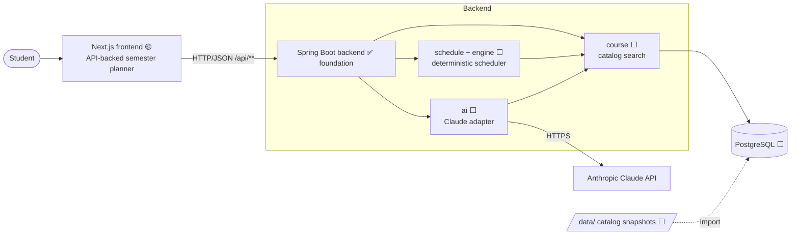
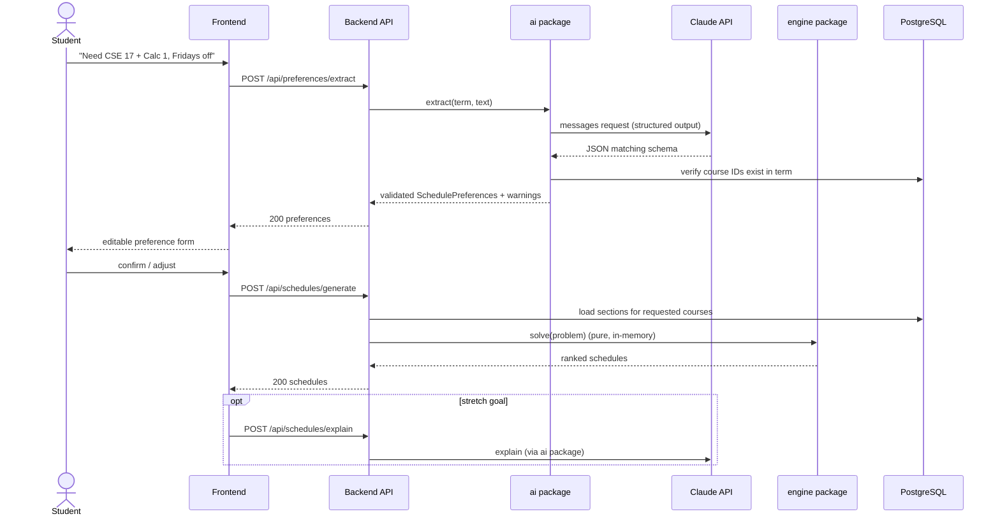
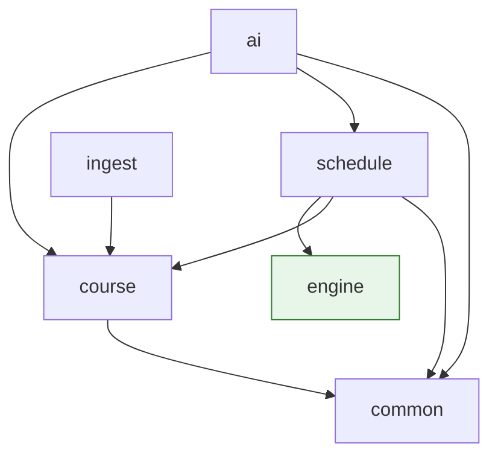
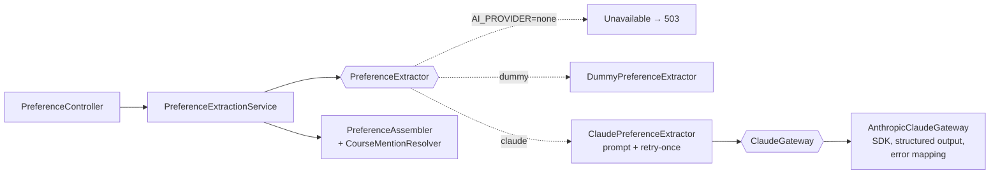
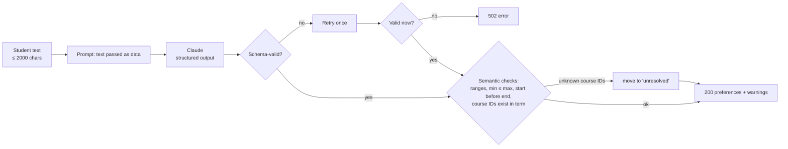

# Architecture

> **Status at a glance (2026-10-18):** Semester frontend integration uses the existing real APIs and same-origin proxy; degree/advisor prototypes remain explicit. Scheduling uses the authoritative pre-main Hikari/JDBC catalogs, Data views and native solver. Production defaults to database with no synthetic catalog fallback. Test-only fixtures remain offline; opt-in tests execute real PostgreSQL/HTTP/solver paths. See [frontend integration](frontend-backend-integration.md) and [earlier backend evidence](schedule-final-integration.md).

Related: [API contract](api-contract.md) · [Decision records](decisions/README.md) · [Development guide](development-guide.md)

## Contents
1. [System overview](#1-system-overview)
2. [Frontend and backend responsibilities](#2-frontend-and-backend-responsibilities)
3. [Component interaction and data flow](#3-component-interaction-and-data-flow)
4. [Backend package structure](#4-backend-package-structure)
5. [Database architecture](#5-database-architecture)
6. [REST API design](#6-rest-api-design)
7. [Scheduling engine](#7-scheduling-engine)
8. [Hard vs. soft constraints](#8-hard-vs-soft-constraints)
9. [AI integration and validation](#9-ai-integration-and-validation)
10. [Error handling](#10-error-handling)
11. [Security](#11-security)
12. [Testing strategy](#12-testing-strategy)
13. [Deployment](#13-deployment)
14. [Scalability](#14-scalability)
15. [Phase 1 decisions (implemented)](#15-phase-1-decisions-implemented)
16. [Open questions](#16-open-questions)

---

## 1. System overview



The **central design principle** is that the AI interprets and explains, and the deterministic Java engine decides.

- **Claude** turns free-text wishes ("no 8 a.m.s, Fridays off, I work Tue/Thu afternoons") into a structured preferences object, and can explain results in plain English.
- **The scheduling engine** is the only component that decides whether a schedule is valid and how good it is.

**Why this split?** An LLM can misread a time or invent a section. If the AI built schedules directly, a student could get a schedule with a hidden conflict, and we couldn't test or reproduce the result. With this split:
- Every schedule we return is guaranteed conflict-free, because the guarantee comes from code, not a model.
- Results are reproducible: same input, same output, so they can be unit-tested and debugged.
- The AI is optional. If the API key is missing or the provider is down, students can still fill in preferences by hand and generate schedules.

## 2. Frontend and backend responsibilities

| Concern | Frontend (Next.js), semester integrated | Backend (Spring Boot) |
|---|---|---|
| UI, routing, calendar view | ✔ | |
| Free-text input and editable preference form | ✔ | |
| Showing AI-extracted preferences for **student confirmation** | ✔ | |
| Input validation | Convenience only | ✔ **authoritative** |
| Course catalog storage and search | | ✔ |
| Schedule generation | | ✔ (engine) |
| Calling Claude | **Never** | ✔ (only place the API key exists) |
| Secrets | None (no `NEXT_PUBLIC_*` secrets, ever) | ✔ from environment |

**Why is the backend authoritative?** Anything in the browser can be bypassed, and the API key must never reach the client. The frontend stays a thin, replaceable presentation layer.

## 3. Component interaction and data flow

Main user flow (status per package in [§4](#4-backend-package-structure)):

The default semester workflow uses `ConnectedPlanner` and shared typed API clients. Browser requests go through an allowlisted same-origin Next.js `/api/backend` route to server-only `BACKEND_URL`, then the existing Spring controllers, production JDBC catalogs and native solver. JSON schemas and Problem Details mirror the existing contract; no client solver computes scores. Catalog facts/instructor names are private/no-store and are not persisted; browser-saved plans contain only identifiers, preferences and a user-entered name. AI extraction is reviewed before applying and AI-off is a useful 503 state. Explicit `FRONTEND_MODE=demo` retains the offline semester prototype. Degree/transcript/advisor workspaces still use labeled sample data because matching APIs do not exist. See the [integration runbook](frontend-backend-integration.md).



Two design points in this flow:
- **A human checkpoint sits between AI and engine.** The student sees and can edit what the AI understood before anything is generated, so extraction mistakes are visible and cheap to fix.
- **The engine does no I/O.** The `schedule` package loads data and converts it into engine input. The engine is a pure function of its input, which is what makes it deterministic and easy to test.

## 4. Backend package structure

Base package: `io.github.michael04.registration`. We **package by feature**: each feature owns its controller, service, DTOs, and tests.

| Package | Status | Contents | Owner module |
|---|---|---|---|
| *(root)* | ✅ | `RegistrationBackendApplication` | Backend API |
| `health` | ✅ | `HealthController`, `HealthResponse` | Backend API |
| `common` | ✅ | `GlobalExceptionHandler`, Problem Details rendering, servlet fallback, application exceptions, validation error record, configurable CORS | Backend API |
| `course` | Implemented | Existing Course API/read interfaces and authoritative PostgreSQL catalogs (`catalog_api`, or with `DB_CATALOG_SCHEMA=catalog_live` also approved promoted courses, [ADR-0003](decisions/0003-promote-evidence-through-approvals-into-catalog-live.md); or with `DB_CATALOG_SCHEMA=catalog_serving` the researched READY and CONDITIONAL courses together with their conditions, [ADR-0007](decisions/0007-serve-researched-courses-with-their-conditions.md)); demo catalogs now test-only ([ADR-0002](decisions/0002-read-only-database-catalog-through-catalog-api-views.md), [database guide](database.md)); the complete researched term catalog is stored in `catalog_research` ([ADR-0005](decisions/0005-store-the-researched-term-catalog-separately-from-serving.md)), which the backend does not read; the Computer Science and Business degree research (business, science and CSB courses, Class Details, linked components, degree structure) is stored additively in `catalog_csb` ([ADR-0009](decisions/0009-store-the-csb-research-additively-in-catalog-csb.md)), also unread by the backend | Backend API (+ Data) |
| `ingest` | ⬜ | Loads `data/` catalog snapshots into the database | Data |
| `engine` | 🟡 | **Pure Java** scheduler: input model, constraint checks, search, scoring. No Spring, no I/O. Implemented and unit-tested; called by `/api/schedules/generate` through `schedule.integration.NativeSchedulingEngine` ([§7](#7-scheduling-engine)). | Scheduling Engine |
| `schedule` | 🟡 | Controller, validation, service, `EngineMapper`, node-cap configuration; `integration.NativeSchedulingEngine` adapts the `SchedulingEngine` boundary to the engine. Endpoints: `generate` (with `electiveAdvice`), `check` (manual mode), `suggest-electives`. | Backend API |
| `ai` | ✅ | Claude client wrapper, prompt, output validation (`PreferenceAssembler`), `PreferenceController`; `none`/`dummy`/`claude` providers | AI Integration |

Allowed dependencies (arrows point from a package to what it may use):



Rules:
- `engine` depends on **nothing** in the project (only the JDK). It has its own immutable input records, such as `CourseOption`, `SectionOption` and `Meeting`, rather than JPA entities. That way database changes can't break the engine, and its tests need no Spring context.
- `engine` and `schedule` never depend on `ai`. Schedules can't be influenced by model output except through validated `SchedulePreferences`.

**Why package by feature?** It maps the four-person split onto folders, so most PRs touch one package, and the dependency rules above are easy to check in review.

## 5. Database architecture

**Implemented:** PostgreSQL through pre-main's existing `CatalogDatabaseConfiguration` (HikariCP),
`JdbcCatalogDao` (`JdbcClient`), `JdbcCourseCatalog`, `JdbcSectionCatalog`, `CatalogProperties` and `TermMapping`.
No JPA/Spring Data implementation exists; this integration does not introduce one or add a second datasource.

**Earlier standalone fixtures (history):**

**Active screenshot dataset (2026-10-15):** `data/cse007-snapshot/` supersedes the
synthetic fixtures for CSE-007. Schema `cse007_snapshot` stores the supplied Spring
2027 sections, actual CRNs and term code, per-image provenance, attributes,
non-live enrollment observations and explicit data issues. Source files replace
unavailable source URLs. `Hackathon Ideas - SuY.pdf` supplies user corrections:
lecture 010 contributes 4 credits and requires exactly one zero-credit lab, 060
or 062; all sections are in person; three nullable requirement rows explicitly
record no CSE-007 prerequisites/corequisites/enrollment restrictions per user.
V3 adds requirement/group tables and source-backed review resolution; V4 applies
the corrections while retaining V1/V2 history. Lecture location is TBD and its
date range is an explicit demo term default; lab 062 room 11/dates come from SuY.
`data_issue` has six resolved and two accepted items, with no open review flags.
Future requirement expressions can hold JSONB course/AND/OR rules; evaluation is
not implemented. Seat precision is out of demo scope and snapshot counts are not
used as scheduling constraints. These are user-confirmed demo facts, not a live
institutional eligibility verification.
UUIDs and same-course/term foreign keys are retained. See its README for schema
details and import commands. This is standalone storage; the backend/API remains
unconnected. The two earlier schemas below are archival synthetic fixtures.

**Standalone demo (2026-10-15):** `data/cse007/` contains versioned PostgreSQL schema/seed
scripts for one catalog-sourced CSE 007 course and simulated term sections, meetings and
lecture/lab links. It runs separately in the `cse007_demo` schema; see `data/README.md`.
No Spring persistence dependency, repository, migration runner or endpoint integration has
been added. The full application database design below remains planned.

**PDF-aligned fixture (2026-10-15):** `data/cse007-pdf/fixture.json` and its schema/seed
scripts use the supplied PDF's UUID-based physical fields. The separate
`cse007_pdf_demo` schema contains CSE-007, simulated sections/meetings/links, and one
synthetic profile/preference. Prerequisite and generated-schedule tables remain
empty because eligibility and scoring are unresolved. See its README for the
additional join-table term consistency field and dataset checks. These storage
fields do not change the provisional REST contract; reconcile IDs and DTOs before
backend integration. The earlier text-ID demo remains available for reference.

The local draft is reconciled with this implementation. `JdbcCourseMetadataCatalog` uses that same Hikari datasource to read term names/capture dates, descriptions and instructor names from the existing qualified Data tables. `CourseService` adds only those display fields to certified courses/sections; eligibility, status, credits and lecture links still come from the authoritative catalogs/views. `SectionLookupCatalog` resolves explanation CRNs through those same catalogs. The older independent datasource, repository and catalog are retained under src/test only and excluded from the production JAR. No schema/view or engine algorithm is changed.

Data owns `data/cse007-snapshot/` (V1-V4 tables/seed) and `data/catalog-api/V1__catalog_api_views.sql`.
The authoritative tables include `source_asset`, `term`, `course`, `section`, `meeting`, `section_link`,
`section_component_group`, `course_requirement` and evidence/issue records. Scheduling and discovery read
`catalog_api.course_offering`, `section_offering` and `section_meeting`; helper views enforce certified whole
credits, confirmed lecture links/component rules and fail-closed readiness. Migrations and seeds are unchanged.

API term `2027-SPRING` maps explicitly to Banner `202710` using `app.catalog.terms`. Database variables are
`DB_URL`, `DB_USERNAME`, optional `DB_PASSWORD` (otherwise PGPASSFILE). The bounded lazy Hikari pool sets
server-enforced read-only sessions and a statement timeout. No production startup DDL/seed writes occur.
Database query/connectivity errors become `CatalogUnavailableException`, rendered as safe 503 by shared advice.

Production `app.catalog.source=${CATALOG_SOURCE:database}` requires DB_URL/DB_USERNAME; there is no fallback
catalog. The original hardcoded catalogs now live in src/test and are selected only by the Maven test profile.
Ordinary tests remain DB-free; `-Pdatabase-it` adds real PostgreSQL/native-solver/random-port HTTP tests.
Their fixture loader imports the unchanged Data SQL in fresh, validated loopback test databases, never drops
schemas/databases and retains fixtures for inspection. Only synthetic availability tests overlay the view in
their dedicated test database; original-source verification uses all views unchanged and reports UNKNOWN status.

What is implemented (2026-10-16): the schema actually in use is `cse007_snapshot` (CSE 007 only), read through the five `catalog_api` views; the entity diagram above is the original proposal, not the running schema. An append-only `banner_evidence` schema records Banner and user-report evidence apart from the catalog; nothing in it makes a course schedulable. See [database.md](database.md).

## 6. REST API design

The full specification is in **[api-contract.md](api-contract.md)**. The design rules:

- Everything lives under `/api`. Resources are plural nouns (`/api/courses`). Computations are `POST` sub-resources (`/api/schedules/generate`), because the inputs are complex JSON objects and the results aren't stored.
- **DTOs are Java records**, kept separate from entities and engine types, so the database and engine can change without breaking clients.
- The contract document is updated **in the same PR** as the code change. The frontend's TypeScript types mirror it.
- Breaking changes are allowed during the hackathon (there are no external clients), but they must be documented and announced.

## 7. Scheduling engine

**Implemented and integrated.** `ScheduleController.generate` validates the request before
`ScheduleService.generate` resolves normalized course IDs through `JdbcCourseCatalog` and sections through
`JdbcSectionCatalog` / `JdbcCatalogDao`. `EngineMapper.prepare` maps and filters actual catalog data.
`NativeSchedulingEngine.solve` translates to the existing `ScheduleProblem` and calls
`new BacktrackingScheduleSolver(nodeCap).solve(problem)`. `EngineMapper.response` preserves score, breakdown,
rank order, credits, diagnostics and limit flag; only overload is derived as totalCredits > 18.
The existing manual-mode/check/elective endpoints remain intact. No second engine, scoring formula or
production repository was added. Real database/HTTP tests and a direct native-solver cross-check pass.

**Caller rules implemented by the API:**
- Bean Validation rejects credit bounds outside 1–21 or `min > max`, weights outside 0–5, empty required selections, `maxResults` outside 1–10, invalid times/days, and **more than 10 original optional entries**, before any catalog or engine call. Numeric JSON input is not clamped or rounded.
- De-duplicate by course ID; required membership wins over optional membership. Resolve all selected IDs against the requested term. Prepare courses by ID and sections by CRN for deterministic input.
- `includeClosedSections=false` excludes closed lectures, labs, recitations and other components. `true` retains closed sections; term/course eligibility still applies. Preserve component types and opaque lecture associations; retain UNKNOWN availability. Unscheduled sections use empty meetings lists. Duplicate identical section rows collapse; contradictory rows and malformed scheduled meetings are internal errors, not guessed data.
- Pass required courses with no eligible sections to the engine for infeasibility diagnostics. Conflict solving, blocked-time exclusion, linked-component selection, credit feasibility, ranking and scoring remain engine responsibilities.
- Map engine results in their returned order. Copy score/breakdown without rescaling, rounding or adding missing values. Derive overload only from the returned `totalCredits > 18`; resolve display metadata from the same prepared snapshot. Unknown result CRNs or missing scores/breakdowns fail safely with 500.
- Bind `scheduling.node-cap=${SCHEDULING_NODE_CAP:200000}` (explicit final-integration API default 200,000) through validated Spring configuration and pass it to the adapter. It must be a positive 32-bit integer; invalid values fail startup. No controller/service constant or second property duplicates the cap.

**Update 2026-10-16 (engine integration).** The native engine now exists (`engine` package, sections below). `schedule.integration.NativeSchedulingEngine` is the adapter: it translates the boundary records to engine records and back, and passes score, breakdown, credits, CRNs, diagnostics and the cap flag through unchanged. Two caller rules were settled with the engine owner:
- **`lectureLink`** is the lecture's CRN (or `null` for a lecture).
- **Closed sections:** `EngineMapper` removes closed sections with `CourseOption.excluding`, so a lecture whose labs are all closed is removed too.

`ScheduleEngineIntegrationTest` covers the whole path with the real engine. Production JDBC catalogs from pre-main are now used and real PostgreSQL/HTTP verified.

`CourseCatalog` and the shared preference record shapes are retained from `origin/feature/ai-preference-extractor` (`c6c7121`); `SectionCatalog` adds section lookups without breaking that catalog interface. The `ai` package uses these shared records and `CourseCatalog`; `engine` and `schedule` never depend on `ai`. `ObjectProvider` lets the application start before adapters are registered; absent dependencies return a shared, sanitized 503. This is distinct from a real engine result with no feasible schedules (200). There is no synthetic production catalog or solver result. The normal test suite needs no database, AI service or secrets.

**Problem:** for each required course, pick exactly one section (a lecture plus its linked labs or recitations) so that no hard constraint is violated. Optionally add courses from the optional list. Then rank the feasible combinations by soft-preference penalty. The engine plans **one semester**. Choosing *which* courses to take is degree planning, which is out of MVP scope.

### Engine API (🟡 implemented, shared interface)

The `schedule` package calls the engine through these types only. They're a [shared interface](../CLAUDE.md#shared-interfaces), so changes need the Backend API owner's review.

| Type | Role |
|---|---|
| `ScheduleSolver` | `ScheduleResult solve(ScheduleProblem problem)`. Pure, deterministic, never throws for infeasible input. |
| `BacktrackingScheduleSolver(nodeLimit)` | The implementation. Stateless and thread-safe, so one instance can be a singleton `@Bean`. `DEFAULT_NODE_LIMIT` is 1,000,000. |
| `ScheduleProblem(courses, constraints, soft, maxResults)` | Complete input. Course IDs unique, CRNs unique across courses, `maxResults ≥ 1`. Input order doesn't matter. |
| `CourseOption(courseId, required, sections)` | A requested course with **all** its sections (lectures and linked labs/recitations). Required and optional courses share this type; `required` tells them apart. `excluding(predicate)` drops sections safely (see rule 4). |
| `SectionOption(crn, courseId, component, parentCrn, credits, meetings)` | One section. `component` is e.g. `LEC`, `LAB`, `REC`. `parentCrn` is `null` for a lecture or standalone section, or the CRN of the lecture a lab or recitation belongs to. An empty `meetings` list conflicts with nothing. |
| `Meeting(days, start, end)` | Weekly block, `start < end`, no midnight crossing. Used for class meetings and blocked times. `overlaps(other)`: shares a day and the times overlap; touching times (10:50 / 10:50) don't. |
| `Constraints(minCredits, maxCredits, blockedTimes)` | Hard constraints. Only checks `0 ≤ min ≤ max`; the 21-credit cap is enforced by the API layer. |
| `SoftWeights(earliestStart, …Weight, latestEnd, …Weight, daysOff, …Weight, gapsWeight, optionalCoursesWeight)` | Soft preferences, weights 0–5. Times are `null` when unset. |
| `ScoredSchedule(sections, totalCredits, penalty, score, breakdown)` | One valid schedule. `sections` lists every chosen CRN, including labs: by course ID, then each lecture before its linked sections. |
| `ScheduleResult(schedules, diagnostics, searchLimitReached)` | Best first; never contains an empty schedule. |

**Rules for the caller (`schedule` package, Backend API).** The engine defines these; the Backend API follows them:
1. Reject invalid requests before calling the engine: credits outside 1–21, `minCredits > maxCredits`, weights outside 0–5, an empty `requiredCourseIds`, `maxResults` outside 1–10.
2. Pass **at most 10 optional courses**; reject more original entries with 400 before normalization. This explicit final-integration requirement supersedes the earlier eight-entry API setting.
3. If a course is both required and optional, treat it as required only.
4. When `includeClosedSections` is false, remove closed sections with **`course.excluding(s -> closed)`**, not by filtering the list yourself. `excluding` also removes a lecture that lost all its labs (or all its recitations), because it can't be taken alone. *(Done in `EngineMapper`, 2026-10-16.)*
5. Fill in `component` and `parentCrn` for every section from the catalog's lecture–lab relation. A section with no scheduled time (TBA/online) gets an empty `meetings` list.
6. Put a course's credits on its lecture and the catalog's own value (usually 0) on its linked sections; the engine adds them up.
7. Set `overload` from `totalCredits` (> 18), and copy `score`, `breakdown` and `diagnostics` through unchanged.
8. Read the node cap from configuration. *(Done: `NativeSchedulingEngine` builds a `BacktrackingScheduleSolver(nodeCap)` per call from `scheduling.node-cap`, whose API default is 200,000 for final integration; see "Search size".)*

**Linked sections (decided 2026-10-15).** One lecture may allow several labs or recitations. A lecture that has linked sections **must** be taken with exactly one of them **per component type**. For example, lecture 010 with labs 011 and 012 and recitations R1 and R2 gives four choices. The engine expands each lecture into these bundles itself. It discards any bundle whose parts overlap each other or a blocked time, and it never picks a linked section without its lecture.

### Algorithm (🟡 implemented)

1. **Bundles and pre-filter.** Expand each course into lecture+linked-section bundles. Drop bundles that conflict internally or overlap a blocked time. A required course with no bundle left, or required credits above `maxCredits`, or a `minCredits` that can't be reached, ends the run straight away with a diagnostic.
2. **Conflict table.** A bundle-by-bundle table is built once, so a clash check during search is a single lookup.
3. **Order.** Required courses first, then optional ones; within each group, fewest bundles first (ties by course ID). Within a course, bundles that score best on their own come first (ties by CRNs), so good schedules are found early and pruning bites sooner.
4. **Depth-first search.** Pick one bundle per course; an optional course can also be skipped. Cut a branch when:
   - it has a time conflict;
   - it would go over `maxCredits`, or can no longer reach `minCredits`, or the remaining required courses can't fit;
   - its **lower bound** can't beat the current K-th best (branch-and-bound). The bound is the score of what's chosen so far plus the minimum the remaining required courses must still add (early/late minutes, days they always meet). Gaps aren't in the bound, because adding a class can shrink a gap.
5. **Top K.** Keep the best `maxResults` schedules. A schedule only replaces another if it's strictly better, so among equally good schedules the first one found in the canonical order is kept.
6. **Node cap.** Stop after `nodeLimit` search steps, and set `searchLimitReached`. The schedules are still valid, but may not be the best possible. This bounds the worst-case time without depending on machine speed.

**When nothing fits** (decided 2026-10-15): no schedules are returned, and `diagnostics` explains why. Actual messages:
- `"CSE-017: every section overlaps your blocked times."` (also `no sections available`, or `no lecture/lab combination fits together without a time conflict`)
- `"CSE-017 and MATH-021 conflict in every combination."`
- `"Your required courses need at least 22 credits, above your maximum of 18."`
- `"These courses add up to at most 7 credits, below your minimum of 12."`
- otherwise a general "no combination fits" message, or "the search stopped at its limit".

They're followed by **suggestions**: the engine re-runs once with each required course made optional, and reports `"Suggestion: making MATH-021 optional gives schedules without it."` The engine never drops a required course on its own. When schedules *are* returned, `diagnostics` can still note an optional course that can't be added, or that the search limit was reached.

### Search size (measured 2026-10-15)

Measured on an Apple M5 Pro (JDK 25 running Java 21 bytecode). Synthetic catalogs: every course has 10 sections, random weekday times from 08:00 to 17:00, all five soft preferences on, credits 12–21, 20 seeds per row. The worst time is the slowest of the 20.

| Courses | Cap 200k: worst time / cap hit | **Cap 1M (default)** | Cap 5M |
|---|---|---|---|
| 7 required | 22 ms / 0 of 20 | 27 ms / 0 of 20 | 23 ms / 0 of 20 |
| 5 required + 3 optional, 3 labs per lecture | 27 ms / 2 of 20 | 54 ms / 0 of 20 | 53 ms / 0 of 20 |
| 5 required + 5 optional | 30 ms / 19 of 20 | 124 ms / 6 of 20 | 183 ms / 0 of 20 |
| 4 required + 10 optional | 33 ms / 20 of 20 | 162 ms / 20 of 20 | 626 ms / 16 of 20 |

**Historical engine-owner decision (2026-10-16):** 1M nodes/eight optional courses. **Superseded for this HTTP integration by the explicit 200,000-node default/ten-original-optionals requirements.** The native class default remains 1M and is overridden by API configuration. Above about 5 optional courses with many sections each, a search can still stop at the cap. Its results are then valid but flagged `searchLimitReached`.

**Optional courses drive the cost.** Each optional course multiplies the choices by (sections + 1). Required courses are cheap, because conflicts and the credit cap prune them hard. Real catalogs usually have far fewer sections per course than these synthetic ones. Options if the cap is hit too often in practice:
- lower the optional-course limit (rule 2);
- raise the node cap;
- add an optimization: bundles of one course with identical times and credits score the same, so they could be searched once and expanded afterwards. Not implemented.

### Scoring (🟡 implemented; to confirm with the Backend API owner)

Each **active** soft preference (weight > 0 and a value set) contributes 0–20 penalty points:

```
points = round(4 × weight × r)        r ∈ [0, 1], weight ∈ 0..5   → at most 20 points
score  = 100 − Σ points               5 preferences × 20 = 100, so score is always 0–100
```

| Breakdown key | `r` (raw penalty, normalized) |
|---|---|
| `earliestStart` | min(1, Σ over each class day of the minutes the class *starts* before `earliestStart`, ÷ 300). E.g. an 08:00 MWF class with earliest start 10:00 is 3 × 120 = 360 → r = 1. |
| `latestEnd` | min(1, Σ over each class day of the minutes the class *ends* after `latestEnd`, ÷ 300) |
| `daysOff` | requested days off that have any class ÷ number of requested days off |
| `minimizeGaps` | min(1, weekly idle minutes between consecutive same-day classes ÷ 600) |
| `optionalCourseIds` | optional courses left out ÷ number of optional courses (including ones that can't fit at all) |

`breakdown` holds the points for active preferences only, keyed by the contract's `softPreferences` field names (`SoftWeights.*_KEY`). The caps of 300 and 600 minutes are initial tuning values. They were kept on 2026-10-16, to revisit with real schedules. **Earliest start, latest end and days off stay soft** (decided 2026-10-16): they lower a schedule's rank but never remove it. Blocked times are the way to forbid a time outright.

**Ranking:**
- By displayed points first, so a higher rank never shows a lower score.
- Then by the exact weighted sum, which `ScheduleScorer` keeps as integers, so rounding ties are broken without floating point.
- Then by **more of the student's electives included** (decided 2026-10-16). With an elective weight of 0, a schedule with a typed elective otherwise ties with the same schedule without it.
- Then by the sorted list of CRNs.

### Manual mode: `SelectionChecker` (🟡 implemented 2026-10-16)

The app has two modes (owner decision, 2026-10-16):
- **Suggested:** the frontend asks `generate` for `maxResults: 4`.
- **Manual:** the student sees every section of their courses on a calendar and drags sections in.

The engine supports manual mode with `new SelectionChecker().check(problem, selectedCrns)`. It uses the same `ScheduleProblem` as the solver and returns a `SelectionReport`:

| Field | Use in the UI |
|---|---|
| `sections`, `totalCredits`, `score`, `breakdown` | Current schedule, scored exactly like generated ones |
| `issues` (`SelectionIssue`: `type`, `severity`, `crns`, `message`) | `CONFLICT` → red warning on the placed sections (time clash, blocked time, two lectures of one course, two labs for one lecture, over max credits, unknown CRN). `INCOMPLETE` → prompt (lecture needs a LAB, lab needs its lecture, required course not placed, under min credits). `complete()` = no issues. |
| `candidates` (`SectionFit`: `crn`, `fits`, `completesLecture`, `reasons`), one per unplaced section | `fits = false` → grey out while dragging, and show `reasons` on hover. `completesLecture = true` → highlight: the labs a placed lecture still needs. |

Decisions (owner, 2026-10-16):
- Bad drops are **greyed out and warned about**, not blocked. A placed conflict is reported, never refused.
- Lecture and lab are **dragged separately**. Placing a lecture highlights its compatible labs, and a lab can't fit until its lecture is placed.

Tests check that every schedule the solver generates passes the checker with zero issues and the identical score, so the two modes never disagree.

**Endpoint (implemented 2026-10-16):** `POST /api/schedules/check`, endpoint 8 in api-contract.md. It has no elective limit.

**Not engine scope:** listing a major's required courses automatically. That needs degree-requirement data and the student's major and completed courses (see HANDOFF).

### Electives: flow and recommendations (🟡 engine implemented 2026-10-16)

**Flow** (owner, 2026-10-16):
1. **Suggested mode** usually gets only the required courses and returns 4 schedules.
2. The student picks one and **adds electives in manual mode**: search the catalog and drag sections in, checked by `SelectionChecker`. Manual mode has **no elective limit**. The 10-course API limit applies only to the optional list in a `generate` request, because that is what multiplies the search.
3. Students can also **type electives up front**. They're sent as optional courses, and the engine fits as many as it can.

**Recommendations: `ElectiveAdvisor`** (both kinds were requested):

| Method | Returns | For |
|---|---|---|
| `explainElectives(problem, result)` | One `ElectiveAdvice` per typed elective: `status` (`IN_TOP_SCHEDULE`, `IN_OTHER_SUGGESTION`, `FITS_WITH_CHANGES`, `CANNOT_FIT`), a `summary` sentence, `fixes` sentences, and `alternativeCrns` | Explaining why a typed elective is missing and how to get it in. Example fixes: "Take MATH-021 20001 instead of 20002.", "Free up your blocked time Tue/Thu 15:00–18:00.", "Raise your maximum credits to 12.", "Take CSE-007 in another semester; it blocks ECO-001." |
| `suggestElectives(problem, scheduleCrns, candidates, limit)` | `ElectiveSuggestion`s (course, the sections to add, credits and time-preference score after adding), best first | "Other electives that fit": `candidates` come from a catalog search (endpoint 3, or the demo major's elective list). Only courses that fit the schedule as it is are returned |

To stay fast, the fix checks re-solve only the required courses plus that one elective, relaxing one thing at a time. The student's minimum credits are ignored in those checks, because the other electives are left out. A "raise your maximum to N" fix can exceed the API's 21-credit cap; the API layer should drop or reword it.

**API (implemented 2026-10-16):** `electiveAdvice` in the `generate` response, and `POST /api/schedules/suggest-electives` (endpoint 9), with candidates from the catalog narrowed like course search.

**Determinism rules.** The same input and catalog snapshot always give the same output, and tests check that shuffling the input changes nothing:
- No randomness and no wall-clock limits. A time limit would make results depend on machine speed.
- Iterate in a stable order: courses by ID, sections by CRN, components by name.
- No hash-order dependence: `HashMap`/`HashSet` are used only for lookups, never iterated to produce output.

**Why hand-written backtracking instead of a constraint solver** (OR-Tools, Choco, Timefold)?
- The problem is small: a student typically schedules about 4–7 courses with a handful of sections each, which is well within reach of pruned search.
- No extra dependency, and every teammate can read and debug it.
- Explanations for infeasibility ("CSE-017 and MATH-021 conflict in every combination") are easy to produce.
- We'd revisit this if profiling shows a need, for example with large optional-course lists.

## 8. Hard vs. soft constraints

| Constraint | Kind | Notes | Status |
|---|---|---|---|
| No two chosen sections overlap in time | **Hard** | Core guarantee | 🟡 engine |
| Every required course is scheduled exactly once | **Hard** | A lecture with linked sections is taken with exactly one linked section per component type (lab, recitation). See §7. | 🟡 engine |
| Total credits within `[minCredits, maxCredits]` | **Hard** | **Hard cap 21 credits** (team rule); default range 12–18. Above 18 (above 17 for first-semester students) is an overload that needs approval under Lehigh policy, so those schedules are flagged `overload: true`. See [api-contract.md § Credit limits](api-contract.md#credit-limits). The engine enforces the range; the 21 cap and the overload flag are the API layer's job. | 🟡 engine range |
| No class during `blockedTimes` | **Hard** | Work, practice, etc. | 🟡 engine |
| Sections belong to the requested term; closed sections excluded unless `includeClosedSections` | **Hard** | The caller filters explicit CLOSED status using `CourseOption.excluding` (§7 rule 4); historical unknown availability remains UNKNOWN. | ✅ caller |
| Prerequisites satisfied | Out of MVP scope | Needs reliable prerequisite data and the student's history. The UI should say we don't check this. | — |
| Include optional courses | Soft | Weighted; only if credits allow. Formulas for all soft preferences: [§7, Scoring](#7-scheduling-engine) | 🟡 engine |
| Earliest start / latest end | Soft | Penalty grows with minutes outside the window | 🟡 engine |
| Days off | Soft | Penalty per requested day off that has any class (one class already costs the day off) | 🟡 engine |
| Minimize gaps between classes | Soft | Penalty grows with idle minutes between same-day classes | 🟡 engine |
| Travel between campuses for back-to-back classes | Soft (future) | Needs location data | — |

**Why separate the two kinds?** A hard constraint is a rule the result must obey. A soft preference is a ranking signal. Mixing them, for example by giving conflicts a huge penalty, can still let invalid schedules through and makes scores hard to interpret. The weights (0–5) come from the student, either set directly or extracted by the AI and confirmed by the student.

## 9. AI integration and validation

**Status: ✅ preference extraction implemented and live-verified** (2026-10-15: one request passed 16/16 checks; 20-case eval 19/20 = 95%, failure `vague-time` documented in api-contract.md). Automated tests run offline against a fake Anthropic API. Schedule explanation is implemented and offline-integrated against a local provider fake; paid-provider quality has not been evaluated. Module: AI Integration. Package: `ai`.

**Uses:**
1. Preference extraction (`POST /api/preferences/extract`): high priority.
2. Schedule explanation (`POST /api/schedules/explain`): implemented via `ScheduleExplanationService`, authoritative `SectionLookupCatalog`, the existing `SchedulingEngine.check` selection validator and `AnthropicScheduleExplainer`. Only Claude mode with a key enables model calls; no dummy production explanation is returned.

**How it's built:**



- **Official Anthropic Java SDK**, `com.anthropic:anthropic-java` **2.71.0**, pinned. It brings Jackson **2.21** (`com.fasterxml.jackson.*`), separate from Spring Boot 4's Jackson **3.1** (`tools.jackson.*`). The two use different packages and coexist; `dependency:tree` shows no conflicts. The SDK uses its own mapper internally, and our REST API uses Boot's.
- **Structured outputs.** `StructuredOutputConfig.format(ClaudeExtraction.class)` derives a JSON schema from an AI-internal record.
  - Scalar fields are `Optional`, which becomes nullable in the schema, so the model answers `null` for anything not mentioned instead of inventing a value.
  - Days are restricted to `MONDAY`…`SUNDAY`.
  - Course mentions stay raw strings. Java resolves them through `CourseCatalog`, so the model never supplies course IDs.
- **Model** from `ANTHROPIC_MODEL`. Default: **`claude-haiku-5-5`**, Anthropic's fast, low-cost model recommended for extraction; it's set in `application.properties`, not in code. Effort `low` keeps latency and cost down. Thinking is adaptive, and thinking blocks are skipped when reading the reply.
- **`ClaudeGateway`** is the only class that touches the SDK. That keeps the extraction logic testable with a simple fake, and SDK upgrades contained in one place.
- **Retries are bounded and not doubled:**
  - The SDK retries transient HTTP failures (429, 5xx, connection) once (`max-retries=1`, `timeout=20s` per attempt).
  - The application re-asks once only for truncated or malformed output.
  - A refusal is final.
- **Secrets and privacy:** the key is read only from `ANTHROPIC_API_KEY`. Logs contain outcomes, status codes and token counts, never the key, the prompt or the student's text.
- **Prompt:** `backend/src/main/resources/ai/preference-extraction-system-prompt.md`. It covers hard vs. soft rules, the weight scale, formats, assumptions, and injection resistance. The student's text is wrapped in `<student_text>`, and an embedded closing tag is neutralized.

**Validation pipeline:**



- Matching the schema doesn't make the output correct, so semantic validation is always done in Java.
- The SDK's non-success outcomes are handled explicitly: `refusal` and `max_tokens` stop reasons, rate limits, timeouts. They map to the `502`/`503`/`429` codes in [api-contract.md, endpoint 5](api-contract.md#5-post-apipreferencesextract). Implemented and tested offline.
- **Prompt injection.** Student text is untrusted. The model has **no tools** and no database access. Its only output is a preferences object that is validated and then shown to the student. The worst a malicious prompt can do is produce odd preferences, which the student sees.
- **If AI is unavailable** (no key, outage), the extract endpoint returns `503`, and the frontend falls back to the manual preference form. Schedule generation still works.

## 10. Error handling

- **Implemented and verified ✅:** `common.GlobalExceptionHandler` extends Spring's `ResponseEntityExceptionHandler` and emits RFC 9457 **Problem Details**. It handles body and method-parameter validation (400), semantic errors (422), missing resources (404), unavailable AI (503), framework HTTP errors, and unknown failures (500). Spring error-response exceptions preserve their status and headers, including future 429/502 mappings. `spring-boot-starter-validation` supplies the validator used at controller boundaries; `spring.mvc.problemdetails.enabled=true` enables framework support.
- **Shared rendering:** `ApiProblems` creates safe bodies with a generated request ID. `ApiErrorController` uses it for servlet error dispatches; `ProblemDetailCorsProcessor` uses it for rejected CORS requests. The same ID appears in `requestId` and `X-Request-Id`. `ValidationErrorResponse` is a record; the enclosing problem uses Spring's native `ProblemDetail` type and Jackson support rather than a separate error envelope.
- **Rules:** never return stack traces, rejected values, or provider messages. Application messages for `NotFoundException` and `UnprocessableException` must be safe to display. Server-error logs from the advice contain the request ID, status, and exception class, avoiding exception messages/causes that might contain secrets or student text. Return-value validation errors remain 500. Infeasible schedules remain a **normal 200 result** with `diagnostics`.

`common.WebConfig` registers a `CorsFilter` for `/api/**`: exact configured origins only, GET/HEAD/POST/OPTIONS, Accept/Content-Type headers, no credentials, and a 3600-second preflight cache. Configuration is `app.cors.allowed-origins=${CORS_ALLOWED_ORIGINS:http://localhost:3000}`. An empty value disables cross-origin access. The filter also supplies CORS headers on errors for allowed origins. This implements the assigned CORS feature; the frontend may still use the proposed same-origin Next.js proxy. See [API contract](api-contract.md#cors).

## 11. Security

| Area | Approach | Status |
|---|---|---|
| Secrets | Read only from environment variables. `.env` is git-ignored; `.env.example` holds placeholders. | ✅ (no secrets exist yet) |
| Anthropic API key | Backend only. Never in frontend code, `NEXT_PUBLIC_*` variables, logs, or error bodies. | ⬜ |
| Authentication | None in the MVP: no accounts, no stored personal data. Revisit if we add saved schedules. | Decision |
| Input limits | Bean Validation on all request DTOs; text ≤ 2000 chars; page size ≤ 100 | ⬜ |
| CORS | Exact origin allowlist from `CORS_ALLOWED_ORIGINS`, default `http://localhost:3000`; no credentials. Empty list supports same-origin/proxy use. | ✅ |
| AI abuse and cost | Rate-limit AI endpoints (mechanism _TBD_); cap request size and `max_tokens` | ⬜ |
| Data | Commit only public or synthetic data; no student records | Policy ✅ |
| Dependencies | Minimal set; Spring Boot version pinned and upgraded deliberately | ✅ |

## 12. Testing strategy

| Layer | Tool | What it proves | Status |
|---|---|---|---|
| Controller slice | `@WebMvcTest` + MockMvc | Health, Problem Details, validation, sanitized failures, protocol headers, and default/custom/disabled CORS | ✅ health and common |
| Application context | `@SpringBootTest` | Configuration and wiring load | ✅ |
| Engine unit tests | Plain JUnit 5, no Spring | Correctness, infeasibility diagnostics, **determinism** (run twice, compare), "no returned schedule has a conflict" checks | ⬜ |
| AI layer | JUnit with a fake `PreferenceExtractor` / recorded responses | Validation pipeline, error mapping. **No real API calls in `./mvnw test`.** | ⬜ |
| Persistence | Testcontainers Postgres or `@DataJpaTest` (_TBD_) | Queries and migrations | ⬜ |
| Frontend | Vitest for pure planner rules; Next production build + ESLint | Deterministic mock rules, strict types and build integrity | 🟡; browser workflow automation remains planned |
| CI | _None yet_. Recommended: GitHub Actions running `./mvnw test` on every PR. | | ⬜ |

**Why slice tests first?** They're fast and need no database, so `./mvnw test` stays a one-command check that every teammate and AI agent can run before every PR.

## 13. Deployment

**Status: not decided.** No environments or URLs exist yet. Candidate approach, to be confirmed:

- **Backend:** a container image (Spring Boot can build one with `./mvnw spring-boot:build-image`; this needs Docker), configured entirely through environment variables.
- **Database:** a managed PostgreSQL service.
- **Frontend:** a Next.js host, with `NEXT_PUBLIC_API_BASE_URL` pointing at the backend.
- **Secrets:** set in the hosting platform's secret settings, never in the repo.

Hosting provider: _TBD_. Deployed URLs: _TBD_.

## 14. Scalability

The expected load is a demo with a handful of users, so these points are about not blocking growth rather than building for it now.

- **The backend is stateless.** No server-side sessions, so it can scale horizontally behind a load balancer.
- **The catalog is read-mostly**, so it can be cached in memory per term to keep the database off the hot path.
- **The engine is CPU-bound but bounded** by the node cap, so worst-case latency is capped.
- **AI calls are the slowest and most expensive step.** Mitigations: timeouts, rate limits, short prompts, and prompt caching if prompts grow.
- **Search:** add trigram or full-text indexes in Postgres before considering an external search service.

## 15. Phase 1 decisions (implemented)

| # | Decision | Why |
|---|---|---|
| 1 | **Monorepo** with `backend/`, `frontend/`, `docs/`, `data/`; each stack builds independently | One clone. A PR can update the API and its docs together. Folder ownership reduces merge conflicts. |
| 2 | **Java 21 + Spring Boot** | See [ADR-0001](decisions/0001-java-spring-boot-over-python-fastapi.md) |
| 3 | **Spring Boot 4.1.1, pinned** in `backend/pom.xml` | It was the stable default on Spring Initializr (2026-10-15), which no longer offers 3.x. Starting on 4.x avoids a 3→4 migration later. Upgrades are deliberate. |
| 4 | **Maven Wrapper** (`./mvnw`, Maven 3.10.0, "only-script", so no binary JAR committed) | Teammates only need a JDK, and everyone builds with the same Maven. |
| 5 | **Minimal dependencies**: `spring-boot-starter-webmvc` + `spring-boot-starter-webmvc-test` only | Faster builds, fewer conflicts. JPA, Postgres and the Anthropic SDK are added when their features land. |
| 6 | **Hand-written `/api/health`** rather than Spring Boot Actuator | One fewer dependency. Keeps everything under `/api` with a stable response for the frontend. Actuator can be added later for readiness and metrics. |
| 7 | **Package by feature** | See [§4](#4-backend-package-structure) |
| 8 | **Records for DTOs** | Immutable and concise; Jackson serializes them without annotations. |
| 9 | **Config through environment variables** (`${ENV_VAR:default}`) | Same artifact in every environment; secrets stay out of the repo. Note: Spring does not load `.env` files automatically. |
| 10 | **No database in Phase 1** | `./mvnw test` and `spring-boot:run` work with only a JDK installed, which makes onboarding simple. |

## 16. Open questions

- **Course data source** for Lehigh (public catalog export, manual snapshot, or something else) and its terms of use. This blocks the Data module.
- Exact formats for terms, CRNs, linked sections, and variable credits. These depend on the data source.
- Migration tool (Flyway vs. Liquibase); local Postgres setup (Docker Compose vs. Testcontainers only).
- Frontend choice of direct API access using the implemented CORS allowlist vs. a Next.js proxy.
- AI rate-limiting mechanism, and the final model choice.
- Hosting provider and CI.
