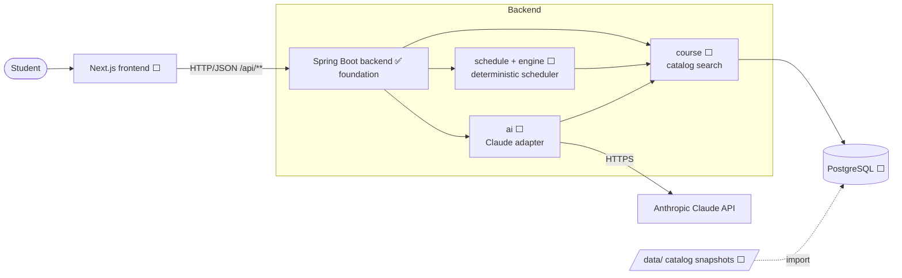
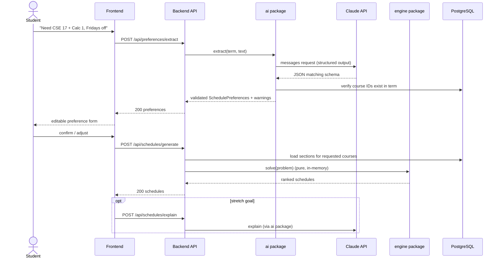
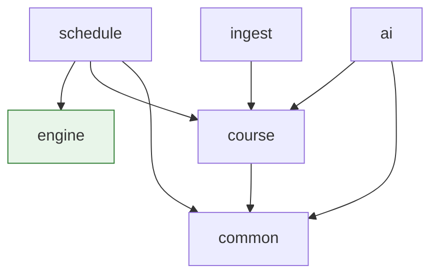
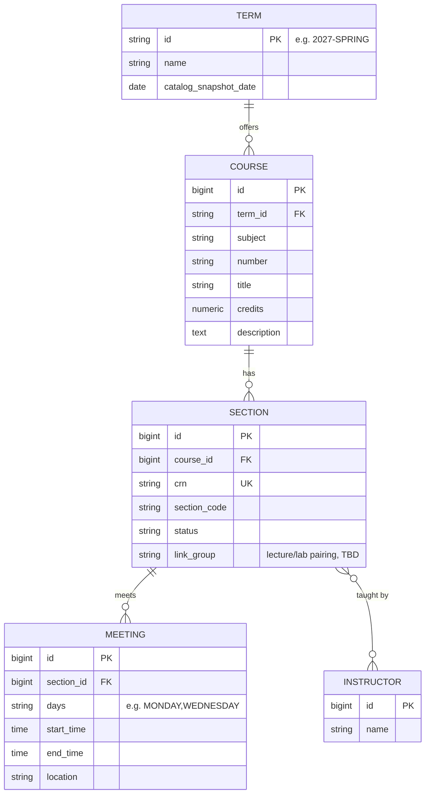
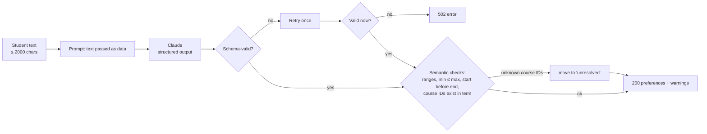

# Architecture

> **Status at a glance (2026-10-15):** Phase 1 (backend foundation) is implemented. Only `GET /api/health` exists. Everything else in this document is **planned design**, labeled ⬜. Implemented parts are labeled ✅. Check the code before assuming anything here exists; [HANDOFF.md](../HANDOFF.md) has the live status.

Related: [API contract](api-contract.md) · [Decision records](decisions/README.md) · [Development guide](development-guide.md)

## Contents
1. [System overview](#1-system-overview)
2. [Frontend and backend responsibilities](#2-frontend-and-backend-responsibilities)
3. [Component interaction and data flow](#3-component-interaction-and-data-flow)
4. [Backend package structure](#4-backend-package-structure)
5. [Database architecture](#5-database-architecture)
6. [REST API design](#6-rest-api-design)
7. [Scheduling engine](#7-scheduling-engine)
8. [Hard vs. soft constraints](#8-hard-vs-soft-constraints)
9. [AI integration and validation](#9-ai-integration-and-validation)
10. [Error handling](#10-error-handling)
11. [Security](#11-security)
12. [Testing strategy](#12-testing-strategy)
13. [Deployment](#13-deployment)
14. [Scalability](#14-scalability)
15. [Phase 1 decisions (implemented)](#15-phase-1-decisions-implemented)
16. [Open questions](#16-open-questions)

---

## 1. System overview

The **central design principle** is that the AI interprets and explains, and the deterministic Java engine decides.

- **Claude** turns free-text wishes ("no 8 a.m.s, Fridays off, I work Tue/Thu afternoons") into a structured preferences object, and can explain results in plain English.
- **The scheduling engine** is the only component that decides whether a schedule is valid and how good it is.

**Why this split?** An LLM can misread a time or invent a section. If the AI built schedules directly, a student could get a schedule with a hidden conflict, and we couldn't test or reproduce the result. With this split:
- Every schedule we return is guaranteed conflict-free, because the guarantee comes from code, not a model.
- Results are reproducible: same input, same output, so they can be unit-tested and debugged.
- The AI is optional. If the API key is missing or the provider is down, students can still fill in preferences by hand and generate schedules.

## 2. Frontend and backend responsibilities

| Concern | Frontend (Next.js) ⬜ | Backend (Spring Boot) |
|---|---|---|
| UI, routing, calendar view | ✔ | |
| Free-text input and editable preference form | ✔ | |
| Showing AI-extracted preferences for **student confirmation** | ✔ | |
| Input validation | Convenience only | ✔ **authoritative** |
| Course catalog storage and search | | ✔ |
| Schedule generation | | ✔ (engine) |
| Calling Claude | **Never** | ✔ (only place the API key exists) |
| Secrets | None (no `NEXT_PUBLIC_*` secrets, ever) | ✔ from environment |

**Why is the backend authoritative?** Anything in the browser can be bypassed, and the API key must never reach the client. The frontend stays a thin, replaceable presentation layer.

## 3. Component interaction and data flow

Main user flow (all ⬜ planned):

Two design points in this flow:
- **A human checkpoint sits between AI and engine.** The student sees and can edit what the AI understood before anything is generated, so extraction mistakes are visible and cheap to fix.
- **The engine does no I/O.** The `schedule` package loads data and converts it into engine input. The engine is a pure function of its input, which is what makes it deterministic and easy to test.

## 4. Backend package structure

Base package: `io.github.michael04.registration`. We **package by feature**: each feature owns its controller, service, DTOs, and tests.

| Package | Status | Contents | Owner module |
|---|---|---|---|
| *(root)* | ✅ | `RegistrationBackendApplication` | Backend API |
| `health` | ✅ | `HealthController`, `HealthResponse` | Backend API |
| `common` | ⬜ | Global error handling (`@RestControllerAdvice`), web config such as CORS | Backend API |
| `course` | ⬜ | Course/section entities, repositories, search service, `CourseController` | Backend API |
| `ingest` | ⬜ | Loads `data/` catalog snapshots into the database | Data |
| `engine` | ⬜ | **Pure Java** scheduler: input model, constraint checks, search, scoring. No Spring, no I/O. | Scheduling Engine |
| `schedule` | ⬜ | `ScheduleController`, maps `course` data to `engine` input, maps results to DTOs | Scheduling Engine |
| `ai` | ⬜ | Claude client wrapper, prompts, output validation, `PreferenceController` | AI Integration |

Allowed dependencies (arrows point from a package to what it may use):

Rules:
- `engine` depends on **nothing** in the project (only the JDK). It has its own immutable input records, such as `CourseOption`, `SectionOption` and `Meeting`, rather than JPA entities. That way database changes can't break the engine, and its tests need no Spring context.
- `engine` and `schedule` never depend on `ai`. Schedules can't be influenced by model output except through validated `SchedulePreferences`.

**Why package by feature?** It maps the four-person split onto folders, so most PRs touch one package, and the dependency rules above are easy to check in review.

## 5. Database architecture

**Status: ⬜ planned.** Phase 1 has no database, by design; see [§15, decision 10](#15-phase-1-decisions-implemented).

Design choices:
- **PostgreSQL**, because the catalog is relational (term → course → section → meeting), and search needs joins and indexes. Postgres's text-search features (`pg_trgm`, `tsvector`) can power fuzzy course search later without adding another service.
- **A course is stored per term** (one row per offering), not as a single row shared across terms. This is simpler for the MVP, because the catalog changes between terms.
- **Read-mostly.** Data is imported from snapshots in `data/`, and students never write catalog data. The MVP stores no user data and has no user accounts.
- **Migrations:** Flyway or Liquibase (_TBD_). The schema is versioned in code; no manual DDL.
- **Linked sections** (lecture + lab/recitation) and **variable credits** depend on what the data source provides. They're marked TBD in the schema.

## 6. REST API design

The full specification is in **[api-contract.md](api-contract.md)**. The design rules:

- Everything lives under `/api`. Resources are plural nouns (`/api/courses`). Computations are `POST` sub-resources (`/api/schedules/generate`), because the inputs are complex JSON objects and the results aren't stored.
- **DTOs are Java records**, kept separate from entities and engine types, so the database and engine can change without breaking clients.
- The contract document is updated **in the same PR** as the code change. The frontend's TypeScript types mirror it.
- Breaking changes are allowed during the hackathon (there are no external clients), but they must be documented and announced.

## 7. Scheduling engine

**Status: ⬜ planned.** Module: Scheduling Engine. Package: `engine`.

**Problem:** for each required course, pick exactly one section (plus linked components) so that no hard constraint is violated. Optionally add courses from the optional list. Then rank the feasible combinations by soft-preference penalty.

**Planned algorithm: backtracking search with pruning and bounded top-K.**

1. **Pre-filter.** Remove sections that violate constraints that apply to a single section on its own, such as overlapping a blocked time or being closed. If a required course has no sections left, return "infeasible" right away, with that course named in `diagnostics`.
2. **Precompute conflicts.** Build a section-by-section conflict table once, so checking two sections during the search is a single lookup.
3. **Order variables.** Search the course with the **fewest** remaining sections first (the "minimum remaining values" heuristic). This finds dead ends early.
4. **Depth-first search.** Assign sections, and backtrack as soon as a time conflict or the credit cap is hit.
5. **Score and keep the top K.** Score each complete schedule with a weighted sum of soft penalties. Keep the best `maxResults`, and skip branches that can't beat the current K-th best.
6. **Bound the work deterministically.** Stop after a fixed **number of explored nodes** (configurable), not after a fixed amount of time, and report `searchLimitReached`.

**Determinism rules.** The same input and catalog snapshot always give the same output:
- No randomness and no wall-clock limits. A time limit would make results depend on machine speed.
- Iterate in a stable order: courses by ID, sections by CRN.
- Break score ties by the lexicographic list of CRNs.
- No hash-order dependence: use sorted lists or `LinkedHashMap`, never iterate a `HashSet` to produce output.

**Why hand-written backtracking instead of a constraint solver** (OR-Tools, Choco, Timefold)?
- The problem is small: a student typically schedules about 4–7 courses with a handful of sections each, which is well within reach of pruned search.
- No extra dependency, and every teammate can read and debug it.
- Explanations for infeasibility ("CSE-017 and MATH-021 conflict in every combination") are easy to produce.
- We'd revisit this if profiling shows a need, for example with large optional-course lists.

## 8. Hard vs. soft constraints

| Constraint | Kind | Notes | Status |
|---|---|---|---|
| No two chosen sections overlap in time | **Hard** | Core guarantee | ⬜ |
| Every required course is scheduled exactly once | **Hard** | Linked components (lab/recitation) must be included too, if the data models them | ⬜ |
| Total credits within `[minCredits, maxCredits]` | **Hard** | **Hard cap 21 credits** (team rule); default range 12–18. Above 18 (above 17 for first-semester students) is an overload that needs approval under Lehigh policy, so those schedules are flagged `overload: true`. See [api-contract.md § Credit limits](api-contract.md#credit-limits). | ⬜ |
| No class during `blockedTimes` | **Hard** | Work, practice, etc. | ⬜ |
| Sections belong to the requested term; closed sections excluded unless `includeClosedSections` | **Hard** | Depends on enrollment data being available | ⬜ |
| Prerequisites satisfied | Out of MVP scope | Needs reliable prerequisite data and the student's history. The UI should say we don't check this. | — |
| Include optional courses | Soft | Weighted; only if credits allow | ⬜ |
| Earliest start / latest end | Soft | Penalty grows with minutes outside the window | ⬜ |
| Days off | Soft | Penalty per class meeting on a preferred day off | ⬜ |
| Minimize gaps between classes | Soft | Penalty per idle minute between same-day classes | ⬜ |
| Travel between campuses for back-to-back classes | Soft (future) | Needs location data | — |

**Why separate the two kinds?** A hard constraint is a rule the result must obey. A soft preference is a ranking signal. Mixing them, for example by giving conflicts a huge penalty, can still let invalid schedules through and makes scores hard to interpret. The weights (0–5) come from the student, either set directly or extracted by the AI and confirmed by the student.

## 9. AI integration and validation

**Status: ⬜ planned.** Module: AI Integration. Package: `ai`.

**Uses:**
1. Preference extraction (`POST /api/preferences/extract`): high priority.
2. Schedule explanation (`POST /api/schedules/explain`): stretch goal.

**Integration plan:**
- Use the **official Anthropic Java SDK**, `com.anthropic:anthropic-java`. The version will be pinned when the AI phase starts. Use the SDK rather than hand-rolled HTTP; the SDK brings typed requests and errors, retries and timeouts.
- **Structured outputs.** Request JSON constrained to a schema derived from a Java record (the SDK's `outputConfig(Class)` support), so responses parse straight into typed objects.
- **Model** comes from configuration (`ANTHROPIC_MODEL`), never hard-coded. Current candidate: `claude-opus-5-5`; the team will make the final choice based on cost and latency.
- Hide the SDK behind our own interface, e.g. `PreferenceExtractor`. Tests then use a fake and never call the real API, and the provider can be swapped without touching controllers.
- To verify when the SDK is added: Spring Boot 4 uses Jackson 3 (`tools.jackson.*`), and the SDK may bring its own Jackson version. Check for dependency conflicts with `./mvnw dependency:tree`.

**Validation pipeline:**

- Matching the schema doesn't make the output correct, so semantic validation is always done in Java.
- Handle the SDK's non-success outcomes explicitly: `refusal` and `max_tokens` stop reasons, rate limits, timeouts. Map them to the `502`/`503`/`429` codes defined in the contract.
- **Prompt injection.** Student text is untrusted. The model has **no tools** and no database access. Its only output is a preferences object that is validated and then shown to the student. The worst a malicious prompt can do is produce odd preferences, which the student sees.
- **If AI is unavailable** (no key, outage), the extract endpoint returns `503`, and the frontend falls back to the manual preference form. Schedule generation still works.

## 10. Error handling

- **Implemented ✅:** Spring Boot's default error JSON (`timestamp`, `status`, `error`, `path`). Verified for 404 and 405; see [api-contract.md § Error responses](api-contract.md#error-responses).
- **Planned ⬜:** a single `@RestControllerAdvice` in `common` that produces RFC 9457 **Problem Details** for every error, with a consistent mapping: validation → 400, semantic → 422, upstream AI → 502/503, unknown → 500.
- **Rules:** never leak stack traces or provider error messages to clients. Log them server-side with a request ID. Infeasible schedules are a **normal 200 result** with `diagnostics`, not an error.

## 11. Security

| Area | Approach | Status |
|---|---|---|
| Secrets | Read only from environment variables. `.env` is git-ignored; `.env.example` holds placeholders. | ✅ (no secrets exist yet) |
| Anthropic API key | Backend only. Never in frontend code, `NEXT_PUBLIC_*` variables, logs, or error bodies. | ⬜ |
| Authentication | None in the MVP: no accounts, no stored personal data. Revisit if we add saved schedules. | Decision |
| Input limits | Bean Validation on all request DTOs; text ≤ 2000 chars; page size ≤ 100 | ⬜ |
| CORS | Allow only the known frontend origin(s), or avoid CORS entirely by proxying through Next.js. _TBD._ | ⬜ |
| AI abuse and cost | Rate-limit AI endpoints (mechanism _TBD_); cap request size and `max_tokens` | ⬜ |
| Data | Commit only public or synthetic data; no student records | Policy ✅ |
| Dependencies | Minimal set; Spring Boot version pinned and upgraded deliberately | ✅ |

## 12. Testing strategy

| Layer | Tool | What it proves | Status |
|---|---|---|---|
| Controller slice | `@WebMvcTest` + MockMvc | HTTP contract: status codes, JSON shape, validation | ✅ health |
| Application context | `@SpringBootTest` | Configuration and wiring load | ✅ |
| Engine unit tests | Plain JUnit 5, no Spring | Correctness, infeasibility diagnostics, **determinism** (run twice, compare), "no returned schedule has a conflict" checks | ⬜ |
| AI layer | JUnit with a fake `PreferenceExtractor` / recorded responses | Validation pipeline, error mapping. **No real API calls in `./mvnw test`.** | ⬜ |
| Persistence | Testcontainers Postgres or `@DataJpaTest` (_TBD_) | Queries and migrations | ⬜ |
| Frontend | _TBD_ (e.g. Vitest / Playwright) | UI behavior | ⬜ |
| CI | _None yet_. Recommended: GitHub Actions running `./mvnw test` on every PR. | | ⬜ |

**Why slice tests first?** They're fast and need no database, so `./mvnw test` stays a one-command check that every teammate and AI agent can run before every PR.

## 13. Deployment

**Status: not decided.** No environments or URLs exist yet. Candidate approach, to be confirmed:

- **Backend:** a container image (Spring Boot can build one with `./mvnw spring-boot:build-image`; this needs Docker), configured entirely through environment variables.
- **Database:** a managed PostgreSQL service.
- **Frontend:** a Next.js host, with `NEXT_PUBLIC_API_BASE_URL` pointing at the backend.
- **Secrets:** set in the hosting platform's secret settings, never in the repo.

Hosting provider: _TBD_. Deployed URLs: _TBD_.

## 14. Scalability

The expected load is a demo with a handful of users, so these points are about not blocking growth rather than building for it now.

- **The backend is stateless.** No server-side sessions, so it can scale horizontally behind a load balancer.
- **The catalog is read-mostly**, so it can be cached in memory per term to keep the database off the hot path.
- **The engine is CPU-bound but bounded** by the node cap, so worst-case latency is capped.
- **AI calls are the slowest and most expensive step.** Mitigations: timeouts, rate limits, short prompts, and prompt caching if prompts grow.
- **Search:** add trigram or full-text indexes in Postgres before considering an external search service.

## 15. Phase 1 decisions (implemented)

| # | Decision | Why |
|---|---|---|
| 1 | **Monorepo** with `backend/`, `frontend/`, `docs/`, `data/`; each stack builds independently | One clone. A PR can update the API and its docs together. Folder ownership reduces merge conflicts. |
| 2 | **Java 21 + Spring Boot** | See [ADR-0001](decisions/0001-java-spring-boot-over-python-fastapi.md) |
| 3 | **Spring Boot 4.1.1, pinned** in `backend/pom.xml` | It was the stable default on Spring Initializr (2026-10-15), which no longer offers 3.x. Starting on 4.x avoids a 3→4 migration later. Upgrades are deliberate. |
| 4 | **Maven Wrapper** (`./mvnw`, Maven 3.10.0, "only-script", so no binary JAR committed) | Teammates only need a JDK, and everyone builds with the same Maven. |
| 5 | **Minimal dependencies**: `spring-boot-starter-webmvc` + `spring-boot-starter-webmvc-test` only | Faster builds, fewer conflicts. JPA, Postgres and the Anthropic SDK are added when their features land. |
| 6 | **Hand-written `/api/health`** rather than Spring Boot Actuator | One fewer dependency. Keeps everything under `/api` with a stable response for the frontend. Actuator can be added later for readiness and metrics. |
| 7 | **Package by feature** | See [§4](#4-backend-package-structure) |
| 8 | **Records for DTOs** | Immutable and concise; Jackson serializes them without annotations. |
| 9 | **Config through environment variables** (`${ENV_VAR:default}`) | Same artifact in every environment; secrets stay out of the repo. Note: Spring does not load `.env` files automatically. |
| 10 | **No database in Phase 1** | `./mvnw test` and `spring-boot:run` work with only a JDK installed, which makes onboarding simple. |

## 16. Open questions

- **Course data source** for Lehigh (public catalog export, manual snapshot, or something else) and its terms of use. This blocks the Data module.
- Exact formats for terms, CRNs, linked sections, and variable credits. These depend on the data source.
- Migration tool (Flyway vs. Liquibase); local Postgres setup (Docker Compose vs. Testcontainers only).
- CORS policy vs. a Next.js proxy.
- AI rate-limiting mechanism, and the final model choice.
- Hosting provider and CI.
