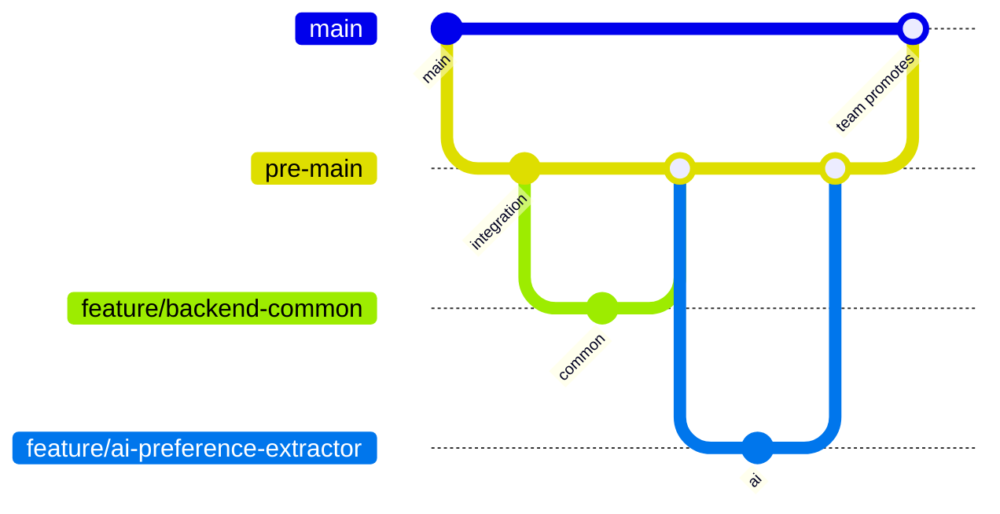

# Development Guide

How the four of us (and our AI coding agents) work in this repo without stepping on each other.

Related: [README](../README.md) (setup and run commands) · [CLAUDE.md](../CLAUDE.md) (rules for agents and humans) · [HANDOFF.md](../HANDOFF.md) (live status)

## 1. Development environment

Follow **[README § Getting started](../README.md#getting-started)** for prerequisites, cloning, environment variables, running and testing. In short: install JDK 21, clone, `cd backend && ./mvnw test`.

Editor tips:
- **VS Code:** install the "Extension Pack for Java" (Microsoft). Open the repo root; the Java extension detects `backend/pom.xml`.
- **IntelliJ IDEA:** *File → Open → `backend/pom.xml`* → "Open as Project". Set the project SDK to 21.
- `.vscode/` and `.idea/` are git-ignored, so keep personal editor settings local.
- Run tests from the terminal with `./mvnw test` before pushing, even if your IDE shows them green. That's the command reviewers and agents rely on.

## 2. Branching strategy



| Rule | Detail |
|---|---|
| **`pre-main` is the shared integration branch** | Every feature PR targets `pre-main`. Integrate and test there first. |
| **`main` stays untouched** | Nobody pushes or merges into `main`. It changes only when the team explicitly decides to promote `pre-main`. |
| `pre-main` is always working | Tests pass and the app starts. Nobody pushes directly to `pre-main`; changes arrive through reviewed PRs. Never force-push. |
| One branch per task | `<type>/<module>-<short-desc>`, e.g. `feature/engine-backtracking`, `fix/backend-health-content-type`, `docs/api-contract-courses` |
| Types | `feature/`, `fix/`, `docs/`, `chore/`, `test/` |
| Module names | `backend`, `engine`, `ai`, `data`, `frontend`, `docs` |
| Keep branches short-lived | Aim to merge within a day or two. Long branches cause painful conflicts. |
| Stay current | `git fetch origin && git merge origin/pre-main` at least daily. Rebase only branches nobody else has pulled. |
| Integrating a finished feature | Merge it into a temporary branch made from the latest `pre-main` (e.g. `integrate/<module>-into-pre-main`), fix and test there, then open the PR into `pre-main`. The feature branch itself is left unchanged. |

Recommended GitHub settings (repo owner): protect **both** `main` and `pre-main`; require a PR with one approval for `pre-main`; restrict who can merge into `main`.

## 3. Commit conventions

We use [Conventional Commits](https://www.conventionalcommits.org/):

```
<type>(<scope>): <imperative summary, ≤ 72 chars>

<optional body: why, not what>
```

| Type | Use for |
|---|---|
| `feat` | New behavior |
| `fix` | Bug fix |
| `docs` | Documentation only |
| `test` | Adding or fixing tests |
| `refactor` | Code change with no behavior change |
| `chore` / `build` | Tooling, dependencies, config |

Scopes match the module names above. Examples:
- `feat(engine): add backtracking search with MRV ordering`
- `docs(api): specify POST /api/schedules/generate`
- `build(backend): add spring-boot-starter-validation`

Keep commits focused. If an AI agent wrote a substantial part, keep the `Co-Authored-By` trailer the tool adds.

## 4. Pull request and review workflow

1. **Before opening:** run `./mvnw test` in `backend/`, update docs (see the Definition of Done in [CLAUDE.md](../CLAUDE.md#definition-of-done)), and update your section of [HANDOFF.md](../HANDOFF.md).
2. **Open a PR** into **`pre-main`** (never into `main`). Use this description outline:
   ```markdown
   ## What & why
   ## Modules touched
   ## Contract changes   (none / link to api-contract.md diff)
   ## How I tested       (exact commands + result, e.g. "./mvnw test → Tests run: 5, Failures: 0")
   ## HANDOFF.md updated (yes/no)
   ```
3. **Review:** at least **one** teammate approves. If the PR touches a shared interface ([CLAUDE.md § Shared interfaces](../CLAUDE.md#shared-interfaces)), the owners of the consuming modules must also review.
4. **Reviewers check:**
   - Tests exist and actually exercise the change.
   - No secrets.
   - No unrelated edits.
   - Docs match the code.
   - The package dependency rules in [architecture.md § 4](architecture.md#4-backend-package-structure) are respected.
5. **Merge** with **squash merge**, then delete the branch.

> There is no CI yet. Until there is, the PR author must paste the actual `./mvnw test` result into the PR, and reviewers should run it themselves for non-trivial PRs. Adding GitHub Actions is on the backlog in [HANDOFF.md](../HANDOFF.md).

## 5. Handling merge conflicts

```bash
git fetch origin
git merge origin/pre-main      # resolve conflicts in your editor
cd backend && ./mvnw test      # always re-run tests after resolving
git add -A && git commit       # commit the merge
```

How to resolve the files that conflict most often:

| File | How to resolve |
|---|---|
| `HANDOFF.md` | **Keep both sides.** Each module has its own section; merge entries and keep newest first. Never delete a teammate's entry. |
| `backend/pom.xml` | Keep both sides' dependencies, then run `./mvnw test`. If two people added the same dependency with different versions, ask before choosing. |
| `docs/api-contract.md` | Don't guess. Talk to the owner of the endpoint in question. |
| `application.properties` / `.env.example` | Keep both keys; check that they don't redefine the same property. |

If a conflict touches someone else's module and the intent isn't obvious, stop and ask them. Don't pick a side.

## 6. Running tests before merging

| Command (from `backend/`) | When |
|---|---|
| `./mvnw test` | Before every push and PR. This is required. |
| `./mvnw test -Dtest=HealthControllerTest` | Quick loop on one test class |
| `./mvnw clean test` | When something behaves strangely (clears stale build output) |
| `./mvnw spring-boot:run`, then `curl` the changed endpoint | When you change or add an endpoint |

Frontend test commands: _TBD once `frontend/` is scaffolded._

## 7. Working with Claude Code and Codex

Both agents read project instructions automatically: **Claude Code** reads [`CLAUDE.md`](../CLAUDE.md), and **Codex** reads [`AGENTS.md`](../AGENTS.md), which points to `CLAUDE.md`. The rules are identical, so you don't need to repeat them in prompts.

**Start of session.** A good opening prompt:
> Read README.md, HANDOFF.md, and docs/architecture.md. I'm working on the **<module>** module on branch `<branch>`. Task: <task>. Propose a plan before editing files.

**During the session:**
- Ask for a **plan first** on anything non-trivial, and approve it before edits.
- **One agent per branch.** To run two agents in parallel, give each its own git worktree, e.g. `git worktree add ../reg-ai-engine feature/engine-backtracking`.
- Review agent diffs as carefully as a teammate's PR. Agents can be confidently wrong, especially about Spring Boot 4 APIs.
- Agents must not commit or push unless you explicitly tell them to in that session.

**End of session.** A good closing prompt:
> Run the relevant tests and show the output. Then update the **<module>** section of HANDOFF.md with what was done, what's in progress, next steps, and the real test results. Don't edit other modules' sections.

**Codex vs. Claude Code:** use whichever you prefer. Avoid having both edit the same branch at the same time.

## 8. Avoiding simultaneous conflicting changes

1. **Respect module ownership.** Each module has one owner (see [README § Team](../README.md#team-and-responsibilities)). Changes inside another module go through its owner.
2. **Claim work** before starting by adding it under *In progress* in your HANDOFF.md section, with your handle and branch.
3. **Announce edits to shared files** in the team chat before making them: `pom.xml`, `application.properties`, the `common` package, `docs/api-contract.md`, `.env.example`, `CLAUDE.md`.
4. **Agree on the contract first.** For a new or changed endpoint, merge the `api-contract.md` change (or get it approved) before both sides build against it.
5. **Keep PRs small.** A PR that touches one module merges quickly and rarely conflicts.

## 9. Updating HANDOFF.md

[HANDOFF.md](../HANDOFF.md) is our shared progress log. Its credibility depends on everyone following these rules.

- **When:** at the end of every meaningful session, and in the same PR as the work.
- **Where:** your module's section, plus one new line at the top of the *Session log*.
- **Pull first** (`git merge origin/pre-main`) so you're editing the latest version.
- **Never overwrite or delete** someone else's entries. Mark resolved items as `~~item~~ Resolved YYYY-MM-DD`, rather than removing them.
- **Only real results.** Paste the actual test summary line, with date and command. If you didn't run tests, write "not run". Never write "should pass".
- **Timestamps:** use `YYYY-MM-DD HH:MM` plus a time zone, e.g. `2026-10-15 16:45 EDT`.
- If your update contradicts another section, note the conflict and tell that owner. Don't silently "fix" their section.

## 10. Onboarding a new contributor

- [ ] Get access to the GitHub repository from the owner (@04michael4).
- [ ] Read [README.md](../README.md), then [HANDOFF.md](../HANDOFF.md), then [architecture.md](architecture.md).
- [ ] Set up the environment and run `./mvnw test` successfully ([README § Getting started](../README.md#getting-started)).
- [ ] Start the backend and `curl http://localhost:8080/api/health`.
- [ ] Read [CLAUDE.md](../CLAUDE.md); its rules apply to humans too.
- [ ] Agree with the team on a module, and add yourself to the README team table and HANDOFF.md.
- [ ] Make a first small PR (e.g. a docs fix) to practice the workflow end to end.
